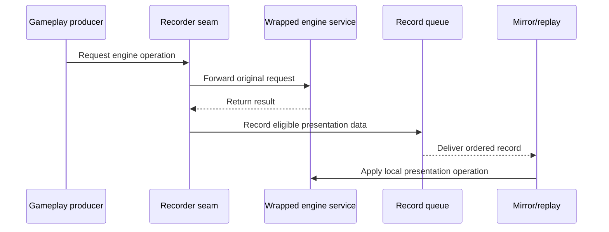

# Boundary seams

A boundary seam is an engine-facing operation that many gameplay producers
pass through. Recording at a shared seam lets the server describe what the
game did without hard-coding every interaction category into a separate
client replay implementation.

The server-side mod wraps selected interfaces or observes selected
construction points, forwards the original operation, and records the subset
of data needed by the client presenter. The client consumes those records to
reproduce selected visual and spatial effects.

## Why record at shared boundaries

A single gameplay outcome may be produced by many different interactions.
Movement can result from a user command, autonomy, a situation, or a lot
rule. If mirroring is attached only to one interaction definition, other
producers bypass it. A common boundary provides wider coverage than a
growing list of special-case producers.

Boundary recording does not mean “record every engine call.” Queries,
internal bookkeeping, and operations with no client-visible meaning need not
become network events. Each recorder should have a narrow payload and a
clear pass-through contract.

## Current seam families

| Engine-facing family | Presentation information | Example recorder |
|---|---|---|
| Animation/state machines | Driver, state, parameters, transitions | `SacsRecorder`, `AnimationRecorder` |
| Slot attachment | Object attach/detach and parent context | `SlotsRecorder` |
| Object updates | Selected transforms, visibility, or state | `ObjectsRecorder` |
| World operations | Selected lot, terrain, and effect operations | `WorldRecorder` |
| Routing | Route start and resulting movement-related events | `RouteRecorder` |
| Visual effects | Create, attach, and dispose visual effects | `VfxRecorder` |
| Audio | Selected world sounds | `AudioRecorder` |

Exact wire encodings are implementation details described in [bridge and
formats](../bridge-and-formats.md). The source projects contain paired
controller and mod codecs where applicable.

## Recorder lifecycle



The core safety invariant is pass-through: recording must not prevent the
original engine call from running. Failures to append presentation data
should be contained at the recorder boundary, not thrown into the game's
main execution path.

## Records are not simulation

A presentation record answers a question such as “which state machine
operation should be shown?” It does not encode every precondition, internal
callback, or gameplay side effect of the original interaction. The client
may need to suppress local interaction logic while replaying a record,
otherwise the game can run its own autonomy or execute a second outcome.

| Record category | Can establish | Cannot establish by itself |
|---|---|---|
| Animation | A visual state or clip was requested | The server's full interaction state |
| Route | A movement operation was initiated or updated | That a destination is reachable in every client world |
| Slot | A prop was attached or detached | Full inventory or object contents |
| Object transform | A position/visibility update occurred | Persistent object ownership |
| Snapshot | A point-in-time state baseline | Every event between two snapshots |

## Ordering, batching, and loss

Record consumers need stable sequencing so a create operation precedes later
references and a destroy operation follows the final use. Some high-volume
data has a bulk path rather than sharing a small control line with all
commands. Replay should treat a missing identity or malformed record as a
bounded failure—not permission to guess the object.

A full snapshot and an event stream have complementary roles:

- A full snapshot establishes or replaces the mirror baseline.
- Incremental events communicate changes after that baseline.
- Presentation records fill selected visual gaps but are not substitutes for
  authoritative state.

## Extension guidance

1. Identify the shared engine boundary and all producers that use it.
2. Define whether the record is state, an event, or presentation-only data.
3. Keep the payload minimal but sufficient for cross-process interpretation.
4. Define identity and lifetime rules for every referenced Sim or object.
5. Preserve the wrapped call's return value and behavior where the
   integration allows.
6. Add decoding and replay behavior on the consumer side.
7. Add a managed contract test and a live scenario for the engine-facing
   claim.
8. Document what the record intentionally omits.

## Failure modes / limits

- An engine build can change or remove a reflected interface field or
  constructor seam.
- A recorder can be installed but miss a new overload or a call path outside
  that interface.
- A replay call can be invalid if local object state or lot activity
  differs.
- Record loss or reordering can leave a prop, animation, or route visually
  stale.
- A boundary stream cannot make arbitrary gameplay deterministic across two
  game instances.

## Related pages

- [Runtime components](runtime-components.md)
- [Server-authoritative simulation](server-authoritative-simulation.md)
- [Object and Sim identity](object-and-sim-identity.md)
- [Bridge and formats](../bridge-and-formats.md)
- [Simulation and presentation](../simulation.md)

## Recorder families in more detail

The recorder families serve complementary purposes. State-machine recording
captures the operations that drive many character animations. The general
animation interface covers clips and procedural movement outside those state
machines. Slot recording tracks attachment transitions needed for held and
carried props. Object recording captures selected spatial changes. World
recording covers selected world-facing operations. Route recording observes
route construction and progression. Audio and visual-effect recorders cover
selected peripheral presentation.

| Family | Typical payload concern | Common omission to document |
|---|---|---|
| State machine | Driver identity, actor, state and parameter changes | Hidden script-side callbacks and game logic |
| Animation | Clip/resource, track, timing or transform detail | Full skeletal pose state |
| Slot | Object, parent, slot and attach/detach | Complete inventory semantics |
| Object | Transform and visibility updates | Every object property or persistence field |
| World | Terrain, lot, placement or world effect | Full world serialization |
| Route | Start, destination and route lifecycle | Native solver internals and every frame |
| Audio | Targeted or positional sound | Music and local interface audio policy |
| Visual effect | Effect resource and attach/disposal | All effect simulation state |

These categories describe the architectural responsibilities and should not
be read as a promise that every method in each engine interface is mirrored.

## Installation and status reporting

Interface wrappers generally retain the previous implementation as an inner
service. Installation is expected to be idempotent and to report whether the
target interface is available, has a usable current instance, and is now
wrapped. Constructor interception is different: it observes construction for
types that do not expose a swappable interface singleton.

A status string such as “installed,” “unavailable,” or “no instance” is more
useful than silently doing nothing. It lets diagnostics separate a game
build mismatch from a recorder that installed but saw no events.

## Pass-through contract

A recorder must preserve the wrapped service's return value and call
ordering. For void methods it should forward the call exactly once. For
methods with callbacks, the recorder must not replace or lose the callback.
Recording failure should not make gameplay fail, but silent data loss should
still be diagnosable through counters or health reports.

This is a balancing act: swallow failures that would otherwise escape into
the game, but do not hide permanent recorder failure from the operator.
Record error counts and installation state at a safe boundary rather than
logging synchronously on every engine call.

## Record ordering example

Suppose a Sim creates a food prop, attaches it to a hand slot, then moves
and sets it down. The receiver needs the creation/resource description
before attachment, the identity mapping before any later reference, and
detach or visibility operations in a valid order. If a late join happens
after the prop exists, history or snapshot state must include enough
identity and current attachment data to reconstruct the view.

```text
create description -> announce identity -> attach to hand -> update transform -> detach -> show at destination
```

This is illustrative sequence, not a public wire transcript. The ordering
requirement exists regardless of which transport carries the records.

## What the boundary does not capture

A method seam sees only calls that cross it. It may not expose internal
native state changes, asynchronous completion, script events fired by
animation clips, or state mutated directly by a producer that bypasses the
selected interface. A missing behavior should therefore be traced from the
visible symptom to the actual producer and then to the nearest shared
boundary before adding another special case.

## How to verify / test

- Unit-test each encoder/decoder pair with representative and malformed
  payloads.
- Confirm the original wrapped method is called once and its return value is
  preserved.
- Test installation idempotence and missing-interface behavior.
- Confirm recorder failures do not escape into the game callback.
- Verify queue ordering under create/attach/detach/destroy sequences.
- Compare server and client behavior in live representative interactions.
- Check late-join replay for stale active drivers and duplicate creations.

## Failure modes / limits

A recorder can be healthy and still have incomplete coverage. Installation
status proves only that the wrapper is present, not that every call path is
observed or that the client can apply the resulting record. See [boundary
coverage and mirror gaps](boundary-coverage-and-mirror-gaps.md).

## Related pages

- [Runtime components](runtime-components.md)
- [Boundary coverage and mirror gaps](boundary-coverage-and-mirror-gaps.md)
- [Object and Sim identity](object-and-sim-identity.md)
- [Simulation](../simulation.md)

## History and late-join replay

A live recorder stream and a late-join presentation history have different
requirements. Live records describe operations as they occur. A joiner may
instead receive a retained history of active presentation state. The history
must represent the current state, not blindly replay every old start event:
a completed machine, a released driver, or an expired route should not be
resurrected merely because its creation record remains in a buffer.

| Record lifecycle | Live consumer | Late-join consumer |
|---|---|---|
| Create/announce | Establish object identity | Include if still referenced by current state |
| Start | Apply operation in order | Include only if still active/current |
| Update | Apply incremental change | Fold into retained current state where supported |
| Stop/release | End active presentation | Remove from retained history |
| Destroy/despawn | Remove alias and owned copy | Ensure no stale reference survives baseline |

A fixed age timeout is not a substitute for lifecycle correctness. A
legitimate long-running animation can outlive a short timeout; a stale
record can also be recent. Use explicit release/completion state and a
bounded replay policy.

## Semantic state versus presentation state

An animation can run on a client while the server interaction has already
failed, or the actor can have the correct posture while its animation
differs. Tests should classify these layers separately. The presentation
stream should not become an accidental second gameplay protocol.

## Open seam coverage questions

Potential gaps include engine methods that bypass the wrapped singleton,
callbacks emitted asynchronously after the recorder returns, fields not
retained in late-join history, and local effects that should not be
replayed. Each suspected gap should be reproduced with a known server action
and checked against both recorder output and client apply diagnostics.

## How to verify / test

- Start and stop a representative animation driver and join a client
  mid-operation.
- Confirm a released driver is absent from late-join history.
- Exercise object creation, attachment, detach, and destruction with a
  reconnect between stages.
- Test an operation that causes a server state change without a presentation
  record and document the expected visual difference.
- Compare event order and queue depth under a burst of records.
- Verify overflow is visible and triggers the chosen recovery path.

## Failure modes / limits

The seam list is not a completeness proof. Some interactions depend on
callbacks or game-local script state that cannot be reconstructed from a
boundary call alone. Consult the current [status](../status.md) before
treating a presentation category as complete.

## Related pages

- [Boundary coverage and mirror gaps](boundary-coverage-and-mirror-gaps.md)
- [Object and Sim identity](object-and-sim-identity.md)
- [Simulation](../simulation.md)
