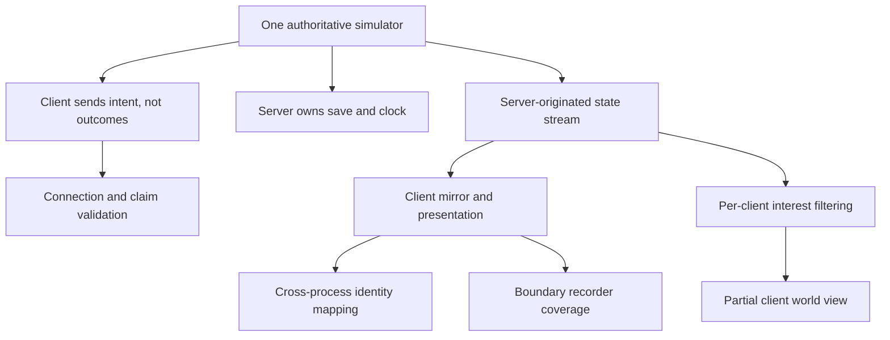

# Decision summaries

This page summarizes the architectural decisions that explain the current
system. It records conclusions and trade-offs, not the historical task
sequence used to implement them.

## Summary table

| Decision | Current conclusion | Main trade-off |
|---|---|---|
| Server authority | The server-side game decides shared outcomes | Player actions have a network round trip |
| One simulator | One game process simulates every shared Sim | Server carries the full simulation workload |
| Clients present | Client games apply authoritative state and selected presentation records | Visual coverage and mirror correctness need ongoing work |
| Boundary recording | Observe common engine-facing seams rather than special-case every producer | A seam can be version-sensitive and may omit hidden engine state |
| Interest filtering | Filter client delivery by relevance without changing server authority | Different clients can hold different partial world views |
| Identity mapping | Use semantic identity and aliases across game processes | Runtime-created entities need explicit lifecycle transfer |
| Separate bridge and protocol | Keep local game integration distinct from remote session messages | Two contracts must remain compatible and diagnosable |
| Full-world host | Keep one coherent game world under current engine constraints | No simple per-player-lot server scaling model |

## Decision: authoritative server, not lockstep

The server executes game actions and emits results. Clients submit intent
and receive state. The decision avoids requiring independent game processes
to make equivalent choices under different timing and object identity.

**Rejected assumption:** two clients can simulate the same world and stay
synchronized merely by receiving identical inputs. The game does not expose
a deterministic lockstep contract for this use.

## Decision: one simulator

A claim gives a player a right to submit intent for a Sim; it does not
transfer simulation execution. This prevents a second authority from needing
to reconcile player-Sim outcomes back into the server save.

**Cost accepted:** input latency and the need to mirror UI and gameplay
state that a locally simulating client would otherwise produce.

## Decision: observe shared seams

Presentation capture favors common engine boundaries because many
interaction producers converge on them. A recorder forwards the original
operation and separately captures selected presentation data.

**Cost accepted:** recorders must tolerate game-version changes, preserve
ordering, and define coverage gaps. A boundary stream remains a projection,
not a complete engine state log.

## Decision: interest is delivery policy

Per-client relevance controls what crosses the network and what the client
mirrors. It does not define the server's simulation obligations or mutate
world ownership.

**Cost accepted:** a client may not have an entity needed for a remote
reference, and its view can differ from another client's view.

## Decision: semantic identity for cross-process entities

Process-local object ids are not universally stable across separate game
processes. Sim description identity and explicit aliases provide a safer
correlation path; object identity may need type/resource information or a
local presentation copy.

**Cost accepted:** lifecycle ordering and generic-copy limitations must be
handled explicitly.

## Decision: full-world simulation under the current engine

A server-only subset of lots is not a supported general model when global
systems need coherent world data. Engine-native LOD and inactive-lot
behavior can reduce work, but they are not equivalent to loading a small
independent world.

**Cost accepted:** the server runs one full game process and inherits its
memory, platform, and compatibility limits.

## How to change a decision

A proposed change should identify the invariant it replaces, the behavior it
enables, and the migration path for existing clients and saves. It should
include:

- A precise current-state description and a target-state description.
- Evidence that the changed behavior works in the live game.
- Compatibility and versioning consequences for both protocol and bridge.
- Failure handling when only part of the rollout is installed.
- Persistence and restart implications.
- A rollback or safe-disable strategy.

## Failure modes / limits

- A decision summary cannot certify every implementation path or old
  compatibility mode.
- Implementation can lag a decision; verify current code and
  [status](../status.md).
- A measured result is scoped to its workload and platform.
- An architectural target is not a shipped feature.

## Related pages

- [One-simulator decision](one-simulator-decision.md)
- [Boundary seams](boundary-seams.md)
- [Scope, interest, LOD, and dormancy](scope-interest-lod-dormancy.md)
- [Design direction](design-direction.md)
- [Architecture](../architecture.md)

## Decision dependency map

The decisions reinforce one another rather than standing alone:

Changing one choice can invalidate assumptions in another. For example,
allowing client-native lot simulation changes save ownership, state conflict
resolution, authority gates, and which presentation records are needed.

## Evidence levels in decision reviews

Use a consistent vocabulary when revisiting decisions:

| Evidence level | Example | Claim strength |
|---|---|---|
| Source inspection | A class contains a policy branch | Code contains a mechanism |
| Unit/integration test | Filter includes claimed actor | Managed behavior matches the test |
| Offline harness | A managed method runs with controlled stubs | That method runs under harness assumptions |
| Live single-process probe | Hidden window still advances ticks | Result for that game/configuration |
| Live multi-client scenario | Two clients see a shared action | Result for that scenario, not all interactions |
| Sustained/varied campaign | Multiple sessions, content and network conditions | Stronger operational confidence, still bounded |

A design decision can be accepted before every behavior is fully measured;
pages should make that distinction explicit.

## Decision review template

When revising one of the summarized choices, write down:

- **Problem:** Which observable behavior or constraint is at issue?
- **Current invariant:** What must remain true today?
- **Options:** Include the current approach and credible alternatives.
- **Evidence:** Identify source facts, tests, live runs, and uncertainty.
- **Chosen model:** State the rule in terms a caller can apply.
- **Consequences:** Latency, compatibility, persistence, performance,
  failure handling.
- **Migration:** How old clients, saves, and integration builds behave.
- **Verification:** Which checks would show the decision is implemented
  correctly?

This avoids turning an implementation note into an untraceable architectural
assumption.

## Superseded approaches

Older designs may still appear in code or historical material. A superseded
approach is not necessarily deleted, and the presence of its types does not
mean it is active in the standard path. Describe it as legacy or
non-default, identify the current decision, and check runtime configuration
before drawing conclusions.

## Trade-off ledger

| Benefit sought | Cost accepted | Guardrail |
|---|---|---|
| Single source of truth | Network delay | Keep input pending state distinct from completion |
| Reduced client bandwidth | Partial view | Make missing entities an expected condition |
| Generic presentation replay | Incomplete engine-state coverage | Track per-seam support and live regressions |
| Full-world engine coherence | Host resource use | Measure tick, memory, and fanout independently |
| Managed extension access | Game-build coupling | Version-check hooks and fail clearly |

## How to verify / test

- Compare the current implementation to each decision statement in this
  page.
- Search for legacy code paths and determine whether launch configuration
  can activate them.
- For each decision, select at least one test that fails if its invariant is
  violated.
- Keep evidence with bounded workload and exact result, not only an
  “implemented” label.
- Review protocol/bridge compatibility and persistence implications before
  changing ownership.

## Failure modes / limits

This page is an index of decisions, not a formal decision log with a
complete timestamped history. The current [architecture](../architecture.md)
and [status](../status.md) remain the sources for what runs and what is
validated.

## Related pages

- [One-simulator decision](one-simulator-decision.md)
- [Design direction](design-direction.md)
- [Architecture overview](../architecture.md)
- [Status](../status.md)

## Practical review example: adding a state field

Suppose a player needs the server's interaction queue count on the client.
The design review should identify the authoritative field in the game
snapshot, its bridge representation, protocol serialization, client mirror
consumer, and fallback for older snapshot formats. It should also decide
whether this is current gameplay state or merely a diagnostic value.

Then define behavior for absent data: a legacy client may use a less precise
current-interaction indicator; a new server may send the field to an older
client; a late join should receive the value in its baseline. Tests should
pin both new and legacy behavior. This is a more useful decision record than
simply noting “queue count added.”

## Practical review example: changing authority

If a future mode lets a client simulate one lot, the review must describe
how it obtains the lot, how the server stops making conflicting decisions,
how transitions transfer authority, how both saves are reconciled, what
happens on disconnect, and how recovery chooses a value after partition. A
local “native Sim set” alone does not define those semantics.

## Source anchors for the lifecycle boundary

The current C# implementation places command and claim state in `DedicatedServer/Authority/AuthoritativeSession.cs`; transport framing lives in `DedicatedServer/Network/`; local bridge commands are encoded in `DedicatedServer/HostBridge/BridgeLineCodec.cs`; the game-side handlers live in `SimsOnlineServerHostMod/ServerHostMain.cs`. The source establishes these component boundaries; it does not turn every item in this historical summary into a completed release feature. See [runtime components](runtime-components.md) and [status](../status.md).
## Keeping architectural docs maintainable

A summary should link to a current source page and avoid copying every
implementation detail. If a number, constant, or behavior is likely to
change, include the source path and state that code is authoritative. When a
decision is superseded, update the summary and preserve historical context
only if it explains a current constraint.

## How to verify / test

- Ask a reviewer to trace each decision from statement to current code and
  test.
- Ensure examples reflect actual contract names and do not invent commands.
- Check that no historical tracker or planning terminology leaks into public
  docs.
- Run documentation link/anchor validation after adding or renaming pages.

## Related pages

- [Design direction](design-direction.md)
- [System overview](system-overview.md)
- [Contributing](../contributing.md)
