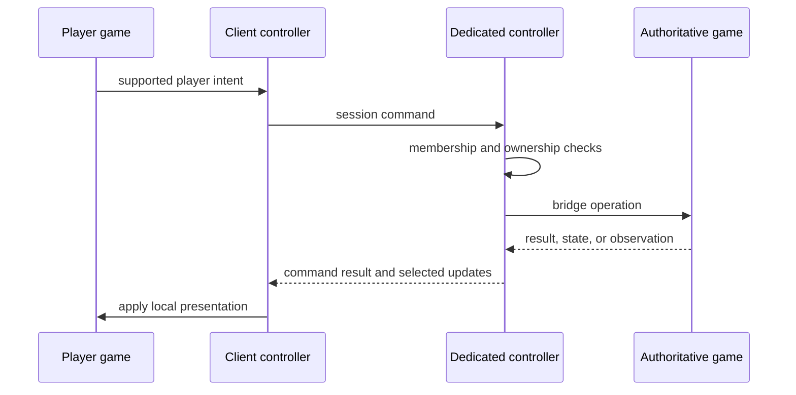

# Architecture deep dive

This section explains how the current runtime divides work across controllers,
game processes, the host bridge, and optional adapters. It distinguishes checked-in
behavior from architectural rationale, measurements, and future direction. “Headless”
means unattended or hidden operation of a Sims 3 process; it is not a replacement
simulation engine.

## Read by question

| Question | Start here |
|---|---|
| What runs, and in which process? | [Process model](process-model.md), [runtime components](runtime-components.md) |
| Who owns a gameplay decision or piece of state? | [Authority and ownership](authority-and-ownership.md), [server-authoritative simulation](server-authoritative-simulation.md) |
| How do host observations reach clients? | [Boundary seams](boundary-seams.md), [boundary coverage and mirror gaps](boundary-coverage-and-mirror-gaps.md) |
| How are clients scoped, and what does dormancy mean? | [Scope, interest, LOD, and dormancy](scope-interest-lod-dormancy.md), [scope hooks and authority modes](scope-hooks-and-authority-modes.md) |
| How do identities survive process boundaries? | [Object and Sim identity](object-and-sim-identity.md) |
| What changes across lots, households, or travel? | [Lots, households, and travel](lots-households-travel.md) |
| What do performance measurements establish? | [Capacity and performance](capacity-and-performance.md) |
| What can or cannot be extended at the game boundary? | [Capability boundaries](capability-boundaries.md), [dedicated server and offline host](dedicated-server-and-offline-host.md) |
| Why is one game the simulator? | [One-simulator decision](one-simulator-decision.md), [decision summaries](decision-summaries.md) |
| Which items are design direction rather than current behavior? | [Design direction](design-direction.md) |

## System flow

The client-facing protocol and the controller-to-game bridge are separate contracts.
Neither makes a controller test equivalent to a live-game result. Use the
[protocol reference](../protocol-reference/index.md) and
[code reference](../code-reference/index.md) for wire and implementation details.

## Topic map

| Area | Pages |
|---|---|
| Runtime and authority | [System overview](system-overview.md), [process model](process-model.md), [runtime components](runtime-components.md), [authority and ownership](authority-and-ownership.md), [server-authoritative simulation](server-authoritative-simulation.md) |
| Boundaries and scope | [Boundary seams](boundary-seams.md), [coverage and mirror gaps](boundary-coverage-and-mirror-gaps.md), [scope hooks and authority modes](scope-hooks-and-authority-modes.md), [scope, interest, LOD, and dormancy](scope-interest-lod-dormancy.md), [capability boundaries](capability-boundaries.md) |
| Game and world structure | [Object and Sim identity](object-and-sim-identity.md), [lots, households, and travel](lots-households-travel.md), [dedicated server and offline host](dedicated-server-and-offline-host.md) |
| Decisions and measurements | [One-simulator decision](one-simulator-decision.md), [decision summaries](decision-summaries.md), [capacity and performance](capacity-and-performance.md), [design direction](design-direction.md) |

## Evidence discipline

- **Current behavior** is supported by checked-in implementation or tests.
- **Decision** explains a trade-off; it does not prove every edge case works.
- **Measurement** applies to its stated setup and workload, not all machines.
- **Design direction** is not a shipped mode or compatibility promise.
- **Historical engine behavior** requires a stated game build and evidence source.

For exact source ownership, see the [code reference](../code-reference/index.md).
For current limitations and safe operating boundaries, see
[status](../status.md) and [security](../security.md).
