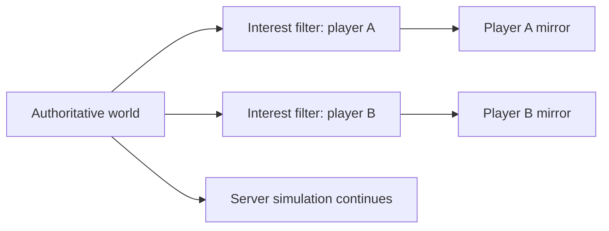
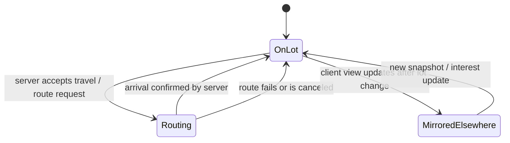
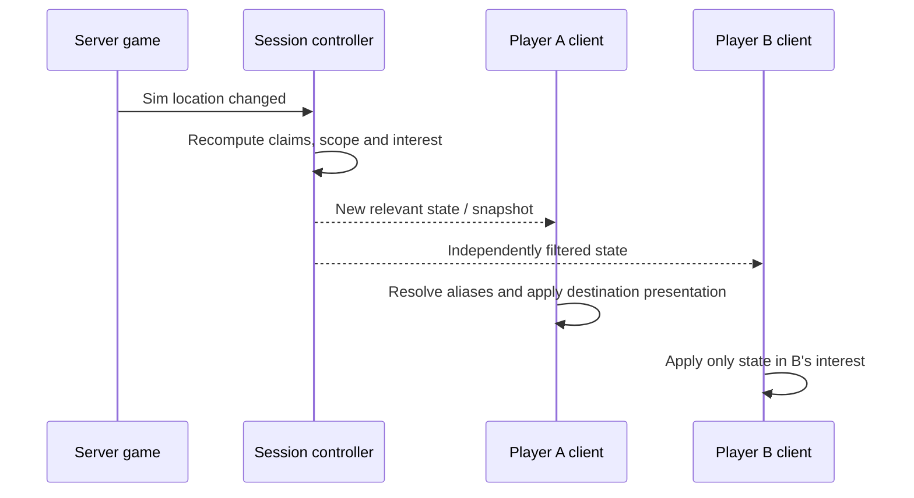

# Lots, households, and travel

Lots are simulation and presentation contexts; households are persistent
groupings; travel moves Sims between locations. Multiplayer adds a second
question to each: which process owns the world transition, and which clients
need to see it?

## One world, per-client view

The authoritative game runs the shared world. Client interest filtering
decides what each client receives. A player with a Sim claimed on one lot
may receive more detail for that relevant area, while another player may
receive a different subset. The server still owns the world outside every
client's current view.

Filtering is not freezing. A Sim omitted from one player's snapshot can
remain present and active on the server.

## Household boundaries

A household is not interchangeable with a Sim claim. Claims authorize a
player's input for selected Sims; household membership describes a group in
the game world and affects relationships, funds, travel, and persistence.
Systems that need to suppress behavior for a player-controlled household may
have to consider the whole household, not only the individually claimed Sim.

| Concept | Primary meaning | Typical consumer |
|---|---|---|
| Sim claim | Player input ownership in this session | Command authorization and input routing |
| Household membership | Persistent in-game grouping | Household data, funds, travel, life events |
| Lot membership | Current spatial/world location | Interest filtering, simulation, object context |
| Client mirror | Local representation of selected entities | Presentation and local UI |

Cross-household state requires complete synchronization of the relevant
relationship and inventory facts. A visibly present Sim does not imply that
every persistent relationship or household attribute has been mirrored.

## Travel is an authoritative transition

A route to an object, a move between lots, and a household travel operation
are different levels of work. The server decides that the transition is
valid and executes its gameplay effects; clients present the resulting
movement and state. A client-side route replay is a presentation operation,
not authority to commit the travel.

A movement to an object is also not merely a coordinate. The destination
object or slot may have semantic meaning, so replay should resolve the
target object and route to the local counterpart where possible.

## State transition sketch

The diagram intentionally separates server transition from client
visibility. A client can receive a lot change later than the server executes
it.

## Interest changes after travel

When a claimed Sim changes lots, its player's relevant interest can change.
A client may need a new snapshot that introduces entities at the destination
and removes entities outside the updated interest. The client should not
infer that the old lot was deleted or that remote state stopped advancing.

Safe sequencing is:

1. Server executes the travel operation.
2. Server reports the new lot/location state.
3. Controller updates interest calculations.
4. Client receives the relevant state baseline or deltas.
5. Client resolves aliases and presentation references for the destination.

## Travel and off-lot simulation

The game applies native lot and autonomy rules. Residential lots, active
lots, community lots, and global services can differ. A Sim off the server's
active lot is not necessarily frozen; a Sim off a client's active lot may
have a local object environment that is not ticking at the same fidelity.
This difference is one reason the server owns gameplay outcomes while
clients focus on presentation.

## Failure modes / limits

- A travel command can be accepted while the game later fails its route or
  transition.
- Client interest can lag a server lot transition, temporarily leaving an
  incomplete local view.
- A client may know the Sim but not the destination object or its local
  slot.
- Household state and Sim claim state have different lifetimes and must not
  be conflated.
- Relationship, inventory, vehicle, and travel presentation coverage can be
  incomplete.

## Related pages

- [Authority and ownership](authority-and-ownership.md)
- [Object and Sim identity](object-and-sim-identity.md)
- [Scope, interest, LOD, and dormancy](scope-interest-lod-dormancy.md)
- [Simulation](../simulation.md)
- [Persistence and time](../persistence-and-time.md)

## Lot changes and message ordering

A lot transition affects several derived views. The server game changes the
Sim's location; the controller rebuilds the Sim-to-lot index; the
simulation-scope policy may publish a new set; each player's interest lots
may change; and client snapshots or events must establish the new visible
state. These computations should follow the authoritative location change,
not race ahead based on client prediction.

## Claiming a household Sim

A player typically claims an individual Sim, while gameplay routines may
reason about the household. For example, a global lot rule might treat a
claimed Sim's housemate as part of the player-controlled household. This
should be explicit: household-level policy can protect a group from
unintended automatic travel, while command authorization remains tied to the
claimed actor.

A household is not automatically transferred to another player when one Sim
is claimed. Nor should a claim be used as proof that all household members
are visible or locally instantiated.

## Interest details and bootstrap

The current interest rule is claim-derived: lots occupied by claimed Sims
form the relevant lot set. Within those lots, claimed Sims are retained, and
unclaimed Sims are mirrored when they are active according to the
interaction-queue signal. Objects on those lots are included. With no
claims, filtering is disabled to support a broad initial view. This is not a
tier-two adjacent-lot graph despite historical “tier” terminology.

| Case | Expected delivery behavior |
|---|---|
| Claimed Sim | Included for its owning player's mirror |
| Active unclaimed Sim on a claimed lot | Included under the activity rule |
| Idle unclaimed Sim on same lot | May be omitted |
| Sim on another lot | Omitted from filtered snapshot unless claimed |
| Object on relevant lot | Included in that client's snapshot |
| Client before any claims | Broad bootstrap snapshot |

## Travel side effects

Travel may be initiated by player intent, autonomy, situations, or game
rules. A claimed Sim is not always the engine's selected actor on the
server, so stock routines can classify it as an NPC and enqueue automatic
actions such as returning home. The integration may need a narrow gate
around a common send-home routine to prevent that behavior for
player-controlled households while still allowing other Sims to follow
normal rules.

Such a gate must preserve emergency or high-priority cases and should be
tested against the actual engine priority ordering; interpreting a priority
enum from its name alone is not sufficient. Household scope and claimed-Sim
scope can differ intentionally.

## Household and relationship data

Household export/import is a distinct data path from Sim snapshots because
households contain persistent information that is not reducible to actor
position or interaction state. Relationships also have multiple components:
a short-term liking value, long-term relationship state, and associated
history or social data may not arrive through the same mirror field. A
social animation can look correct while the client's pie menu still observes
a stale relationship.

## How to verify / test

- Test two claimed Sims on separate lots and confirm per-client snapshots
  differ as intended.
- Move a claimed Sim to a new lot and check that scope and interest update
  only after the server transition.
- Verify active and idle unclaimed Sims on the same relevant lot against
  queue-count behavior.
- Test household travel suppression for a claimed Sim and a housemate, plus
  unrelated NPCs and emergency actions.
- Test object-target travel where the same semantic object exists on both
  sides.
- Compare relationship state before and after a social on the server and
  each client.
- Join late and verify household, lot, and claim state is reconstructed from
  authoritative data.

## Failure modes / limits

A client can have enough data to render a household but not enough data to
offer the same menu choices. Likewise, an entity can travel successfully on
the server while its client-side route is delayed or visually different.
Treat those as separate state and presentation checks.

## Related pages

- [Scope hooks and authority modes](scope-hooks-and-authority-modes.md)
- [Object and Sim identity](object-and-sim-identity.md)
- [Scope, interest, LOD, and dormancy](scope-interest-lod-dormancy.md)
- [Simulation](../simulation.md)

## Two-household scenario model

A useful multi-household test separates three questions: whether both
households exist in the authoritative save, whether each player's claims and
commands stay isolated, and whether state about interactions between
households reaches both clients. These are independent. Household
export/import can preserve the first while relationship mirroring remains
incomplete.

| Scenario | Primary invariant |
|---|---|
| Two claimed Sims on one lot | One server world; both clients receive relevant activity |
| Players on separate lots | Per-player filtering does not transfer simulation authority |
| Social between households | Server relationship outcome remains authoritative and eventually mirrors |
| Sim travels to community lot | Server executes movement; claim follows Sim; interest is recomputed |
| Late join after travel | Snapshot resolves current lot and identity, not stale origin state |
| Housemate triggers automatic travel rule | Household-level policy does not disrupt unrelated NPCs |

## Lot identity and lot activity

A lot id is useful for filtering and context but does not indicate whether
its objects are ticking in a particular client process. The server has its
own active lot and simulation policy; each client game also has local
runtime state. A Sim can be represented in a client mirror while a local
object's script or state machine is not progressing because that lot is not
active under the client's game rules.

This is particularly relevant to terminal object interactions: seeing an
actor walk to a toilet or chair does not prove that the local object's
interaction machinery is active or that the server selected the same object
instance. Prefer server-authoritative completion state and use client
playback only for the supported presentation contract.

## Travel target semantics

There are at least three target types to distinguish:

- A world coordinate, where arrival is judged spatially.
- A lot destination, where the transition changes the Sim's world context.
- An object or slot destination, where semantic object identity and
  placement matter.

A client replay that substitutes a coordinate for an object slot can reach a
nearby location but fail to reproduce the intended posture or attachment.
Preserve target identity when the protocol and local alias map support it.

## How to verify / test

- Build a scenario matrix with same-lot, separate-lot, and community-lot
  cases.
- Observe server Sim lot, client interest set, local active lot, and object
  simulation separately.
- Validate that a claimed Sim's housemate is affected only by the explicit
  household policy.
- Verify social relationship data on server and clients before and after a
  late join.
- Exercise object-target routing and plain coordinate routing as separate
  cases.
- Confirm that a route failure does not alter server lot ownership or save
  state incorrectly.

## Failure modes / limits

The current architecture can provide a correct server transition without
visually smooth travel on every client. Vehicle and cross-lot presentation
are especially distinct from world-state authority. Report them as
presentation gaps rather than weakening the one-simulator rule.

## Related pages

- [Boundary coverage and mirror gaps](boundary-coverage-and-mirror-gaps.md)
- [Object and Sim identity](object-and-sim-identity.md)
- [Persistence and time](../persistence-and-time.md)
