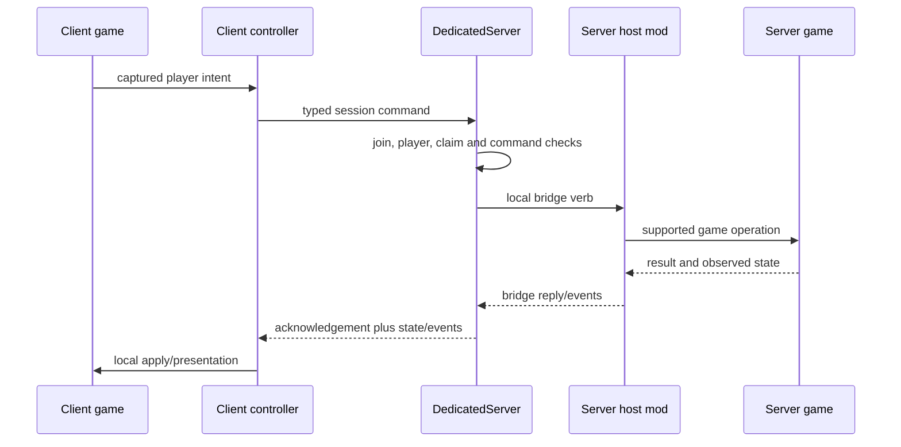

# Process model

The current player path pairs each controller with a local Sims 3 process. The server-side game remains the shared-world simulator; client-side game processes provide input capture and presentation. Controllers communicate with their local game integration through the process-memory bridge and with one another through the public session protocol.

## Roles and boundaries

| Process | Role | Boundary owned |
|---|---|---|
| `SimsOnline.DedicatedServer` | Server controller | Public listener, session membership, claims, command policy, synchronization |
| Server `TS3W.exe` + host mod | Authoritative game | World execution, interaction validity, live world and save behavior |
| `SimsOnline.Client` | Player controller | Session client, intent forwarding and local state/event application |
| Client `TS3W.exe` + host mod | Input source and presenter | Local UI/input and application of server-originated state |

The controller-to-controller link is not the same protocol as the controller-to-game bridge. In the C# path, the latter locates a shared region in the game process; the bridge does not turn the game into a network listener.

## Request lifecycle

A command acknowledgement marks a controller decision; it does not mean the interaction completed. The server game can subsequently reject, cancel, or complete its own work. The old current-architecture record describes this separation as the principal defense against mistaking a menu click for a gameplay result.

## Bridge v11 layout and startup

The current shared layout constants in the controller, mod, and experimental Rust bridge agree on layout version 11, bridge protocol 23, and HELLO wire version 6. The C# control region has a 64-byte header and 16 4096-byte slots; each slot has a 16-byte header. Bulk data uses four 512-KiB slots. The complete region is 2,162,816 bytes. Exact fields are listed in [runtime components](runtime-components.md); see [bridge and formats](../bridge-and-formats.md) for the wire contract.

A process being alive is not equivalent to a ready session. Check controller initialization, game attach/launch, bridge handshake, in-world state, listener state, and client baseline application independently. A public socket can accept connections while the game bridge is unavailable unless the current lifecycle code gates that path; diagnose the precise reported stage rather than relying on a delay or process list.

## Failure classification

| Symptom | Boundary to inspect first |
|---|---|
| No command arrives at the server | Client input capture and public client codec |
| Command rejected before bridge call | Session membership, claim, command policy |
| Bridge reports error or times out | Bridge version, frame state and mod handler |
| Server game refuses interaction | Game-side target validity and interaction tests |
| Server state changes but client does not | Snapshot/event sequencing, filter and client apply |
| Server state agrees but visuals differ | Recorder coverage and client replay |

A timeout after dispatch can leave the outcome unknown; the game may have executed before the reply was lost. Do not retry non-idempotent gameplay work merely because the controller reply is missing.

## Tests and limits

`DedicatedServer.Tests/` exercises session authorization, bridge framing, scope, snapshot filtering and event translation. Rust bridge fake-memory contracts are in `rust/simlink_bridge/tests/driver_fake_mod.rs`; `attach_finds_the_region_connects_and_routes_commands_to_ctl_slots` tests a fake `SimMemory`, not a live game. Live acceptance must name the game/mod build and the scenario; a passing pure policy or simulated memory test does not establish that a fork hook resolved in a game process.

A hidden or minimized game window is still a game process. It depends on the game runtime, content, save, platform, and address-space limits. Do not call this a standalone simulator or infer desktop-less service support from a hidden-window run.

## Related pages

- [Runtime components](runtime-components.md)
- [Authority and ownership](authority-and-ownership.md)
- [Dedicated server and offline host](dedicated-server-and-offline-host.md)
- [Bridge and formats](../bridge-and-formats.md)
- [Troubleshooting](../troubleshooting.md)

## Source anchors

| Process boundary | Source to inspect |
|---|---|
| TCP session commands, join state, claims, command dispatch | `DedicatedServer/Authority/AuthoritativeSession.cs` |
| Public listener and connection lifecycle | `DedicatedServer/Network/ClientListenerServer.cs` and `DedicatedServer/Network/BridgeAdminListener.cs` |
| Client command encoding and event application | `SimsOnline.Client/` |
| Host-mod request dispatch and game-facing handlers | `SimsOnlineServerHostMod/ServerHostMain.cs` and `SimsOnlineServerHostMod/Handlers/` |
| C# shared-memory protocol constants and slots | `DedicatedServer/HostBridge/` and `SimsOnlineServerHostMod/` |
| Rust fake-memory bridge boundary | `rust/simlink_bridge/src/driver.rs` |
| Rust fake-memory integration contract | `rust/simlink_bridge/tests/driver_fake_mod.rs` |

The directories are intentionally named as component boundaries, not as a promise that every
operation is implemented in one file. For a particular command, begin at its protocol record,
follow the `AuthoritativeSession` dispatch branch, then follow the bridge verb into the host-mod
handler and inspect the resulting event or snapshot path. The test names listed above exercise
only the specific policy, codec, or fake-memory seam they target.
