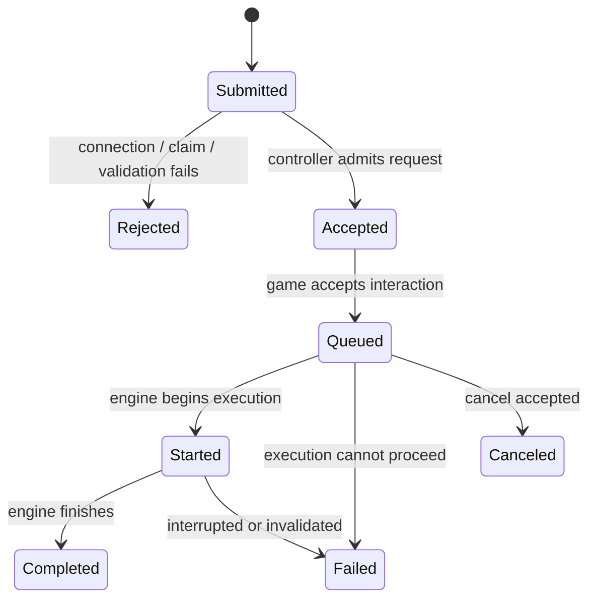

# Scope, interest, LOD, and dormancy

Four different mechanisms are often described loosely as “scope.” They
answer different questions. Treating them as synonyms leads to incorrect
assumptions about who simulates a Sim, which state a client receives, and
whether an off-lot entity is frozen.

## Four concepts

| Concept | Question answered | Typical effect |
|---|---|---|
| Server simulation scope | What does the authoritative game need to simulate or keep at higher fidelity? | Server-side game policy |
| Client interest scope | Which entities or events does a particular client receive? | Network bandwidth and mirror contents |
| Engine LOD | How much work does the game perform for an actor under current engine rules? | High-detail or reduced autonomy/simulation work |
| Dormancy | Is some work deferred or skipped because a lot/entity is inactive? | Lower-frequency updates, not necessarily a freeze |

Interest scope is a transport filter, not an authority model. Filtering a
remote lot from a client does not stop the server simulating it. Engine LOD
is not a network subscription. A sleeping lot is not deleted, and a client
missing an entity does not mean the authoritative entity stopped existing.

## Interest filtering

The current interest policy derives relevant lots from claimed Sims. A
client can receive Sims that are claimed or active within its relevant
interest area, plus objects associated with those lots. The precise filter
is implemented in `DedicatedServer/Mirroring/MirroringInterestScope.cs`.

A claim change can move a lot into or out of a client's interest. Different
clients may therefore receive different filtered snapshots of the same
authoritative world. A no-claim/bootstrap case can intentionally use a
broader view to establish session state.

| Input | Interest consequence |
|---|---|
| Claimed Sim identity | Determines which player owns the input claim |
| Sim current lot | Contributes to the player's relevant lot set |
| Snapshot Sim record | Included according to claim/interest and activity rules |
| Snapshot object record | Included according to relevant lot membership |
| No relevant claims | Filtering may be relaxed for initialization |

These policies can change independently of server simulation scope. An event
omitted from a client stream is not proof it never occurred.

## Engine LOD and inactive lots

The game has native cost controls for Sims and lots. High-detail autonomous
decisions are more constrained than low-detail updates; inactive residential
lot work may be slept or skipped while global services still run. Community
lots, active lots, active actors, and world-level systems can follow
different rules.

The practical distinction is that “less work” is not “no state change.”
Off-lot Sims may still receive low-fidelity updates or be changed by global
systems. Active interactions can also keep a Sim relevant regardless of a
simple distance heuristic.

## Server simulation obligations

A controller-level scope policy can identify player-relevant lots and Sims
and send that information to the server integration. This is an instruction
about server-side simulation obligations. It is separate from the per-client
filter and does not mean clients receive exclusive ownership of those lots.

The engine does not expose a general supported API for loading only selected
lots while keeping all world services coherent. The current authoritative
host therefore runs a full world, while the project uses filtering and
engine-native cost management to bound work.

## Lot simulation and Sim autonomy are separate gates

A lot-level simulation check and a Sim-level autonomy decision are related
but not identical. The game can skip or defer an inactive residential lot's
object update pass while still keeping the lot and its Sims in the world.
Separately, the autonomy manager can apply different decision-making work to
a Sim based on active-lot, household, screen, and activity conditions.

| Gate | Unit | Typical effect |
|---|---|---|
| Lot simulation | Lot | Object scripts and lot-local work may be skipped or slept |
| Sim autonomy LOD | Sim | High-detail autonomous action selection or a reduced update path |
| Client interest | Entity set per client | Snapshot/event delivery is included or filtered |
| Server scope policy | Claimed Sim and relevant lot set | Controller asks the server integration to maintain player-relevant simulation |

A client can therefore receive a Sim's position while the corresponding
local lot objects are not advancing at the same rate. Replaying a terminal
interaction against a non-ticking local object can stall even when the actor
itself is visible. This is a presentation/runtime limitation, not evidence
that the server interaction failed.

## Publishing server scope

The server scope policy is derived from session claims and current Sim
locations. In broad terms, claimed Sims are the high-detail autonomy set,
while lots currently containing those Sims are the player-relevant lot set.
The policy is published to the host only when its value changes, with retry
behavior after a failed command rather than a repeated send on every
synchronization cycle. Its controller implementation is
`DedicatedServer/Mirroring/SimulationScopePolicy.cs`.

This mechanism is intentionally distinct from the per-client interest
filter. A client can receive a different subset of the same world without
changing which Sims and lots the server is asked to simulate. Changes of lot
or claim must cause a scope recomputation so that the server's
responsibilities follow the players.

## Example: two players on different lots

Suppose player A claims a Sim at home and player B claims a Sim at a
community lot. The server continues to run one world. Its scope policy can
include the two claimed Sims and their current lots. A's client may receive
the home interest area; B's client may receive the community-lot interest
area. The two clients do not gain separate authority over those lots, and
neither client's filtered view is a full record of the world.

If A's Sim travels, the server executes that transition first. The claim
still belongs to A, while the Sim's new location changes relevant scope and
interest. The controller then sends appropriate state to clients. Claim
ownership, current lot, server simulation scope, and the receiving client's
filter are four separate facts.

## Dormancy vocabulary

Use precise terms in code and diagnostics:

- **Filtered:** not sent to a client.
- **Low fidelity:** still exists and updates through reduced engine
  behavior.
- **Sleeping:** scheduled less often or skipped by a lot-level gate.
- **Suppressed:** a specific engine behavior is explicitly blocked by
  integration policy.
- **Frozen:** no relevant state advances; do not claim this unless measured.

A stale client position can result from filtering, missing updates, delayed
delivery, or server-side engine behavior. It cannot alone identify which
case occurred.

## Diagnostic method

1. Check server-side state and tick progress first.
2. Determine whether the Sim or object is within the client's interest set.
3. Inspect the server's interaction and autonomy state, not just its visible
   position.
4. Compare a fresh full snapshot with incremental delivery.
5. Check whether the relevant lot is active or whether engine LOD changes
   its update path.
6. Separate a state mismatch from a presentation mismatch.

## Failure modes / limits

- Filter changes can make a client appear to lose an entity that still
  exists on the server.
- Expanding interest increases snapshot and event volume; it does not reduce
  server simulation work.
- Engine behavior varies by lot type and actor activity.
- Global systems can change state on off-screen Sims.
- There is no universal “off-lot means dormant” rule.

## Related pages

- [Authority and ownership](authority-and-ownership.md)
- [Lots, households, and travel](lots-households-travel.md)
- [Capacity and performance](capacity-and-performance.md)
- [Simulation and presentation](../simulation.md)

## Concrete command path

The server controller receives a typed public command, resolves the player
associated with the socket, and calls the session state machine. Only after
the command passes validation does the host abstraction issue a local bridge
operation. This separates network framing and authorization from engine
invocation.

The interaction request conceptually contains an actor, an interaction
definition, an optional target object or position, and menu-selection
context. Server-side reconstruction is important: the controller does not
trust a client to declare that the pick passed the game's own `Test` method.
The authoritative game repeats validation against its current world.

| Input field concept | Purpose | Validation concern |
|---|---|---|
| Actor identity | Identify the claimed Sim | Must resolve to the claimed server-side actor |
| Interaction key | Select the interaction definition | Must be supported and parseable by the host |
| Target identity | Identify an object target when applicable | Must resolve in the server world |
| Target position | Support location-based actions | Must be finite and valid for the game API |
| Menu context | Preserve the user's selected option | Should not be treated as proof that the action is valid |

## Replies and lifecycle events

A successful command acknowledgement says the controller admitted the
request. Subsequent game events represent actual progress. For example, an
interaction may be queued, started, completed, failed, canceled, or dropped.
A user interface can present an accepted request as pending, but should
replace that state when the authoritative event arrives.

## Snapshot filtering walkthrough

The interest filter is computed separately for each receiving player. It
indexes Sim-to-lot membership from the snapshot, finds lots that contain
claimed Sims, retains every claimed Sim, retains active unclaimed Sims in
those lots, and retains objects in those lots. If there are no claims, it
leaves the snapshot unfiltered for bootstrap. Interaction-queued events
follow a related actor/lot check.

The policy is intentionally simple and predictable. It is not a
camera-frustum system, adjacency graph, or server simulation throttle. It
should be reviewed whenever new event types refer to entities that may be
filtered out.

## Observability at each boundary

| Boundary | Observable evidence | What it does not prove |
|---|---|---|
| Local input capture | Intent event or client log | Server accepted the command |
| Public protocol | Typed response and connection state | Game executed the request |
| Host bridge | Correlation response and mod build/capabilities | World tick is advancing |
| Game simulation | Tick, queue, and lifecycle probes | Client received the changes |
| Client mirror | Applied acknowledgement and alias state | Visual replay is complete |
| Presentation | Recorder/replay counters or live view | Persistent gameplay state is correct |

## Concurrency and ordering

Several players can submit commands close together. The server state machine
must validate each against the state that exists when handled; two clients
cannot safely assume that their local view remains current until the command
arrives. For state streams, ordering matters when one record creates an
entity and a later record references it. A full snapshot can repair state,
but it does not erase the need for correct event ordering during normal
operation.

## How to verify / test

- Submit a valid command for a claimed Sim and check the whole lifecycle,
  not only acceptance.
- Submit the same command with a mismatched player identity and assert
  rejection before bridge execution.
- Simulate disconnect and confirm claim cleanup.
- Compare the filter result for two clients with claims on different lots.
- Feed an old-format snapshot missing an activity count and verify its
  documented fallback.
- Delay or omit an incremental update and verify that a full snapshot
  restores the mirror.

## Failure modes / limits

A trace with no interaction event may mean the game rejected the work, the
bridge did not deliver the event, or the actor was removed by filtering.
Inspect evidence from each layer before drawing a conclusion. The [protocol
reference](../protocol.md) and [troubleshooting
guide](../troubleshooting.md) describe the public diagnostics.

## Related pages

- [Scope, interest, LOD, and dormancy](scope-interest-lod-dormancy.md)
- [Server-authoritative simulation](server-authoritative-simulation.md)
- [Protocol](../protocol.md)
- [Bridge and formats](../bridge-and-formats.md)
