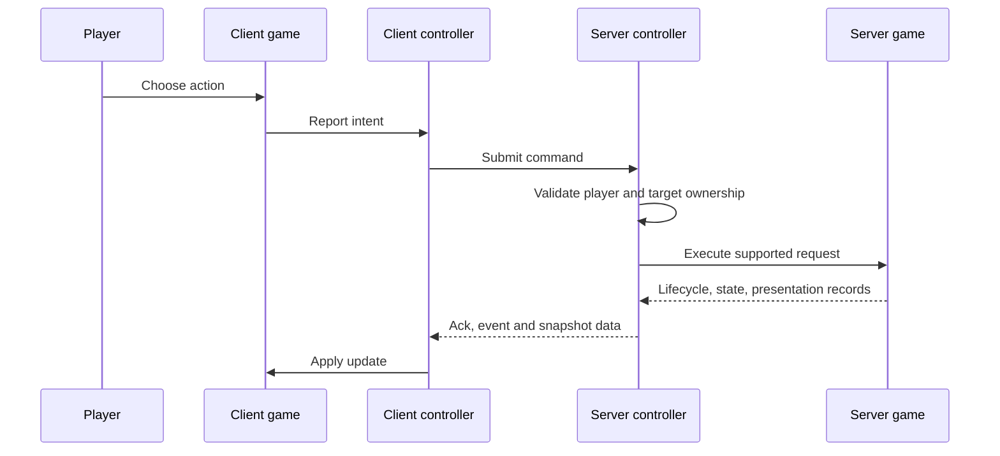

# Server-authoritative simulation

The system uses a server-authoritative model rather than lockstep
simulation. The server-side game process computes shared gameplay outcomes.
Client controllers send player intent and deliver server state to local
games for presentation.

## Authority flow

Commands cross an authorization boundary before they reach the game. The
command carries intent; the authoritative game owns success, failure, route
outcome, and world mutation. Clients can run at different frame rates
without requiring identical local schedules.

## Why not lockstep

Lockstep requires all peers to produce equivalent outcomes from the same
inputs in the same order. The game runtime includes timing, native systems,
local identifiers, and scheduling behavior that are not exposed as a
deterministic replicated-state-machine contract. Comparing and reconciling
independent outcomes would add complexity without a dependable equality
guarantee.

The authoritative model accepts that clients are views that may be delayed
or incomplete. It uses snapshots, events, and resynchronization rather than
requiring every local game to reach exactly the same state on every tick.

## Command lifecycle

| Phase | Responsible component | Observable outcome |
|---|---|---|
| Capture | Client game integration | Candidate user-directed action |
| Forward | Client controller | Protocol command sent to server |
| Validate | Dedicated controller | Accepted or rejected response |
| Execute | Server game integration | Game begins or refuses work |
| Report | Server controller/mod | Queued, started, completed, failed, canceled, or state update |
| Present | Client mirror | Local state and supported visuals applied |

A “command accepted” event is not equivalent to “interaction completed.” The
game can reject or interrupt work after the controller accepts the request.

## Synchronization model

The server provides initial state and subsequent updates. Clients
acknowledge applied progress. If a client falls too far behind or the server
requires replacement, a full snapshot can re-establish the current view.
This is state synchronization, not deterministic replay of every internal
engine tick.

| Mechanism | Goal | Non-goal |
|---|---|---|
| Full snapshot | Establish or replace a mirror baseline | Prove every historical event was observed |
| Delta/event | Communicate changes efficiently | Make the client an authority |
| Acknowledgement | Track client apply progress | Guarantee no visual divergence |
| Presentation stream | Reproduce selected engine-facing operations | Replicate hidden engine internals |

## Clock and save ownership

The authoritative game owns the world clock that drives simulation. The
controller can coordinate requested speed and communicate time to clients,
but client clocks are not independent world clocks. The server-side world is
the persistent copy; client local saves are not competing shared-world
commits.

## What the client does

The client has two legitimate roles: originate a player's request, subject
to server checks, and apply server-originated state and presentation to its
local game. It should not independently decide that a shared Sim's
interaction succeeded, advance the shared world clock, or commit a competing
version of the shared save.

An in-game authority gate may be necessary because suppressing network-side
work does not automatically suppress engine-native behavior.

## Recovery and disconnects

When a client reconnects, it needs a current baseline rather than reliance
on incomplete local history. Claims and session membership must also be
reconciled. A disconnect can release the player's claims while the server
game continues simulating; this does not imply rollback of already-executing
gameplay.

## Failure modes / limits

- A server game pause can stop world progress while the controller and local
  bridge still answer.
- Network delay produces temporary client staleness; server state remains
  authoritative.
- Client presentation can differ where recorded seam coverage is incomplete.
- The model does not provide authentication or encryption by itself.
- The model does not promise identical results across game versions or
  content sets.

## Related pages

- [Authority and ownership](authority-and-ownership.md)
- [One-simulator decision](one-simulator-decision.md)
- [Process model](process-model.md)
- [Protocol](../protocol.md)
- [Simulation and presentation](../simulation.md)

## Why server authority does not imply lockstep

The server is authoritative because the controller forwards requests to one
game instance and distributes its outcomes. It is not authoritative because
every client executes the same game code and votes on a result. The latter
would require a determinism guarantee that the engine does not expose.

Lockstep commonly depends on a shared simulation step, deterministic random
streams, identical entity allocation, and reproducible scheduling. Separate
game processes can have independent timers, native call ordering, random
state, object allocation, graphics cadence, and content. Sending the same
player command to all of them does not ensure the same route or interaction
result.

| Property | Server authority | Lockstep replication |
|---|---|---|
| Gameplay execution | One authoritative game | Every peer simulates |
| Client result | Applied from server | Locally recomputed |
| Divergence handling | Snapshot/delta repair | Determinism or rollback required |
| Network payload | Commands plus resulting state/events | Inputs and synchronization barriers |
| Main risk | Delay and incomplete mirroring | Peers compute different outcomes |

## Authoritative state versus accepted request

A controller command can be considered accepted at the session layer but
still fail at the game layer. For example, an interaction definition might
be known while its target becomes unavailable before the game evaluates it.
The server game must remain the final judge of current-world validity.

The controller should therefore report transport/authorization acceptance
separately from game execution state. Clients should render “pending” as
provisional and then reconcile it with the authoritative lifecycle event. A
timeout is not proof that the server did not execute the command; retries
must avoid creating duplicate work unless the command is idempotent or has a
deduplication key.

## State replication categories

| Data | Appropriate representation | Consumer behavior |
|---|---|---|
| Durable current values | Snapshot fields | Replace or update mirror state |
| One-time transition | Event | Apply once and preserve order |
| High-volume visual operations | Presentation stream or bulk payload | Apply with bounded queues and entity resolution |
| User intent | Client command | Validate and execute only on server |
| Diagnostic observation | Probe/status output | Never treat as a gameplay command |

## Clock synchronization nuance

One authoritative world clock removes the need to elect which client's time
wins. It does not mean every client display is perfectly synchronized.
Controllers can communicate current speed/time and periodically repair
drift, while each local game still advances through its own runtime and
rendering cadence. A paused or blocked game may diverge even if its
controller believes it requested Normal speed.

Health checks should test tick advancement, not just the speed command
response. The server clock is the source; clients display an applied view.

## Save and checkpoint boundary

The server-side world owns shared persistence. The controller may coordinate
save operations, validation, checkpoint copies, and recovery, but a client
save is not an authoritative branch that can be merged automatically. This
avoids silently accepting stale or conflicting state from a player's local
copy.

A save-related workflow should record whether the server game acknowledged
the operation and whether the resulting persisted data is complete. A save
command acknowledgment alone does not establish that the file is safely
committed or that a later restart can load it.

## Reconnection behavior

A reconnecting client should receive a full current baseline, re-establish
its claim state under current policy, and then resume applying incremental
updates. It should not assume its previous object aliases or local save are
still valid. If a player disconnects, session claims may be released while
the authoritative world continues.

## How to verify / test

- Assert that player commands are executed only by the server host.
- Verify request acceptance and interaction completion as separate
  assertions.
- Pause or stall the server game while keeping its controller responsive;
  confirm health reporting detects the distinction.
- Disconnect a client mid-interaction and verify server progress is not
  rolled back.
- Rejoin with a stale client save and confirm a snapshot repairs current
  mirrored state.
- Run a multi-client scenario with different local frame rates and compare
  server outcomes.

## Failure modes / limits

Server authority reduces ambiguity but does not guarantee fairness, low
latency, client visual parity, or protection from malicious users. Those
concerns require separate protocol, transport, and security design.

## Related pages

- [One-simulator decision](one-simulator-decision.md)
- [Authority and ownership](authority-and-ownership.md)
- [Capacity and performance](capacity-and-performance.md)
- [Persistence and time](../persistence-and-time.md)

## Client enforcement is a separate proof obligation

The one-simulator rule must be enforced inside the client game, not only in
the network controller. A controller can refuse to send a local action, yet
the game may already have queued or autonomously generated work. The forked
authority hook blocks selected local insertion paths and reports its mode; a
stock/unforked game does not gain that behavior just because the controller
requested Enforce.

The controller's policy record distinguishes gate mode from the list of Sim
ids permitted for native simulation. In the default presenter-only mode that
list should be empty. Sorting the ids makes state comparison stable when
claim enumeration order changes. State is sent when it changes, and a
just-rejected state is held back for a bounded retry delay so an older host
does not receive the same unsupported command on every update.

## Autonomy suppression is not replaced by insert blocking

A script-level interaction insert gate is not necessarily the same as
suppressing the engine's autonomous director. The current policy keeps
explicit mirror autonomy suppression because live probing showed that the
authority hook alone did not prevent every mirrored Sim from receiving local
autonomy work. This is a useful general lesson: adjacent gates can overlap
without one subsuming the other.

## Role separation

| Runtime role | Claimed set received? | Authority gate purpose |
|---|---|---|
| Server game | Claimed Sim and relevant lot scope | Make player households participate under server rules |
| Client presenter | Server-owned aliases and presenter policy | Prevent local shared-gameplay execution |
| Diagnostic/offline host | Depends on harness | No implication of live session authority |

The exact low-level hook behavior depends on the loaded gameplay build.
Diagnostics should report whether the hook exists, the selected mode, the
native Sim set, and whether mirror autonomy suppression is active.

## How to verify / test

- Run with the expected gameplay fork and confirm the hook reports present.
- Repeat on an unmodified assembly and confirm the integration does not
  claim successful enforcement.
- Assert that presenter mode publishes an empty native Sim list.
- Observe a local user-directed insert and confirm it is forwarded or
  blocked, not executed twice.
- Separately inspect autonomous action queues for multiple mirrored Sims.
- Verify rejected policy updates back off and later retry after the delay.
- Recompute the set on claim and lot transitions and verify stable sorted
  output.

## Failure modes / limits

Enforce is a requested policy, not proof of enforcement. The proof requires
the matching hook loaded in the actual game process, with expected role and
version. A policy status without hook status is incomplete evidence.

## Related pages

- [One-simulator decision](one-simulator-decision.md)
- [Scope hooks and authority modes](scope-hooks-and-authority-modes.md)
- [Simulation](../simulation.md)
