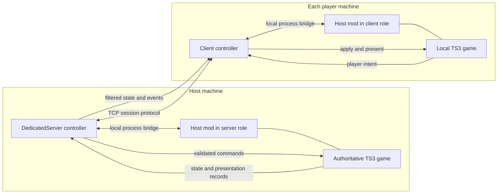
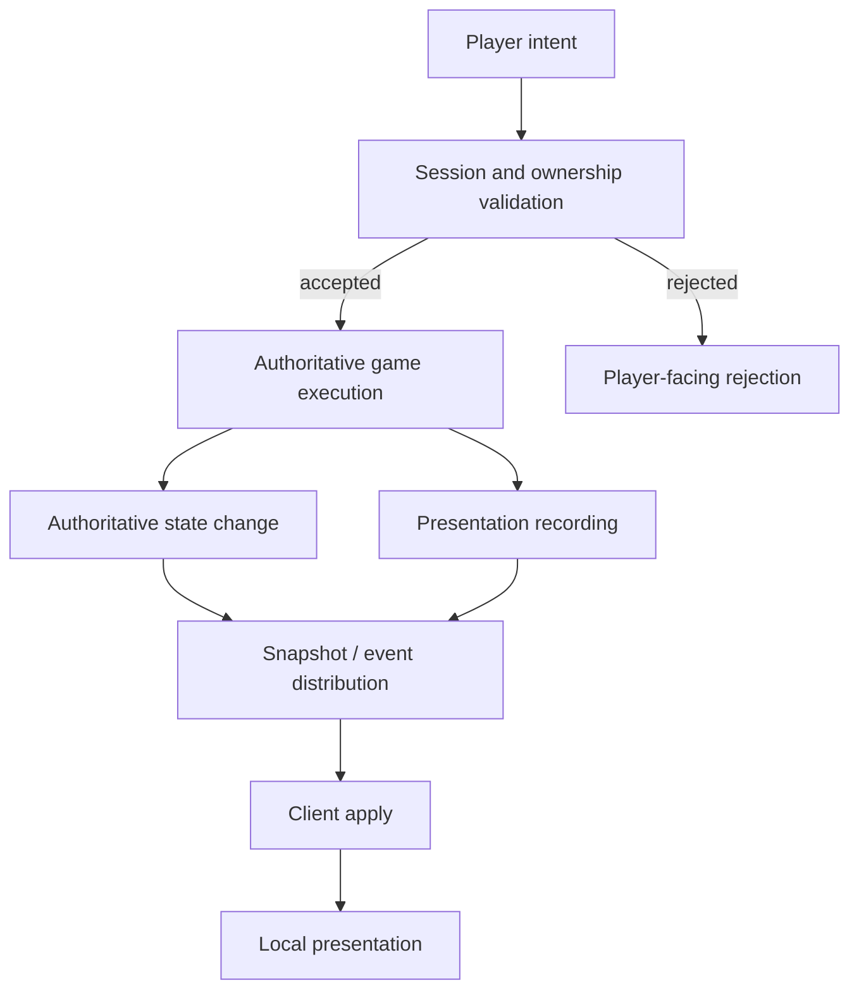

# System overview

Sims3Online connects a player's local game to a shared session coordinated by
a controller and a server-side copy of the game. The architecture separates
three concerns that are easy to conflate:

1. **Simulation:** the authoritative game process advances the world and
   decides gameplay outcomes.
2. **Coordination:** controllers manage connections, player identity,
   claims, command validation, persistence, and synchronization.
3. **Presentation:** each player's local game renders server-originated
   state and selected engine events while forwarding player intent.

A client can display a Sim without being entitled to decide that Sim's next
action. Receiving a snapshot does not grant simulation authority, and
holding a claim does not make the client a second simulator.

## Topology



The controller-to-controller link and controller-to-game bridge are separate
boundaries. The first is a public session protocol. The second is a local
integration interface for a running game process. See [process
model](process-model.md) and [boundary seams](boundary-seams.md).

## Main data paths

| Path | Direction | Meaning |
|---|---|---|
| Player action | Local game → client controller → server controller | A request to perform work, not a client-authored result |
| Authoritative execution | Server controller → server game | A validated request is passed into the game runtime |
| State synchronization | Server game → server controller → client controller | Snapshot or event data representing server-owned state |
| Presentation replay | Server game → recorder → controller → client game | Selected engine-facing operations are reproduced locally |
| Persistence | Server game ↔ server controller | Save ownership remains on the authoritative side |

A command may be accepted by the controller but later fail inside the game.
The protocol therefore separates command acknowledgements from later
interaction lifecycle events; acceptance is not completion.

## State categories

### Session state

The controller owns network-session facts: which connections have joined,
which player identity is bound to each connection, which Sim is claimed by
which player, and session lifecycle or requested speed. These facts are not
inferred from a client snapshot.

### World state

The server game owns live gameplay state: positions, interaction outcomes,
autonomous decisions, world time, and state committed to the server save. A
controller may carry a mirror for routing and delivery, but that mirror does
not become a second source of truth.

### Presentation state

Client games need enough state to render remote Sims and objects. They apply
snapshots and selected presentation events, but those events are not
evidence that the local engine independently reached the same result.

## Why the separation matters

- **Correctness:** one simulator avoids reconciling two competing answers to
  “what happened?”
- **Security boundary:** the server validates connection and command policy
  before work reaches the game.
- **Recoverability:** a full snapshot can replace a stale client mirror
  without changing world authority.
- **Diagnosability:** controller, bridge, simulation, and presentation
  faults can be classified independently.
- **Extensibility:** transport and presentation can evolve without
  pretending to replace the game engine.

## Common confusion

| Confusion | Accurate interpretation |
|---|---|
| “The client shows my Sim, so it simulates it.” | Showing a puppet is not authority; the server computes gameplay outcomes. |
| “A successful response means the action finished.” | It means the command was accepted; later events report execution outcomes. |
| “A full snapshot means the client owns the world.” | It is a baseline view for mirroring and recovery. |
| “The local game bridge is the network protocol.” | The bridge is a separate local process interface. |
| “A dedicated server means a lightweight engine.” | The current host still runs the full game simulation process. |

## Failure modes / limits

- A stopped or paused authoritative game prevents gameplay progress even if
  controllers remain responsive.
- A controller may be connected while its game bridge is unavailable or
  stale.
- A client can be behind the server; acknowledgement and resynchronization
  reduce divergence but do not provide lockstep determinism.
- Presentation coverage is selective. Unsupported events can produce visual
  differences while authoritative world state remains correct.
- Game-version and content differences can change engine behavior outside
  the controller's control.

## Related pages

- [Process model](process-model.md)
- [Authority and ownership](authority-and-ownership.md)
- [Server-authoritative simulation](server-authoritative-simulation.md)
- [Protocol](../protocol.md)
- [Bridge and formats](../bridge-and-formats.md)

## Walking the system end to end

Consider a player choosing an interaction from the local pie menu. The local
integration observes the player-directed choice and the client controller
packages it as intent. The server controller ties that request to the joined
connection, checks that the target belongs to that player's claim, and asks
the local server mod to reconstruct the game's pick. The game then runs its
own validity tests and queue behavior. The result returns as interaction
lifecycle events and state. The client mirror translates those updates into
local operations.

This path deliberately has two independent success boundaries. The network
command can be accepted while the game rejects the interaction. The game can
complete the action while one presentation operation fails locally. A useful
bug report identifies which boundary failed rather than saying only “the
action did not work.”

| Observation | Likely layer | First question |
|---|---|---|
| No command reaches server | Input capture or client controller | Did the local game emit a user intent? |
| Server rejects immediately | Session and authority policy | Is the player joined and does the claim match? |
| Game reports refusal | Game validity and current world state | Does the server-side pick pass its own tests? |
| Server state changes but client does not | Synchronization and mirror | Did the client receive and apply the event or snapshot? |
| Client state is correct but animation differs | Presentation recorder/replay | Is that engine seam recorded and replayed? |

## Snapshot versus event

A snapshot describes a sampled state. It is useful when a client first joins
or needs repair after falling behind. An event describes a transition, such
as a claim change or an interaction lifecycle stage. The two forms solve
different problems: snapshots do not contain every transition between
samples, and event history alone is not a robust way to reconstruct a
baseline after reconnect.

A client should apply a full snapshot as a baseline, then process later
updates according to the protocol's sequencing and acknowledgement contract.
Presentation records complement both: they can carry detailed engine-facing
operations that are not useful as ordinary gameplay-state fields.

## Placement of the main boundaries



The diagram highlights that rejection and execution are separate branches.
An accepted command does not skip the game validity check, and a client
apply failure does not undo the server state change.

## Architectural invariants

| Invariant | Practical implication |
|---|---|
| One authoritative gameplay world | Do not accept client-computed outcomes as truth |
| Connection identity is bound at join | Do not trust a payload's player id alone |
| Claim and simulation authority differ | Claims route input; they do not assign a second simulator |
| Local bridge is not network transport | Keep local command and public protocol changes separate |
| Client mirror may be partial | Every caller must tolerate missing entities outside interest |
| Presentation is selective | Do not infer game state from animation alone |
| Engine calls remain engine-owned | A controller cannot make an unsupported native operation safe |

## Reading a runtime trace

When comparing logs from controller and game, first establish a shared
timeline. Record the session join, claimed Sim, submitted command,
controller acceptance/rejection, bridge result, interaction lifecycle,
server snapshot tick, client acknowledgement, and any replay diagnostic.
Missing timestamps make it easy to confuse an old snapshot with a failed
current command.

A useful compact trace might look like this (illustrative, not a literal
command transcript):

```text
client: joined player=7
client: intent actor=<server-sim> interaction=<key>
server: accepted command=<correlation>
server-game: interaction queued actor=<server-sim>
server-game: interaction started actor=<server-sim>
server: snapshot tick=<newer-tick>
client: applied tick=<newer-tick>
client-game: presentation applied actor=<local-alias>
```

The placeholders intentionally distinguish server identity from the local
alias; never copy private player ids or machine data into public
documentation.

## Failure modes / limits

The overview is a map, not a guarantee of feature completeness. A component
can be optional, a mod can be absent, or a protocol version can be
incompatible. Always verify the actual configuration described in
[status](../status.md) before depending on an optional path.

## How to verify / test

- Use controller tests for connection binding, command rejection, snapshot
  filtering, and event translation.
- Use bridge tests for line framing, bridge version negotiation, and payload
  decoding.
- Use a live game scenario for queue insertion, lot travel, identity
  aliases, and presentation.
- Compare authoritative server state with client-applied state, not just two
  client screenshots.
- Check that the world clock advances independently of bridge
  responsiveness.
- Re-run a join/rejoin path after changing snapshot or identity behavior.

## Related pages

- [Process model](process-model.md)
- [Authority and ownership](authority-and-ownership.md)
- [Boundary seams](boundary-seams.md)
- [Troubleshooting](../troubleshooting.md)
