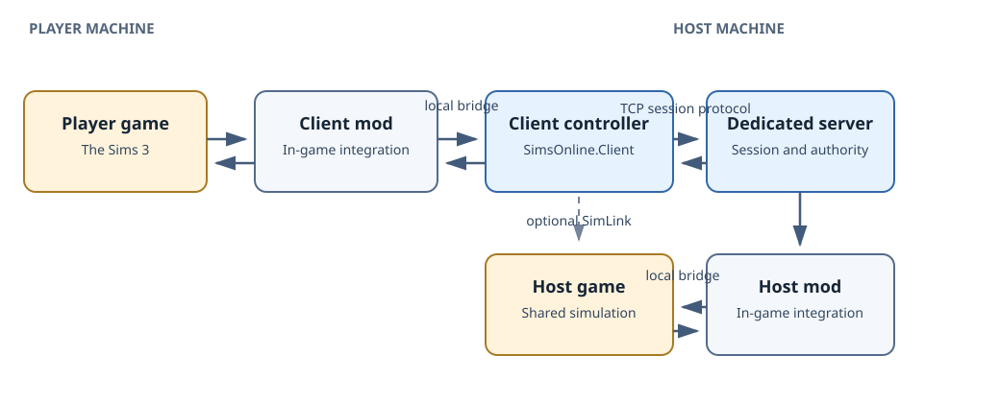

# Architecture

## System boundary

A session has a controller process and a game process on each participating machine. The
dedicated server controller coordinates the session and connects to its local authoritative
game. A player-side controller connects to the server over TCP and to that player's local game
through the game integration layer. The controllers do not send game-process memory directly to
one another.

The local game bridge and the player-facing TCP protocol are separate interfaces:

| Boundary | Purpose | Implementation |
|---|---|---|
| Player controller ↔ .NET dedicated server | Session commands, events, and state synchronization | Newline-delimited JSON over TCP |
| Experimental client ↔ Rust front door | Experimental session commands and events | Versioned line-v1 over TCP; separate from the established .NET server |
| Controller ↔ local game | Game commands, observations, and bulk snapshot payloads | Local host bridge, implemented by the mod and controller |
| Optional SimLink sidecar ↔ local controller | An alternate local transport for supported streams | Native sidecar under `SimLink/` |

The experimental Rust front door is documented in the
[Rust kernel and server reference](design/rust-kernel-overview.md); it does not replace the
established .NET server path. SimLink is optional and does not replace either client-facing
protocol. See [components](components.md), [protocol reference](protocol-reference/index.md),
and [bridge formats](bridge-and-formats.md) for module and data contracts.

## Authority and ownership

The dedicated server and its host game are the default authority for shared-session outcomes.
Clients submit player intent and apply server-originated state and presentation; a client mirror
is not a second source of truth for ordinary server-authoritative gameplay.

The code also contains explicit client-native lot-authority and reconciliation paths. When that
mode is active, exports of selected owned Sims' positions are filtered and merged under
server validation; deep household state remains quarantined. A save checkpoint can be
refused until each client-native player has a fresh merged export. This does not establish
reconciliation of every owned lot; see [validation and bootstrap limits](protocol-reference/world-transfer-and-reconcile.md).
Treat this as a deliberate
ownership mode, not as evidence that clients may arbitrarily write shared state.

The transport and authority checks are distinct. A joined connection is associated with one
player, and commands are checked against that identity and the relevant simulation ownership.
The host's local loopback path is separately trusted for development operations. These checks do
not authenticate remote users; see [security](security.md).

## State flow

1. A local game raises player intent to its controller.
2. The controller sends a command with its player identity to the server.
3. The server validates connection and ownership rules, then asks the authoritative game to
   perform supported work.
4. The server emits command results, lifecycle events, snapshots, and supported presentation
   data.
5. Each client controller filters and applies the updates to its local game.

Snapshots are used to establish or repair a view of the world; events communicate changes and
the results of commands. Presentation updates such as animation replay are not a substitute for
authoritative simulation state.

## Synchronization and recovery

Each client acknowledges the tick it has applied. The server can send incremental updates or
request a full replacement when a mirror has fallen too far behind. A joining connection receives
an initial snapshot plus the current speed and world time when available. This gives a late
joiner a baseline without treating its older local world as authoritative.

The world clock advances inside separate game processes. The server compares its authoritative
host time with the last time it broadcast and periodically re-sends that time according to
`WorldTimeReconcilePolicy`; it does not sample mirror clocks. This is authoritative-clock
rebroadcasting, not measured mirror drift correction or a guarantee of lockstep simulation.

## Design limitations

The Sims 3 remains the simulation engine. The architecture does not guarantee parity across
game versions, expansions, custom content, mods, or every interaction. Behavior that matters to
players needs a reproducible scenario and evidence from the running game; a successful protocol
test alone cannot prove visual or gameplay correctness.
