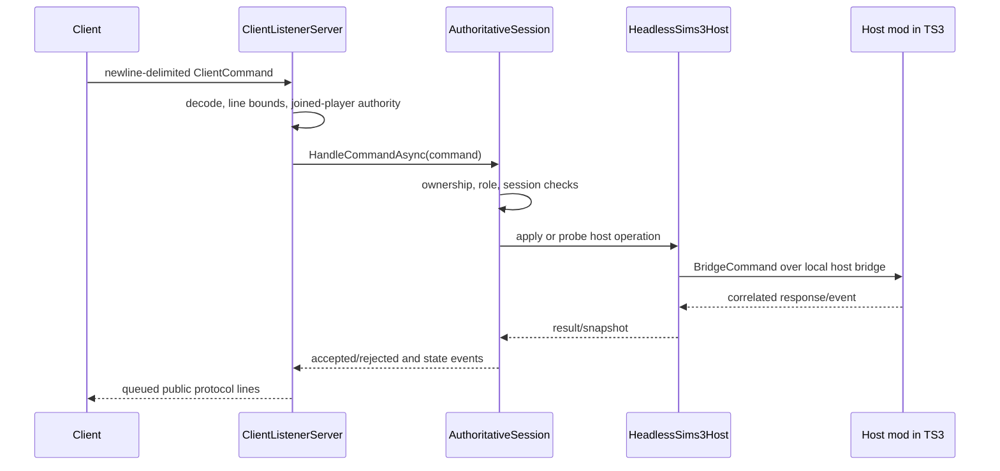

# Dedicated server controller

`DedicatedServer` is the long-lived controller executable. It owns authoritative session
state, coordinates the authoritative Sims 3 process through a local host bridge, accepts
client connections, and publishes protocol events. The controller is not the game
simulation: the actual game process runs gameplay, while this .NET process enforces session
policy and moves commands and observed state across process boundaries.

The main policy boundary is `IAuthoritativeSimulationHost`. `AuthoritativeSession` depends
on that adapter contract rather than game APIs, so command authorization, claim bookkeeping,
snapshot scheduling, and network-facing decisions can be tested without booting the game
runtime. `HeadlessSims3Host` is the bridge-backed implementation.

## `Main` startup lifecycle

`DedicatedServer/Program.cs` contains the executable's private `Main`. It parses
`SessionConfig.FromArgs(args)`, configures telemetry, and hooks shutdown signals into a
cancellation token. On non-Windows platforms, SIGTERM follows the same cancellation path as
Ctrl+C, allowing `finally` and async-disposal logic to run.

| Phase | Source operation | Observable result |
|---|---|---|
| Parse | `SessionConfig.FromArgs(args)` | One config record; invalid argument combinations fail before server operation. |
| Telemetry | `SentryConfigurator.Configure`, `SentryReleaseResolver.Resolve` | Optional telemetry wrapper with privacy filtering and explicit DSN/environment controls. |
| Shutdown wiring | Ctrl+C and POSIX SIGTERM | Cancellation token drives one async cleanup path. |
| Probe dispatch | Early branches for isolated diagnostic modes | Probes can exit without starting normal serving. |
| Construct | `HeadlessSims3Host` + `AuthoritativeSession` | Concrete adapter and session policy coordinator. |
| Configure | Interest-scope, presentation, route, optional Rust switches | Features are explicit, not inferred from client timing. |
| Start | `session.StartAsync(saveName, token, attachExistingHost)` | Bridge and world are ready before the listener serves. |
| Loop | Listener/session tasks plus cancellation wait | Client work proceeds until cancellation or a fatal fault. |
| Stop | `session.StopAsync`, host disposal, telemetry disposal | Best-effort bridge disconnect and owned-process cleanup. |

Launch and attach differ in process ownership. A launch-mode controller owns the game
process and shuts it down when stopped. In attach mode, the game was started elsewhere and
remains externally owned. `--attach-pid` pins the process identity so a same-name game
process cannot be mistaken for the intended host. `RunStateFile` optionally reports
machine-readable phases; without `--state-file` no state file is written.

## Configuration points

`SessionConfig` is a positional record assembled by `FromArgs`. These switches are
operator-facing and are verified in the current parser.

| CLI option | Config member / default | Effect |
|---|---|---|
| `--ts3 <path>` | `Ts3ExecutablePath` | Executable used for a launched host process. |
| `--save <name>` | `SaveName` | World/save to load for a new session. |
| `--listen <address:port>` | `ListenEndpoint` | Public client TCP listener endpoint. |
| `--host-bridge <address:port>` | `HostBridgeEndpoint` | Controller-to-mod bridge endpoint. Endpoint support is validated before launch. |
| `--host-timeout-seconds <n>` | `HostBridgeTimeout` | Long bridge-operation timeout for load, save, and snapshots. |
| `--player-command-timeout-seconds <n>` | optional; effective default 10 s | Short bound for player-paced operations. |
| `--attach-existing` | `AttachExistingHost=false` | Attach to a game already running rather than launch one. |
| `--attach-pid <pid>` | optional | Pin attach to the intended host PID. |
| `--ts3-sandboxie-box <name>` | optional | Windows process-isolation box for the game. |
| `--ts3-sandboxie-start <path>` | optional | Sandboxie launcher; validation requires a box. |
| `--start-speed <name>` | `StartSpeedName="normal"` | `pause`, `normal`, `double`/`speed2`, `triple`/`speed3`, `skip`/`ultra`, or `none`. |
| `--checkpoint-save <name>` | optional | Alternate save slot for checkpoint/reuse logic. |
| `--sync-broadcast-seconds <n>` | optional | Periodic synchronization broadcaster cadence. |
| `--no-interest-scope` | default false | Disables lot/interest filtering for mirrored snapshots. |
| `--bridge-trace` | default false | Emits per-frame bridge diagnostics. |
| `--bridge-record <path>` | optional | Records lossless bridge frames. |
| `--bridgectl-listen <address:port>` | optional | Starts bridge-admin listener; validation requires loopback because it has no authentication. |
| `--state-file <path>` | optional | Writes machine-readable controller lifecycle phases. |

`EffectivePlayerCommandTimeout` is 10 seconds; `DefaultForceAlignCommandTimeout` is 30
seconds. `EffectiveMaxFoldPerCycle` defaults to 8, and `EffectiveResyncCooldown` defaults to
5 seconds. `ResyncThresholds` uses `ResyncThresholds.Default` unless one of
`--resync-warn-ticks`, `--resync-hard-ticks`, or `--resync-max-interval-seconds` overrides
it. The threshold type remains the source of truth; these docs intentionally do not restate
its default tick values.

`SessionConfig` includes a large set of probes with typed fields. Common switches include
`--host-probe`, `--probe`, `--snapshot-and-exit`, `--probe-object-guid-stability`,
`--object-guid-sample-size`, `--probe-sim-lifecycle`, `--probe-state-injection`,
`--probe-load-path-comparison`, `--probe-autonomy`, `--probe-actor-lookup-parity`,
`--probe-role-switch`, `--probe-motive-roundtrip`, `--probe-interaction-roundtrip`,
`--probe-cash-roundtrip`, `--probe-skill-roundtrip`, `--probe-autonomy-roundtrip`,
`--probe-live-snapshot`, `--probe-claim-autonomy`, and `--go-here`. Inputs include `--sim`,
`--household`, `--funds`, `--motive`, `--motive-value`, `--skill`, `--skill-level`, `--x`,
`--y`, and `--z`. `ValidateProbeArguments` rejects invalid combinations; for example,
claim-autonomy needs `--sim`, and live-snapshot / claim-autonomy cannot use attach mode.

### Startup environment switches

`Program` reads these environment variables directly. Treat them as runtime configuration
whose current spelling should be verified before depending on it externally.

| Variable | Behavior in current source |
|---|---|
| `SIMSONLINE_PRESENTATION_STREAM` | Default on; exact value `0` disables publication. |
| `SIMSONLINE_CLIENT_NATIVE_MODES` | `0` forces presenter-only clients; `1` preserves native lot modes when the presentation stream is active. |
| `SIMSONLINE_ROUTE_STREAM` | Route stream requires value `1` and presentation stream enabled. |
| `SIMSONLINE_RUST_ROUTE` | Enables route planning handoff when set to `1`. |
| `SIMSONLINE_RUST_ROAD_PLACE` | Enables the Rust road-place side path when set to `1`. |
| `SIMSONLINE_TRANSPORT_TRACE` | Enables transport tracing in the authoritative session. |
| `SIMSONLINE_JOIN_REUSE` | Value `0` disables join save reuse in `HeadlessSims3Host`. |
| `SIMSONLINE_SERVER_SAVES_DIR` | Overrides server save-directory resolution. |
| `WINEPREFIX` | Used when launching the game through Wine on non-Windows hosts. |

## Optional Sentry telemetry

The C# controller starts Sentry when the configured DSN environment variable has a value.
`SENTRY_DSN` is the default. With `--sentry-dsn-env`, the controller reads the named
variable and disables Sentry if that variable has no value.

`SentryReleaseResolver` tags the release with the first seven characters of the startup
checkout's Git commit when available. The controller prefers `--sentry-release`, then
`SENTRY_RELEASE`, then the resolved Git tag. `SentryPrivacyFilter` scrubs events, transactions,
breadcrumbs, logs, and metrics before sending them. Sanitize local logs separately when sharing
reports. See [logging and diagnostics](../guides/logging-diagnostics.md).

The default `SentryTracesSampler` samples session start and stop, bridge connect, process
exit, and claim and release traces at 100%. Bridge ping, hello, and liveness traces are
skipped. Mirror dispatch is sampled at 5% and other operations at 10%.
`--sentry-traces-sample-rate` replaces this policy with one rate.

## Session policy: `AuthoritativeSession`

`DedicatedServer/Authority/AuthoritativeSession.cs` is the principal policy coordinator. It
does not own TCP framing or direct process-memory access. Its method surface includes:

| Public method / group | Responsibility |
|---|---|
| `StartAsync`, `StopAsync` | Start/stop host and session lifecycle, including optional attach semantics. |
| `HandleCommandAsync` | Convert a decoded `ClientCommand` into host work and accepted/rejected result events. |
| `SaveGameAsync` | Checkpoint the authoritative world through the host adapter. |
| `GetSnapshotAsync`, `GetSnapshotSinceAsync` | Return full snapshot or a delta after a requested tick. |
| `RecordSnapshotAck`, `TryGetPlayerAckTick`, `TryGetMinPlayerAckTick` | Maintain per-player acknowledgement progress. |
| `ReleasePlayerClaimsAndLeaveAsync` | Release owned Sims and leave cleanup when a connection is no longer active. |
| `GetPlayerRole`, `TryTakePickRequester` | Read role and correlate captured pick intents with requesters. |
| `ConfigurePresentationStream`, `ConfigureRouteStream`, `ConfigureRustRoute` | Configure per-session stream/route options. |
| `PublishPresentationAsync`, `PublishSimDetailsAsync`, `PublishVisibleSimStateAsync`, `PublishSimPresenceAsync` | Publish presentation/state subsets through the listener. |
| `ApplyInterestScopeForPlayer`, `ApplyMirrorScopeForPlayer` | Select snapshot content for an individual recipient. |
| `RefreshLotLocalAuthorityModes*`, `CollectLotExportRequestsAsync`, `TryDeepMergePendingLotExportAsync` | Detect lot authority transitions and integrate client-export reconciliation. |
| `TryGetLiveWorldTimeAsync`, `MaybeBroadcastWorldTimeReconcileAsync` | Observe and reconcile the world clock. |

A decoded `PlayerId` is not proof of authority. The listener's `CheckCommandAuthority`
verifies joined identity and loopback-specific operations; the session separately applies
game-domain role and ownership policy. `ClientCommand` records are defined in
`SimsOnline.Protocol/ClientCommand.cs`, and `HandleCommandAsync` is where they become
authoritative decisions.

### Command lifecycle

The order is important: host mutation follows policy checks; the client-facing result
follows the authoritative result, not a local assumption that an action succeeded.

## Host adapter and save boundary

`IAuthoritativeSimulationHost` captures operations required by the session: host
start/load/save, command application, snapshot reads, checkpointing,
simulation-scope/authority operations, and specialized state or presentation actions.
`HeadlessSims3Host` is the concrete bridge-backed implementation.

`HeadlessSims3Host` responsibilities include:

* Resolve launch/attach mode and bind the chosen process identity before opening the bridge.
* Launch the game or attach to a PID, then wait for a bridge handshake/readiness event.
* Translate typed `ClientCommand` and session actions into `BridgeCommand` values.
* Use command-specific timeouts; the 10-second player-command default is shorter than
  long-running load/save/snapshot operations.
* Read checkpoint contents and ask the host to save before a join-world transfer.
* Convert bridge snapshot data, including `SNAPSHOT2`, into `SimulationSnapshot` and detail
  DTOs.
* Perform graceful `DISCONNECT` and stop an owned host when disposed; attached hosts remain
  externally owned.

`SimsOnline.Protocol/WorldSave.cs` holds the persistence transfer records.
`WorldSave.ChunkBytes` is 256 KiB. Each `WorldFileChunk` carries folder, file index/count,
name, offset, declared file length, and bytes. `WorldSaveWriter` requires chunks in
file/index/offset order, stages files, and writes the ownership marker
`simsonline-world.txt`. A target save without that marker is not replaced. A write failure
aborts staging and preserves any pre-existing user save.

`LastGoodSave` and `JoinWorldReuse` in `DedicatedServer/Authority/` separate save
preservation from join-reuse policy. `CheckpointSaveTests` covers config defaults, separate
checkpoint slot, join slot, last-good copy, and cache invalidation; see
[tests-map.md](tests-map.md).

## Host bridge inventory

| File/type | Role |
|---|---|
| `BridgeCommand.cs` | Strongly typed command/arguments that the controller asks the game mod to execute. |
| `BridgeLineCodec.cs` | Encodes/decodes host bridge line values. |
| `BridgeResponse.cs` | Correlation and response representation. |
| `HostBridgeServer.cs` | Accepts bridge connection; serializes sends, correlates responses, assembles chunks/bulk payloads. |
| `BridgeSharedRegionLayout.cs` | Shared ring and bulk-region offsets/markers. |
| `BridgeEventDrops.cs` | Classifies/counts host events the listener cannot enqueue. |
| `NativeProcessMemory.cs`, `ProcessMemoryBridge.cs` | Process-memory access and bridge discovery. |
| `Snapshot2BinaryReader.cs` | Reads the compact snapshot emitted by the mod. |
| `HouseholdExportTransport.cs` | Moves large household export payloads through bridge bulk slots. |
| `OnScreenWalk.cs`, route request records | Typed request/telemetry values for presentation and routing. |

The bridge has bounded resources. Its shared-region layout defines control/bulk areas and
CRC validation; bulk slots carry length and checksum. The host bridge reports dropped events
rather than treating enqueue as successful delivery. Large or out-of-order chunks can fail
assembly; correlated sends are cancelled during disposal rather than left waiting forever.

When the controller's command wait times out, `HostBridgeServer.SendAsync` removes the
pending response and releases its write lock. A written command can still occupy a control
slot marked `ServerSenderId`. A later write can reuse that slot before the host reads it.
See the [shared-memory bridge layout](../protocol-reference/bridge-layout.md).

If a late reply reaches the controller, `--bridge-trace` logs
`unmatched response dropped corr=...`. Without a matching reply, the command's outcome
remains uncertain. Check the resulting world state before repeating a state-changing command.

## TCP listener and outbound pressure

`ClientListenerServer` owns the public listener and connection objects. It parses the
endpoint, accepts peers, decodes JSON or line-v1 commands, associates accepted joins with
connection leases, dispatches to the session, and sends events. `BoundedLineReader` prevents
one oversized line from consuming unbounded memory. `NonFiniteValues` gives path-specific
diagnostics if state contains NaN/infinity values that JSON cannot represent.

Each connection's events flow through `OutboundDeliveryPump`:

* It uses a bounded `Channel<OutboundOperation>` with a single reader, FIFO ordering, and
  asynchronous continuations.
* `TryEnqueue` fails synchronously with a `QueueFull` receipt when the channel has no
  capacity; it does not wait behind a stalled client.
* The pump tracks one in-flight operation and the oldest pending operations for diagnostics.
* Delivery is awaited serially. Cancellation/disposal produce explicit receipts; a thrown
  send becomes `Faulted`.
* `AllDelivered` is true only when an intended recipient exists, delivered equals intended,
  failed is zero, and failure kind is `None`.

Failure kinds are `ZeroRecipients`, `QueueFull`, `Disposed`, `Cancelled`, `PartialDelivery`,
`DeliveryFailed`, and `Faulted`. “Enqueued” and “fully delivered” are different outcomes: an
accepted operation can later complete with a failure receipt, so consumers requiring
delivery must inspect its completion task.

### Connection diagnostics

Start with the `[client-conn] closed` line for the failed connection. It records the UTC
timestamp, player, remote endpoint, connection age, bytes in and out, last operation, and
close reason. When an earlier `[client-conn] write failed` or `[client-conn] encode failed`
line is available, use it to identify the event and failure.

When a later join replaces a connection for the same player, the old connection logs
`superseded-by`. Disconnect cleanup checks the closing connection's lease before releasing
claims, so late cleanup from the old connection leaves the replacement session intact.

## Admin listener and lifecycle state

`BridgeAdminListener` is a separate optional control listener. `SessionConfig` validation
requires a loopback endpoint because this listener has no authentication. Do not bind it to
a non-loopback interface as a reachability workaround. It is not the public client listener.

`RunStateFile` is optional. When passed `--state-file`, `Program` sets values such as
save/listener/bridge endpoint/mode and transitions through starting, session-starting, and
started phases, with phase callbacks from the host. Without the option, no lifecycle-state
file is created.

## Threading and ordering contracts

The controller is asynchronous, but the game bridge is a serialized command channel. Host
bridge writes correlate one command at a time so an interleaved request cannot steal another
reply. Public outbound writes are queued per connection and the pump is a single-reader
FIFO. Client receive is separated from mirror dispatch by `ReceiveQueue` and
`MirrorCoordinator`.

Keep these distinct paths intact:

1. Connection read loop: bounded framed intake.
2. Session command path: player/session/ownership authorization.
3. Host command path: serialized bridge work and response correlation.
4. Event broadcast path: recipient/scope selection and enqueue.
5. Delivery completion path: actual success/failure, distinct from queue admission.

Blocking the accept loop on a game operation can stall unrelated peers; concurrent mirror
dispatchers can reorder state effects. The suite exercises listener shutdown, write-failure
classification, bridge disposal with pending sends, queue capacity, and connection
supersession.

## Probe paths are not normal serving modes

`SessionConfig` includes probes dispatched either before normal session creation or against
a started host. Examples include `--host-probe`, `--snapshot-and-exit`,
`--probe-object-guid-stability`, `--probe-sim-lifecycle`, `--probe-state-injection`,
`--probe-actor-lookup-parity`, `--probe-motive-roundtrip`, `--probe-interaction-roundtrip`,
`--probe-cash-roundtrip`, `--probe-skill-roundtrip`, `--probe-autonomy-roundtrip`, and
`--probe-load-path-comparison`. `ValidateProbeArguments` checks required inputs and
incompatible modes.

Probe result DTO/report files beside `Program.cs` include `ActorLookupParityReport.cs`,
`HouseholdCashProbeReport.cs`, `InteractionQueueProbeReport.cs`,
`LoadPathComparisonReport.cs`, `SimAutonomyProbeReport.cs`, `SimLifecycleProbeReport.cs`,
`SimSkillProbeReport.cs`, `StateInjectionProbeReport.cs`, and `SnapshotIdentityProbe.cs`.
Their presence should not be read as a public compatibility promise; the current argument
parser defines the diagnostic entry points.

## High-value trace questions

| Question | Read |
|---|---|
| Which commands mutate authoritative state? | `AuthoritativeSession.HandleCommandAsync`, `HeadlessSims3Host.ApplyCommandAsync`, `ClientListenerServer.CheckCommandAuthority`. |
| Which world is transferred to a joiner? | `AuthoritativeSession.StartAsync`, `SaveGameAsync`, `HeadlessSims3Host.CheckpointWorldAsync`, `WorldSave.ToChunks`. |
| How are claims released on disconnect? | `AuthoritativeSession.ReleasePlayerClaimsAndLeaveAsync` and the `ClaimSim`/`ReleaseSim` command cases. |
| How is interest scope selected? | `MirroringInterestScope`, `SimulationScopePolicy`, and the session publication methods. |
| Why did an event not reach a client? | `EnqueueEventBatch*`, `OutboundDeliveryPump`, `BridgeEventDrops`, then connection logs. |
| Why did a bridge operation time out? | `HeadlessSims3Host.CommandTimeoutFor`, `HostBridgeServer.SendAsync`, and shutdown/timeout tests. |

Focused examples: `dotnet run --project
DedicatedServer.Tests/SimsOnline.DedicatedServer.Tests.csproj -- --filter
ClientListenerServer` and the analogous `--filter HostBridgeServer`. The custom runner uses
case-name substring matching; see [tests-map.md](tests-map.md). Continue with
[protocol-library.md](protocol-library.md) for TCP contracts,
[client-and-test-client.md](client-and-test-client.md) for client processing, and
[build-and-solution-layout.md](build-and-solution-layout.md) for project boundaries.
