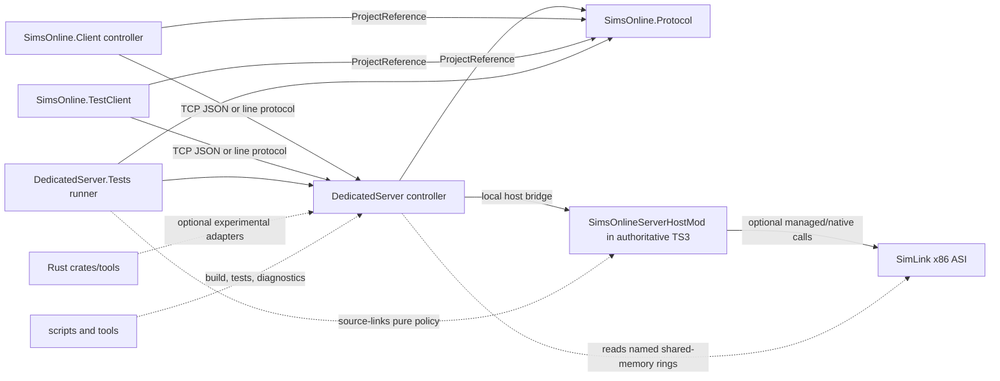

# Code reference: how to navigate the repository

This folder maps implementation ownership and gives a source-first path for contributors.
The most useful mental model is **one Sims 3 process is authoritative**: the server
controller issues commands to its host process and publishes state; connected clients
receive protocol events and present that state. A local game process on a client does not
make that client an independent simulation authority.

This split avoids two independently advancing engine worlds making contradictory decisions
about interaction queues, time, identity, and simulation state. The current source and the
original architecture rationale both describe a one-simulator boundary. Detail below is tied
to current source files, not a reconstruction of game internals.

## Start with the question you need to answer

| If you need to… | Start here | Then inspect |
|---|---|---|
| Trace process startup, save loading, and stop | [dedicated-server.md](dedicated-server.md) | `DedicatedServer/Program.cs`, `DedicatedServer/Authority/HeadlessSims3Host.cs` |
| Add/change a client command or event | [protocol-library.md](protocol-library.md) | `SimsOnline.Protocol/ClientCommand.cs`, `SimsOnline.Protocol/ServerEvent.cs` |
| Understand the host bridge | [dedicated-server.md](dedicated-server.md) | `DedicatedServer/HostBridge/HostBridgeServer.cs`, `SimsOnlineServerHostMod/BridgeCodec.cs` |
| Work on SimLink | [simlink.md](simlink.md) | `SimLink/CMakeLists.txt`, `SimsOnlineServerHostMod/SimLinkNative.cs` |
| Change hook/authority/presentation behavior | [server-host-mod.md](server-host-mod.md) | `SimsOnlineServerHostMod/ServerHostMain.cs`, `SimsOnlineServerHostMod/Handlers/HandlerSet.cs` |
| Follow client receive or mirroring | [client-and-test-client.md](client-and-test-client.md) | `SimsOnline.Client/Program.cs`, `SimsOnline.TestClient/Program.cs` |
| Find the right regression test or subset command | [tests-map.md](tests-map.md) | `DedicatedServer.Tests/Program.cs`, `scripts/dev.py` |
| Understand project references and build boundaries | [build-and-solution-layout.md](build-and-solution-layout.md) | `SimsOnline.sln`, project files, `Directory.Build.props` |

## Dependency and process map

The diagram separates a normal session from optional tooling. Solid arrows show visible
compile-time/runtime links; the dotted game boundary indicates separate processes.

The controller and host mod are separate programs with different runtime constraints. The
controller is a .NET 8 executable. The in-game mod is built for the game's older managed
runtime using its own PowerShell build scripts; it cannot inherit modern project settings.
`SimsOnline.Protocol` is the shared public data/codec assembly among controller, client,
test client, and tests.

## Repository map

This map covers source-bearing top-level directories, solution projects, and
runtime-boundary subfolders. Generated outputs and ignored local caches are not source
projects.

| Path | Kind | Purpose / boundary |
|---|---|---|
| `.github/` | CI / policy | Build and test workflows, release, ownership, contribution and issue templates. |
| `Assets/` | Public assets | Repository artwork and usage notes; not game content. |
| `DedicatedServer/` | .NET 8 executable | Controller entry point, authoritative session, bridge, TCP listener, mirroring policy, observability. |
| `DedicatedServer/Authority/` | Controller subsystem | Session orchestration and the `IAuthoritativeSimulationHost` adapter boundary. |
| `DedicatedServer/HostBridge/` | Controller subsystem | Bridge framing, shared-region layout, host snapshots, and SimLink readers. |
| `DedicatedServer/Mirroring/` | Controller subsystem | Event translation, client scope/policy, and presentation decisions. |
| `DedicatedServer/Network/` | Controller subsystem | Public TCP listener, bounded line intake, and queued outbound delivery. |
| `DedicatedServer/Observability/` | Controller subsystem | Sentry configuration, privacy filters, telemetry and traces. |
| `DedicatedServer.Tests/` | .NET test projects | Custom reflection test executable and a separate VSTest/NUnit sidecar test project. |
| `SimsOnline.Protocol/` | .NET class library | Public command/event DTOs, codecs, save transfer, and payload validation. |
| `SimsOnline.Client/` | .NET 8 executable | Client TCP controller, event receive queue, join/resume, mirror dispatch, local bridge. |
| `SimsOnline.TestClient/` | .NET 8 executable | CLI protocol client for join, snapshot, claim, interaction, and delta smoke tests. |
| `SimsOnlineServerHostMod/` | Game script-mod source | Host hooks, bridge codecs, snapshot/event recorders, authority/presentation filters and package scripts. No proprietary game implementation is included. |
| `SimsOnlineServerHostMod/Handlers/` | Mod handlers | Reflection-dispatched handler set for selected host operations. |
| `SimsOnlineServerHostMod/Presentation/` | Mod policies | Small modules for walks, inventory/use, moodlets, refusals, and join settling. |
| `SimLink/` | Native x86 plugin | C++17 ASI loaded into the game process; ring and optional native observation/patch modules. It is not a C# project. |
| `SimLink/src/` | Native sources | Ring, process attach, SACS and other native-side seams, self-test. |
| `rust/simlink_bridge/` | Rust library/CLI | Separately built process-memory bridge crate and `simlinkctl`; not the C++ ASI. |
| `rust/simlink_headless_server/` | Rust library/executable | Separate headless server crate depending on bridge and kernel crates. |
| `rust/sim96_kernel_cleanroom/` | Rust library/tools | Rust simulation-kernel work and command-line tools in an independent Cargo workspace. |
| `scenarios/` | Scenario fixtures | Structured integration/test inputs consumed by repository tooling. |
| `schemas/` | Data schemas | Schema definitions and fixtures for structured repository data. |
| `scripts/` | Developer commands/tests | Python and PowerShell build, bridge, test, diagnostic, and source-validation entry points. |
| `tools/` | Supporting utilities | Python packages and C# utilities for code generation, analysis, test helpers, and workflows. |
| `refs/sims3/` | Local compile inputs | Public checkout contains the README only; users must separately supply legally usable references. |
| `credentials/` | Local-only placeholder | Only `README.md` is tracked; ignored contents are local configuration and are not read by repository code. |
| `signing/` | Local-only placeholder | Only `README.md` is tracked; ignored contents are local signing material. README states releases are unsigned. |
| `docs/` | Public documentation | User-facing architecture, development, operations, protocol, and code-reference pages. |

## Runtime paths in order

### Server startup

1. `DedicatedServer/Program.cs` parses `SessionConfig.FromArgs(args)`, configures telemetry,
   and wires Ctrl+C and (outside Windows) SIGTERM into cancellation.
2. The program creates `HeadlessSims3Host` and `AuthoritativeSession`, applies feature
   switches, and starts host/session. Probe-only branches return before normal serving.
3. `HeadlessSims3Host` launches or attaches to a game process, connects `HostBridgeServer`,
   waits for bridge readiness, loads/reuses the world, and adapts bridge commands to
   `IAuthoritativeSimulationHost` operations.
4. The TCP listener accepts clients. `AuthoritativeSession.HandleCommandAsync` applies
   session/authority policy and asks the host adapter to execute engine work.
5. The host reports bridge events and snapshots. The session publishes resulting
   `ServerEvent` values through `ClientListenerServer`.

### Client join and update

1. A client connects over TCP. JSON mode exchanges serialized `ClientCommand`/`ServerEvent`
   objects; line mode starts with `HELLO`/`WELCOME` and then v1 frames.
2. `JoinSession` establishes session identity and capabilities. `RequestWorld` is a distinct
   early operation that checkpoints/transfers the server world before the local game loads.
3. Events enter `ReceiveQueue`, then `MirrorCoordinator` drains them on one owner loop.
   Snapshot deltas can be folded by whole Sim/object record; ordered gameplay events
   dispatch through the mirror path.
4. The client acknowledges applied snapshot ticks. Gaps or forced-full events use resync
   rather than parallel state mutation.

### Stop and persistence

`Program.Main` uses async-disposal ownership for telemetry and the host. Cancellation
requests a best-effort bridge disconnect and host cleanup. `SaveGame` and join-world
checkpointing go through the server host; `WorldSave` transfers files as ordered chunks. The
client `WorldSaveWriter` stages data under an `.incoming` folder and refuses to replace a
folder it did not mark as SimsOnline-written.

## Source-reading guide by concern

| Concern | Files to read together | Why |
|---|---|---|
| Startup/configuration | `DedicatedServer/Program.cs`, `DedicatedServer/SessionConfig.cs`, `DedicatedServer/RunStateFile.cs` | CLI parsing and feature selection are outside core session policy. |
| Session authority | `DedicatedServer/Authority/AuthoritativeSession.cs`, `IAuthoritativeSimulationHost.cs` | Session policy is independent of the process/bridge adapter. |
| Engine process lifecycle | `DedicatedServer/Authority/HeadlessSims3Host.cs`, `DedicatedServer/HostBridge/ProcessMemoryBridge.cs` | Launch/attach and bridge connection are distinct seams. |
| Bridge line protocol | `BridgeCommand.cs`, `BridgeLineCodec.cs`, `BridgeResponse.cs`, mod `BridgeCodec.cs` | Endpoints must agree on tags, escaping, correlation, and payload size. |
| Public TCP wire | `SimsOnline.Protocol/ClientCommand.cs`, `ServerEvent.cs`, `PublicProtocolCodec.cs`, `PublicLineCodecV1.cs` | DTO contract and transport codecs are separate concerns. |
| Snapshot flow | `DedicatedServer/HostBridge/Snapshot2BinaryReader.cs`, mod `Snapshot2Writer.cs`, `SimulationSnapshot.cs` | Host snapshot becomes typed public state. |
| Listener pressure | `BoundedLineReader.cs`, `ClientListenerServer.cs`, `OutboundDeliveryPump.cs` | Input bounds and delivery queue behavior are separate safety limits. |
| Client mirror | `SimsOnline.Client/ReceiveQueue.cs`, `MirrorCoordinator.cs`, `OrderCompletionReassert.cs` | Socket intake does not directly own mirror mutations. |
| Native boundary | `SimLink/src/sidecar.cpp`, mod `SimLinkNative.cs`, `SimLinkShadowReader.cs` | Native export, managed wrapper, and reader are three interfaces. |
| Reconciliation | `SimsOnline.Protocol/LotExport.cs`, `DedicatedServer/Mirroring/LotReconcile.cs`, `AuthoritativeSession.cs` | Validation, field policy, and session integration are separate steps. |

The .NET suite uses a custom case-name filter; `scripts/dev.py` is the CI-aligned Python
runner. Exact commands and feature-grouped cases are in [tests-map.md](tests-map.md).

For user-facing setup see [development](../development.md) and [testing](../testing.md). For
system behavior at a higher level see [architecture](../architecture.md),
[components](../components.md), and [protocol](../protocol.md).

## Deeper source map: server implementation

The directories below are intentional layers rather than arbitrary placement. This second
map is useful when the first target file references a policy helper or adapter you have not
seen before.

| Namespace area | Source file(s) | Follow-up question it helps answer |
|---|---|---|
| `Authority` | `AuthoritativeSession.cs` | Where are player commands accepted, rejected, and translated into server events? |
| `Authority` | `IAuthoritativeSimulationHost.cs` | Which operations must any host adapter implement? |
| `Authority` | `HeadlessSims3Host.cs` | How does the controller translate host work into bridge commands? |
| `Authority` | `JoinWorldReuse.cs`, `LastGoodSave.cs` | What state is retained or restored around a join/save cycle? |
| `Authority` | `ResyncPolicy.cs`, `WorldTimeReconcilePolicy.cs` | Which tick/time conditions trigger correction behavior? |
| `Authority` | `SyncBroadcaster.cs` | When does periodic public synchronization run? |
| `Authority` | `RustAuthoritySidecar.cs`, `RoadPlaceHop.cs`, `RoutePlanHop.cs` | Which optional Rust adapters are consulted, and which remain separate from normal protocol? |
| `HostBridge` | `HostBridgeServer.cs`, `BridgeCommand.cs` | How are commands correlated and replies completed? |
| `HostBridge` | `BridgeLineCodec.cs`, `BridgeResponse.cs` | What are the line grammar and response representation? |
| `HostBridge` | `BridgeSharedRegionLayout.cs`, `Snapshot2BinaryReader.cs` | What is the controller's shared-region and binary snapshot boundary? |
| `HostBridge` | `ProcessMemoryBridge.cs`, `NativeProcessMemory.cs` | How is the selected host process found and accessed? |
| `HostBridge` | `SimLinkShadowReader.cs`, `SimLinkShadowSession.cs`, `SimLinkClientShadowSession.cs` | How do optional shared-memory observations join the controller event flow? |
| `HostBridge` | `HouseholdExportTransport.cs` | How are larger export payloads transferred through bulk slots? |
| `Network` | `ClientListenerServer.cs` | How do accepted client connections reach session commands and receive events? |
| `Network` | `BoundedLineReader.cs`, `NonFiniteValues.cs` | Which input and serialization errors are handled before session dispatch? |
| `Network` | `OutboundDeliveryPump.cs`, `PresentationSentCounts.cs` | How are delivery outcomes counted and diagnosed? |
| `Network` | `BridgeAdminListener.cs` | Which loopback-only diagnostic interface is enabled separately from public TCP? |
| `Mirroring` | `MirrorEngine.cs`, `IMirrorHost.cs`, `LoggingMirrorHost.cs` | How are public events mapped to local mirror operations? |
| `Mirroring` | `EventToBridgeCommandTranslator.cs` | Which mirror events become host bridge commands? |
| `Mirroring` | `ClientAuthorityPolicy.cs`, `SimulationScopePolicy.cs` | Which Sims and operations are within a player's client authority boundary? |
| `Mirroring` | `MirroringInterestScope.cs`, `VisibleSimStatePolicy.cs`, `SimPresencePolicy.cs` | Which snapshot, state, and presence rows are interesting to a given client? |
| `Mirroring` | `MirrorEventFilter.cs`, `MirrorAutonomyController.cs` | Which events/autonomy actions are filtered before application? |
| `Mirroring` | `InteractionQueuedCoalescer.cs`, `InteractionReplayBundleParser.cs`, `InteractionReplayPolicyResolver.cs` | How are queued and replay interactions parsed or classified? |
| `Mirroring` | `LotLocalAuthorityMode.cs`, `LotReconcile.cs` | How are lot authority and field reconciliation represented? |
| `Observability` | `SentryConfigurator.cs`, `SentryPrivacyFilter.cs`, `SentryEnvironment.cs` | How are telemetry options and privacy-sensitive fields handled? |
| `Observability` | `SimsOnlineTelemetry*.cs`, `SentryReleaseInfo.cs`, `SentryReleaseResolver.cs`, `SentryTracesSampler.cs` | Which trace/events/context are emitted and how releases are identified? |

## Cross-project seams

When behavior crosses assemblies, trace both sides and the tests that pin the seam. These
relationships are explicit in project references or source-linked compilation items.

| Seam | Producer / source | Consumer / test boundary |
|---|---|---|
| Public commands/events | Protocol record hierarchy | Controller `HandleCommandAsync`; client `MirrorCoordinator`; wire pinning tests. |
| Client snapshots | Server `SimulationSnapshot` | Client receive queue and `MirrorEngine`; snapshot ACK travels back as `AckSnapshot`. |
| Host command | Controller `BridgeCommand` / `BridgeLineCodec` | Mod `BridgeCodec` and `ServerHostMain` dispatch table. |
| Snapshot2 | Mod `Snapshot2Writer` | Controller `Snapshot2BinaryReader`; parity/round-trip tests. |
| Shared ring | Native `simlink_layout.h` and ring | Controller `SimLinkShadowReader`; Windows integration tests. |
| Pure mod policy | Mod filter/gate source file | Source-linked compile in controller/tests; direct case-name filter. |
| Save transfer | Server `WorldSave.ToChunks` | Client `WorldSaveWriter`; world-fetch protocol tests. |
| Lot export | Protocol export records and validators | Session reconciliation policy and host `MERGE_LOT_STATE` adapter. |

## A disciplined trace through the code

For a new public feature, start at the serialized DTO or CLI entry rather than searching for
a similarly named helper across every folder. A command trace normally looks like this:

1. Define or locate the public `ClientCommand` record in
   `SimsOnline.Protocol/ClientCommand.cs`.
2. Follow its registration/encoding through `PublicProtocolCodec` or `PublicLineCodecV1`.
3. Find the listener's decode and authority gate in
   `DedicatedServer/Network/ClientListenerServer.cs`.
4. Follow `AuthoritativeSession.HandleCommandAsync` to find player ownership/role checks.
5. Follow the selected `IAuthoritativeSimulationHost` method into `HeadlessSims3Host`.
6. Track its `BridgeCommand`, line representation, response, and any host-side command
   handler.
7. Identify whether the result is a direct command reply, a broadcast event, a
   snapshot/delta, or a bridge-only diagnostic.
8. Find the smallest test case by name and run it using the test runner described in
   [tests-map.md](tests-map.md).

For an incoming state/event trace, start at the host event encoder and controller parser,
then find the corresponding `ServerEvent` type and the recipient filter. Only after that
should you inspect the client mirror path. This order distinguishes a host emission, a
controller acceptance, a public broadcast, and a local presentation action—four different
facts.

## Non-runtime project boundaries

The `SimsOnlineServerHostMod.Ide.csproj` is a navigation project, not the mod packaging
tool. `SimLink/` is native C++ and is not included in the .NET solution as a C# project. The
three Rust directories each define their own Cargo workspace; the .NET `ProjectReference`
graph does not build them. `scripts/`, `tools/`, `scenarios/`, and `schemas/` support
build/test/analysis workflows but are not one deployable application.

The `refs/sims3/` directory documents expected local compile inputs; the public checkout contains
no assembly binaries there. These files are ignored and the source guard now rejects binary
references in all paths. `credentials/` and `signing/` contain tracked README placeholders only; ignored
local files are not part of this source map. The documentation tour should remain useful
without access to any local game installation, secret, or generated output.

## Useful path aliases by implementation concern

| Concern label used in code | Files with the primary implementation |
|---|---|
| `public listener` | `DedicatedServer/Network/ClientListenerServer.cs` |
| `line-v1 wire` | `SimsOnline.Protocol/PublicLineCodecV1.cs` |
| `JSON wire` | `SimsOnline.Protocol/PublicProtocolCodec.cs` |
| `full/delta state` | `SimsOnline.Protocol/SimulationSnapshot.cs`, `DedicatedServer/Authority/AuthoritativeSession.cs` |
| `session ownership` | `DedicatedServer/Authority/AuthoritativeSession.cs`, `DedicatedServer/Mirroring/ClientAuthorityPolicy.cs` |
| `host command serialization` | `DedicatedServer/HostBridge/HostBridgeServer.cs` |
| `bridge command model` | `DedicatedServer/HostBridge/BridgeCommand.cs` |
| `host outbound queue` | `DedicatedServer/Network/OutboundDeliveryPump.cs` |
| `world save assembly` | `SimsOnline.Protocol/WorldSave.cs` |
| `client backlog` | `SimsOnline.Client/ReceiveQueue.cs` |
| `client drain owner` | `SimsOnline.Client/MirrorCoordinator.cs` |
| `local mirror translation` | `DedicatedServer/Mirroring/EventToBridgeCommandTranslator.cs`, `MirrorEngine.cs` |
| `presentation stream` | `DedicatedServer/Mirroring/PresentationStream.cs`, mod recorders and presentation modules |
| `lot reconcile` | `DedicatedServer/Mirroring/LotReconcile.cs`, `SimsOnline.Protocol/LotExport.cs` |
| `mod package` | `SimsOnlineServerHostMod/Sims3PackageBuilder.cs` and package scripts |
| `native shared memory` | `SimLink/src/simlink_layout.h`, `DedicatedServer/HostBridge/SimLinkShadowReader.cs` |
| `Rust sidecar adapter` | `DedicatedServer/Authority/RustAuthoritySidecar.cs`, Rust crate manifests/sources |
| `Python checks` | `scripts/dev.py` and matching `*_test.py` modules |

When a symbol has more than one implementation because a file is source-linked, use the
project reference and compile items in each `.csproj` to find which assembly owns the built
type. Namespace similarity is not enough to determine whether a file is linked, referenced,
or compiled twice.

## Documentation boundaries

This folder complements rather than replaces user-facing guides. The code tour names
implementation files and current public types; [architecture](../architecture.md) explains
the system model, [protocol](../protocol.md) provides the higher-level wire guide,
[testing](../testing.md) covers setup, and [server-cli](../server-cli.md) documents
operator-oriented commands. This index intentionally points to those existing references
rather than duplicating their setup steps.
