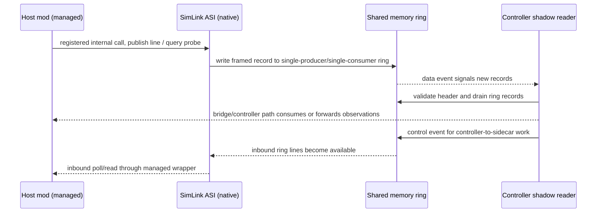

# SimLink sidecar and managed boundary

SimLink is the project's optional **native x86 C++ ASI plugin**, loaded into the Sims 3
process. It is not a standalone service and there is no C# project under `SimLink/`. The
managed boundary is in `SimsOnlineServerHostMod/SimLinkNative.cs`; the controller's
shared-memory reader is `DedicatedServer/HostBridge/SimLinkShadowReader.cs`. This
distinction is useful when tracing a failure: native export/patch, managed game hook,
controller IPC reader, and server feature switch are separate layers.

The native sidecar is optional. The main .NET controller/client can build without it.
SimLink-enabled functions require the expected 32-bit Windows process environment and a
locally installed, legally obtained game for live testing; game files and an ASI loader are
not shipped here.

## Project shape and platform constraints

`SimLink/CMakeLists.txt` is authoritative for the native target definition:

| Target / setting | Source / value | Effect |
|---|---|---|
| `SimLink` shared library | `sidecar.cpp`, `sacs_patch.cpp`, `gc_gate.cpp`, `free_ring.cpp`, `chunk_reserve.cpp`, `onscreen.cpp`, `gc_heap.cpp` | Outputs a shared library with `.asi` suffix. |
| `simlink_ring` static library | `ring.cpp` | Shared ring implementation used by plugin and self-test. |
| `simlink_selftest` executable | `selftest.cpp` | Exercises ring and helper logic without loading into the game. |
| C++ standard | C++17 | Required by the native sources. |
| Architecture check | `CMAKE_SIZEOF_VOID_P == 4` | Configuration fails unless building x86 / Win32. |
| Compiler options | `/W4 /EHa` | Warnings and structured-exception handling for the MSVC build. |
| Runtime library | static MSVC runtime selection | Set by `CMAKE_MSVC_RUNTIME_LIBRARY`. |

A quick source scan is not a substitute for matching the game process architecture: the
plugin is explicitly 32-bit. CI builds it with the repository script and runs its native
test path on Windows.

## Three-layer data path



This path separates high-frequency local observations from the controller's public TCP
protocol. `SimLinkShadowReader` reads a memory-mapped ring; it is not itself a public client
socket. The mod also retains the normal bridge path. The sidecar documentation and source
describe it as an optional transport/observation extension, not a replacement for the host
bridge.

## Shared-region contract

`SimLink/src/simlink_layout.h` defines the on-memory layout and comments explicitly require
the controller mirror to change with it and bump the layout version if the structure
changes.

| Field / region | Current value | Reader consequence |
|---|---:|---|
| Layout version | `1` | Controller refuses incompatible section layout. |
| Header size | `256` bytes | Ring data begins after fixed header. |
| Default ring size | `4u << 20` (4 MiB) | Power-of-two SPSC byte ring in v1. |
| Native version | `15` | Identifies the set of exported native calls/features. |
| Header magic | `SimLinkShadowReader` validates it | A mapped section with wrong magic is rejected. |
| Control event | `<section>.control` | Auto-reset notification from controller to sidecar. |
| Data event | `<section>.data` | Auto-reset notification from sidecar to controller. |
| Primary mapping | process-specific section | Sidecar creates the mapping and the controller opens it read/write. |
| Inbound mapping | primary name plus `.in` | Carries controller-to-game text records. |

A record is not simply “whatever bytes are available”: the ring has read/write positions and
record framing. The reader validates record size before advancing. A malformed record,
unsupported header/version, missing event, missing mapping, or inaccessible process fails
the SimLink reader path; controller code can then keep using its normal bridge route rather
than assuming the optional sidecar is alive.

`SimLinkShadowReader` has a `LayoutVersion` constant, reads layout and native versions at
documented header offsets, checks the magic/version on map, and exposes operations to signal
the control event, wait for data, and drain records. It can open a Win32-named mapping or
the NT object path used for a Sandboxie session. The latter is a platform/integration
concern, not a different wire format.

## Managed export layer

`SimsOnlineServerHostMod/SimLinkNative.cs` declares the managed native-call surface under
the mod namespace. `SimLink/src/sidecar.cpp` registers corresponding internal-call names
with Mono when the plugin loads. A managed feature first checks native version and probe
results; feature support is version-gated, so a newer wrapper does not blindly call an
absent native entry point.

The current version gates in the wrapper distinguish generations of functionality:

| Native version floor | Managed capability family (names from wrapper/source) |
|---:|---|
| 1 | Version/probe, publish, inbound poll/read, bridge note, array probe. |
| 2 | SACS seed read/write. |
| 3 | SACS switches, patch state, pick counters/words. |
| 4 | SACS order counters/words. |
| 5–6 | Random counters and random log records. |
| 7–8 | GC interval/counter and free-ring observation. |
| 9–10 | Additional gated native seams and chunk-reserve observation. |
| 12 | On-screen walk observation. |
| 13 | Walker read/write/carry observation. |
| 14 | GC heap counters/configuration. |
| 15 | Current reported native version. |

The native functions expose small scalar/string/array operations such as `Version`, `Probe`,
`Publish`, `InboundPoll`, `NoteBridge`, `InboundRead`, SACS seed/pick/order/random
accessors, walker accessors, and GC counters. This public description intentionally
describes interop names and behavior only; it does not reproduce game-engine implementation
details or native patch bytes.

`SimLinkNative` also tracks availability state, including native version, probe result,
enabled status, and bridge note counts, and emits a report string. A zero/negative version
or failed probe prevents feature activation. This is a safe failure mode: the managed code
can report the missing native capability instead of invoking a mismatched entry point.

## Native source map

| Source unit | Responsibility visible in repository |
|---|---|
| `src/sidecar.cpp` | ASI load, shared-memory sections/events, native-call registration, inbound/outbound ring operations, module startup. |
| `src/simlink_layout.h` | Shared header offsets, layout/native version, region sizes and names. |
| `src/ring.h`, `src/ring.cpp` | SPSC ring API and implementation. |
| `src/sacs_patch.h`, `src/sacs_patch.cpp` | Optional native patch gate and install boundary. |
| `src/sacs_random.h` | Random-observation interface declarations. |
| `src/free_ring.h`, `.cpp`, `_logic.h` | Free-ring observation/policy logic. |
| `src/chunk_reserve.h`, `.cpp`, `_logic.h` | Chunk-reserve feature gate and logic. |
| `src/gc_gate.h`, `.cpp`, `_logic.h` | GC gate feature and counters. |
| `src/gc_heap.h`, `.cpp`, `_logic.h` | GC heap configuration/counters; source validates patch preconditions before write. |
| `src/onscreen.h`, `.cpp`, `_logic.h` | On-screen state feature and counters. |
| `src/walker_copy_logic.h` | Walker-copy decision logic helpers. |
| `src/selftest.cpp` | Native ring/helper self-test executable. |

The `_logic.h` helpers are separate from the side-effecting translation units so small
policy decisions can be tested independently. The native self-test also creates in-memory
and named shared mappings to exercise the same ring layout without requiring an active game.

## Opt-in and failure controls

Many native modifications are gated rather than assumed active. Current source comments
document these examples:

* `SIMLINK_NOPATCH=1` or a `SimLink.nopatch` file beside the ASI is a kill switch for the
  native patch install path.
* `SIMLINK_CHUNKRESERVE=0` disables the chunk-reserve feature; its comment says it is on by
  default.
* `SIMLINK_ONSCREEN=0` disables the on-screen module; its comment says it is on by default.
* The free-ring and GC modules are described as opt-in.

Use the exact case/value semantics in the corresponding `.cpp` / `.h` source before changing
environment values. Several native paths are sensitive to build identity and exact binary
layout; a failed guard should be treated as “feature not installed,” not bypassed. The GC
heap logic, for example, has explicit expected-byte pins and validates allowed configured
ranges before applying its native operation.

Typical failure boundaries are:

| Symptom | Likely layer to inspect | Evidence to collect |
|---|---|---|
| Native version is zero | ASI did not load or native registration failed | `SimLinkNative` availability report and sidecar load/build logs. |
| Version is present but `Probe` fails | Wrapper/export ABI mismatch or incompatible process | Managed probe report and sidecar version; do not invoke dependent feature. |
| Mapping not found | Plugin not loaded, process/session mismatch, or sandbox object namespace | `SimLinkShadowReader.TryOpen` reason and process identity. |
| Header rejected | Layout/native mismatch or corrupt section | Magic, layout version, mapping size and sidecar build. |
| Invalid record size | Bad ring framing or inconsistent producer/consumer state | Reader error and current ring indices; avoid consuming past malformed record. |
| Native patch refuses to install | Guard mismatch or kill switch | Module-specific status/counter; leave patch disabled until version/pin is confirmed. |
| Data event is quiet | Optional feature not enabled or no records published | Feature gate, wrapper enabled status, and ring availability. |

## `SimLink` is not the Rust bridge

The repository also has Rust crates named `simlink_bridge` and `simlink_headless_server`.
They are separate build/workspace units under `rust/`:

* `simlink_bridge` contains Rust process-memory bridge code and a `simlinkctl` CLI. Its
  manifest has its own workspace and a Windows-only `windows-sys` dependency.
* `simlink_headless_server` is a Rust server crate that depends on `simlink_bridge` and the
  kernel crate.
* `SimLink/` is the C++17 x86 ASI. It is linked to a running game process and exports the
  managed internal-call surface.

The shared name does not imply they have the same artifact, ABI, or startup lifecycle. The
controller's `RustAuthoritySidecar` is another optional boundary; it should not be confused
with the native ASI or its shared-memory ring.

## Build and verification

The workflow builds the native sidecar on a Windows runner. The repository script is the
supported entry point; a CI-compatible command is:

```powershell
python scripts/sidecar.py build --generator "Visual Studio 18 2026"
```

The CMake project itself requires an x86 generator configuration. `simlink_selftest` tests
ring behavior. `DedicatedServer.Tests/SimLinkTests.cs` exercises managed-reader/native-ring
integration and includes platform-specific cases; Linux-only execution can skip Windows
mapping/native cases. The Windows CI path runs the SimLink-filtered custom tests with
`--fail-on-skip` so a skipped case is not mistaken for coverage. Python helpers are covered
by `scripts/sidecar_test.py` and `scripts/simlink_offline_gates_test.py`.

```powershell
dotnet run --project DedicatedServer.Tests/SimsOnline.DedicatedServer.Tests.csproj -- --filter SimLink
```

Use `--fail-on-skip` on a machine where the native artifact has actually been built. A
standalone .NET test run without the C++ build can validate some framing/reader logic, but
it does not prove that the ASI loads into the game process.

For the surrounding bridge lifecycle see [dedicated-server.md](dedicated-server.md), for the
mod's managed wrapper see [server-host-mod.md](server-host-mod.md), and for project-level
build constraints see [build-and-solution-layout.md](build-and-solution-layout.md). The
[testing guide](../testing.md) covers the repository-wide validation entry points.

## Managed/native call inventory

The wrapper and native registrar must agree on every call name and signature. The following
names are visible in `SimLinkNative.cs` and the registration table in
`SimLink/src/sidecar.cpp`; they are interop identifiers, not a description of game code.

| Call family | Registered entry names | Version floor indicated in `sidecar.cpp` |
|---|---|---:|
| Discovery / text ring | `Version`, `Probe`, `Publish`, `InboundPoll`, `NoteBridge`, `ProbeArray`, `InboundRead` | 1 |
| SACS seed state | `SacsReadSeed`, `SacsWriteSeeds` | 2 |
| Pick decisions | `SacsSetSwitches`, `SacsPatchState`, `SacsPickCount`, `SacsPickWord`, `SacsPickCounter` | 3 |
| Order decisions | `SacsOrderCount`, `SacsOrderWord`, `SacsOrderCounter` | 4 |
| Random observation | `SacsRandomCounter` | 5 |
| Random event log | `SacsRandomCount`, `SacsRandomWord` | 6 |
| GC gate | `SacsGcCounter`, `SacsGcInterval` | 7 |
| Free-ring observation | `SacsFreeRing` | 8 |
| Chunk reservation | `SacsChunkReserve` | 10 |
| On-screen state | `SacsOnScreen` | 12 |
| Walker state | `SacsWalkerRead`, `SacsWalkerWord`, `SacsWalkerWrite`, `SacsWalkerCarry`, `SacsWalkerCounter` | 13 |
| GC heap state | `SacsGcHeap` | 14 |

A native call returns a scalar status/value and communicates larger content through a
managed buffer or shared ring. `SimLinkNative`'s wrapper does not replace the ordinary
bridge: bridge notes and published lines coexist with the sidecar path. When adding an
entry, update the C# declaration and C++ Mono registration in the same change, then cover
the version gate and the unavailable-native behavior.

## Ring initialization and notification model

The native code creates the named section and notification events in the game process. The
controller opens the section and event handles; it does not create an alternate transport
protocol. The shared header includes magic/layout/native version and the ring state; a
layout change must be mirrored in `SimLinkShadowReader` and rejected cleanly by mismatched
readers.

The controller uses two synchronization directions:

| Direction | Notification | Meaning |
|---|---|---|
| Controller → sidecar | `.control` auto-reset event | The controller has work for the inbound ring / native consumer. |
| Sidecar → controller | `.data` auto-reset event | The sidecar has published data for the controller. |

The primary ring is for game-to-controller publication. A second mapping, named with `.in`,
is for controller-to-game data. Ring records are framed, not newline-delimited on the
shared-memory boundary. The controller drains and validates record sizes, then adapts
complete lines into the host bridge/session pipeline.

`SimLinkShadowReader.TryOpen` has a normal Win32 name path and a special NT object-manager
path for a boxed game process. Open/map failures are returned as diagnostic reasons; the
managed path does not assume all processes share one namespace. After mapping it validates
the layout header before exposing data. Disposal closes mapped view and handles.

## Feature gates as deployment behavior

The server controller defaults the public presentation stream on, while SimLink itself
remains optional. The mod wrapper's `Enabled` and `ClientEnabled` states derive from native
version and successful probe results. It also exposes native-version capability properties
so newer methods are only called when the loaded ASI reports the required version.

The C++ module comments document a mixture of defaults: patch install is guarded by a kill
switch, chunk-reserve and on-screen features have explicit environment toggles, and
free-ring/GC modules are opt-in. The modules report counters/state through the wrapper
rather than requiring a separate public network port.

A useful diagnostic decision tree is:

1. Confirm the game process is the expected x86 process and that the ASI was loaded.
2. Read the managed native version. A missing version means no usable registration.
3. Run the wrapper's probe before relying on a module-specific call.
4. Check the controller mapping-open reason and the shared layout version.
5. Confirm the expected data/control event and ring record activity.
6. Only then diagnose the bridge/session forwarding or client presentation layer.

This sequence stops a protocol-layer investigation from masking a process-architecture or
shared-memory mismatch. It also keeps the kill switch meaningful: a native guard refusal is
a feature-unavailable result, not a reason to bypass layout/version validation.
