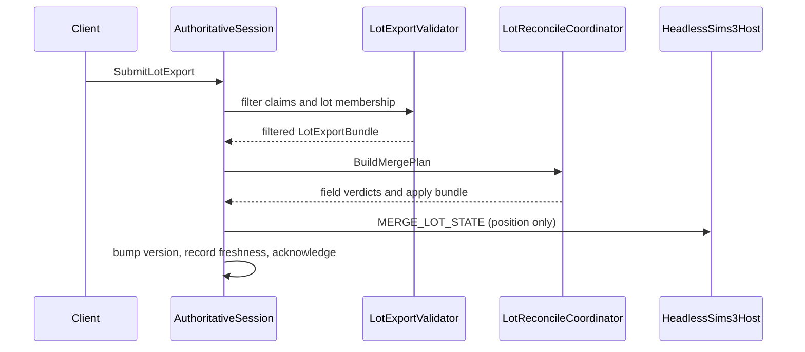

# Lot reconciliation

Lot reconciliation is a bounded attempt to carry selected client-native state back to the server before a checkpoint, authority-mode exit, or leave. The current, verified merge surface is position-only `MERGE_LOT_STATE`; the deep household `ImportContent` path is not a supported durable merge. This page documents the distinction so that “export accepted” is not mistaken for “all owned state is saved on the server.”

## Why reconciliation exists

When a client-native player Sim continues mutating a local game, the server's save can become stale relative to that client's state. Checkpointing only the server copy risks losing those client-side changes on reload. `LotReconcileSavePolicy` defines the checkpoint gate:

| Policy | Enum value | Behavior |
|---|---:|---|
| `RejectWhenUnreconciled` | 0 | Block checkpoint until each client-native player has a fresh merged export |
| `AllowWithDataLossRisk` | 1 | Permit checkpoint while explicitly accepting the data-loss risk |

The default is `RejectWhenUnreconciled`. `LotReconcilePolicy.ExportFreshnessWindow` is 30 seconds; `ExportRequestInterval` is 10 seconds. The client-native world can keep changing after an export, so a merge older than the freshness window no longer satisfies the save gate.

## Export model

`LotExportBundle` contains:

- `PlayerId` — session player submitting the export;
- `LotId` — declared active lot scope;
- `ClientTick` — client snapshot tick used as the export version/time;
- `Sims` — selected per-Sim data (`ObjectId`, `Position`, optional `CurrentInteractionKey`);
- optional `DeepExport` — household property stream and table payload, presently quarantined from deep apply.

The client-side `LotExportBuilder.BuildFromSnapshot` selects only the player's owned Sims. It uses the supplied active lot when available; otherwise it finds a lot from the first owned Sim with a `LotId`. Owned Sims on other lots are excluded. If there are no owned Sims, no snapshot Sims, no resolvable lot, or no included Sim rows, it returns null.

`LotExportValidator.FilterToOwnedLot` independently applies server-side checks. It discards every Sim not claimed by the submitting player. When the known snapshot index is nonempty, it also discards a Sim if that Sim is absent from the index, has no known lot, or is not on the bundle's declared lot. An empty index is treated as bootstrap and accepts claimed Sims on the declared lot because the first snapshot may not have arrived yet.

This is a defense-in-depth boundary: client construction is not trusted as authorization.

## Merge pipeline and effective current behavior

The broad pipeline in `AuthoritativeSession` is:



The implementation currently tracks seven export classes in `LotReconcileFieldKind`: `SimDescription`, `Relationships`, `Inventory`, `Funds`, `Objects`, `Opportunities`, and `Rewards`. But only `Objects` (position) has an active `MERGE_LOT_STATE` apply. The other six can be classified in the plan but are not deep-imported by that command. Comments in `LotReconcileCoordinator.BuildMergePlan` state this explicitly.

`LotReconcilePlan` records `PlayerId`, `LotId`, client and server versions, per-field results, the filtered bundle, and `VersionMismatch`. `LotReconcileFieldVerdict` is `NoConflict`, `ClientWins`, `ServerWins`, or `Contested`.

## Conflict classification

`LotReconcileFieldTickMap` records last server mutation and last reconciled tick for a `(PlayerId, LotId, Field)` key. `LotReconcileTracker` records a monotonic version per `(player, lot)`. Each accepted merge advances that version; `LotReconcileAcknowledged` returns it so the client can send it in `SubmitLotExport.ClientLastReconciledVersion` next time.

For each field, `ClassifyField` compares client export time and server mutation time against the last-reconciled tick:

| Client mutated since baseline | Server mutated since baseline | Version situation | Verdict |
|---:|---:|---|---|
| no | no | versions current | `NoConflict` |
| yes | no | any supported state | `ClientWins` |
| no | yes | any supported state | `ServerWins` |
| yes | yes | both changed after baseline | `Contested` |

For positions, a `ServerWins` verdict calls `DropAllSims`: the plan's apply bundle preserves `PlayerId`, `LotId`, and tick, but its `Sims` list is empty. This avoids applying an old client position over a server-only movement. The other field verdicts do not currently filter the bundle because the deep import path is not active.

The code compares `clientVersion < serverVersion` to set `VersionMismatch`. The mismatch is not itself proof of a conflict; mutation ticks determine which side changed. It supplies context for classifying a client that did not acknowledge a prior server version.

## Freshness and request debounce

`LotReconcileTracker.IsReconciledForCheckpoint` returns true only when the player's latest entry is marked merged and its receive time is within the provided freshness window. `ShouldRequestExport` returns false when a fresh merged export exists or a request was sent within the request interval. Otherwise it stamps the request time and adds the player to the outstanding-request set.

A simplified timeline:

| Time | Action | Checkpoint state |
|---:|---|---|
| `t0` | No valid merged export | Request may be sent |
| `t0 + 1s` | Request already outstanding/recent | Debounce suppresses repeat |
| Export merged | Entry marked merged, version bumped | Fresh until expiry |
| `t0 + 30s + 1s` | Prior merge is stale | Checkpoint gate reopens; new request may be sent |

`ConsumeOutstandingExportRequest` distinguishes a client response to a server-requested deep export from an unsolicited legacy submission. `Clear(playerId)` removes pending export, request debounce/outstanding state, per-lot versions, and relationship snapshots when a player leaves.

## Deep state remains quarantined

`HouseholdExportPayload` is transportable and its bytes are validated, but `LotExportBundle.DeepExport` is explicitly marked as quarantined until there is an engine-supported cold-reload-safe lifecycle. In particular:

- an accepted payload is not equivalent to an applied payload;
- a bridge import handler existing does not mean session policy permits it for production reconciliation;
- the current confirmed merge applies positions, not relationships, funds, inventory, opportunities, rewards, or full Sim descriptions;
- a deep merge must preserve existing actor and descriptor identity through a supported lifecycle;
- correctness requires save, cold load, and repeated-cycle validation, not just inspecting live memory.

The historical engine note described how a stock travel-return path imports into a fresh household then merges selected data into existing Sim descriptions. That analysis informs safety but does not make the stock path callable through this public controller.

## Worked example

Suppose player 7 owns Sim `500` on lot `300`, and client position tick is 500. The controller's last reconciled tick for the position field is 450. If the server has no later position mutation, the client position classifies `ClientWins`, and `MERGE_LOT_STATE` can apply the position. If the server mutation tick is 480, both sides changed since 450, so it is `Contested`; the position conflict policy chooses the owned lot's client value. If server mutation tick is 520 while client export is still 500, the server is newer; the plan strips the Sim from the apply set.

This example describes `BuildMergePlan` behavior; it does not imply the six non-position fields are imported.

## Save gate and response behavior

`AuthoritativeSession` checks active client-native players before accepting a save request. It can issue `LotExportRequested` with reasons such as `checkpoint_freshness` and require that an export be merged recently. If policy is explicitly configured to allow risk, the checkpoint can proceed without that guarantee; logs should not present that as a successful reconciliation.

The public event `LotReconcileAcknowledged(PlayerId, LotId, Version)` is the response the client can use to update its last-reconciled version. `LotExportRequested(PlayerId, LotId, Reason)` is a request event. These event shapes are declared in `SimsOnline.Protocol/ServerEvent.cs`; the command is `ClientCommand.SubmitLotExport`.

## Tests and source map

`DedicatedServer.Tests/Program.cs` includes tests for:

- `ReconcileSave.SucceedsAfterLotExportMerged`
- `LotReconcile.MonotonicVersionIncrementsPerAcceptedMerge`
- `LotReconcile.ConflictDetectionClassifiesContestedFieldViaLastMutatedTick`
- `LotReconcile.ServerWinsDropsSimFromApplyBundle`
- `LotReconcile.ClearDoesNotMutateDuringEnumeration`
- `PublicProtocolCodec.RoundTripsSubmitLotExport`
- `PublicProtocolCodec.RoundTripsLotExportRequested`

`DedicatedServer.Tests/ProtocolHardeningTests.cs` includes `AuthoritativeSession.RejectsLotExportWithoutClientNativeModes`. `SimsOnline.Protocol/LotExport.cs` owns payload records and validation; `DedicatedServer/Mirroring/LotReconcile.cs` owns filtering, tick/version tracking and plan construction; `DedicatedServer/Authority/AuthoritativeSession.cs` coordinates commands and save gating.

Tests exercise controller policy and synthetic host calls. They do not prove the live Sims 3 `MERGE_LOT_STATE` behavior nor the semantic durability of a deep `Household.ImportContent` operation.

## Related pages

- [Household export and import](household-export-import.md)
- [Inventory persistence](inventory-persistence.md)
- [Save/load pipeline](save-load-pipeline.md)
- [Protocol](../protocol.md)

## Bundle filtering examples

Assume player 9 claims Sims 100 and 101 on lot 40, and submits a bundle that also includes Sim 202 from lot 41. The client builder should have excluded 202, but the server validator still removes it. If Sim 101 is no longer claimed when the export arrives, it is removed too. The accepted bundle contains only claimed Sims on the declared lot.

If the active snapshot index has not arrived yet, the validator treats it as bootstrap and checks claims plus declared lot. This avoids rejecting the first valid export merely because snapshot discovery is still in flight. Once the index is populated, unknown Sim IDs and wrong-lot rows are rejected by filtering.

Filtering is not a denial response for the entire bundle in every case: the accepted result can be a narrower bundle. Emptying the bundle can then make merge a no-op. Tests should pin whether the controller rejects or filters each class of malformed input.

## Version acknowledgement flow

The client includes `ClientLastReconciledVersion` in `SubmitLotExport`. On an accepted merge, the tracker bumps the version for that `(player, lot)` pair and emits `LotReconcileAcknowledged`. The next client export echoes that version. This is a per-player/per-lot sequence, not a global world version.

```text
Initial client version 0 -> accepted merge -> server version 1 / ack 1
Next export echoes 1 -> accepted merge -> server version 2 / ack 2
Old client echoes 0 after server advanced -> version mismatch recorded and plan compares field ticks
```

Version mismatch provides evidence that the client did not acknowledge a prior merge; it does not by itself determine which value wins. `LotReconcileFieldTickMap` and the last reconciled baseline drive the field conflict classification.

## Debounce and freshness are separate clocks

Freshness asks how recently a merge happened; debounce asks how recently the server requested another export. A 10-second debounce prevents repeated request pressure, while the 30-second freshness window determines whether a checkpoint may proceed. An outstanding request does not magically make an old export fresh.

When an export request is outstanding, an arriving submission can be classified as the response to that request. An unsolicited submission can still be processed according to session policy, but it does not automatically prove the required request/acknowledgement handshake occurred.

| State | Request decision | Save decision |
|---|---|---|
| No merge, no recent request | Send request | Block under default policy |
| Recent outstanding request | Debounce request | Still block until merge |
| Fresh merged export | No request needed | Permit default checkpoint gate |
| Expired merged export | Request again after debounce permits | Block until fresh merge |
| Risk-accepting policy | Requests may still be useful | Save may proceed with explicit risk |

## Why only positions apply today

The `LotExportBundle` includes a list of Sim rows with positions and interaction keys. Current `MERGE_LOT_STATE` serialization is position-oriented: it constructs actor/position pairs for the selected Sim rows. Other `LotReconcileFieldKind` values are presently policy/classification metadata; they are not serialized into the active merge line as a complete domain-state patch.

This avoids a misleading implementation where a reconciliation plan says “client wins” for inventory or funds but the host receives no safe representation for those values. To expand the merge surface, each field needs a proven data contract, identity policy, conflict rule, bridge transport, host-side apply lifecycle and cold-load validation.

A successful position merge therefore says only that the selected owned Sims' positions were applied to the server game and recorded as fresh under the tracker. It does not prove a household export, inventory or relationship merge happened.

## Review checklist before widening reconciliation

For each candidate field, answer these questions in code and tests:

1. Which source process is allowed to author it?
2. How is ownership determined on the server?
3. What baseline version/tick is compared?
4. What is the conflict policy when both sides changed?
5. Is the value self-contained, or does it reference objects that require remapping?
6. Can the host apply it without corrupting live actor state?
7. Is the operation idempotent on retry?
8. Does an acknowledgement identify exactly what was merged?
9. Does a native save and cold load preserve the merged result?
10. Does a second load cycle preserve it again?

If any answer is unknown, the field should remain excluded or explicitly quarantined rather than being implied by the existence of an enum value.

## Export timing and mutation windows

Freshness is measured when the session accepts/merges the export, not by comparing two wall clocks. `ClientTick` is a client simulation tick used in field comparisons; `DateTimeOffset` in the tracker records when the server observed the export for freshness. These time domains answer different questions and should not be substituted for one another.

A client can change again immediately after export. The 30-second gate bounds the divergence window but cannot prove a stable world at the instant of save. If strict consistency is required, the controller must coordinate a freeze/quiescence protocol or take the save at an explicit stable point. The current policy uses freshness as a pragmatic bound, not a transaction lock across two Sims runtimes.

## Acknowledgement interpretation

An acknowledgement says the controller accepted a particular lot export and advanced its reconciliation version. It is not an acknowledgement that all fields in the submitted bundle were applied. Logs and UI should report merged field scope when it is available; at present the safe claim is the position-oriented merge described above.
