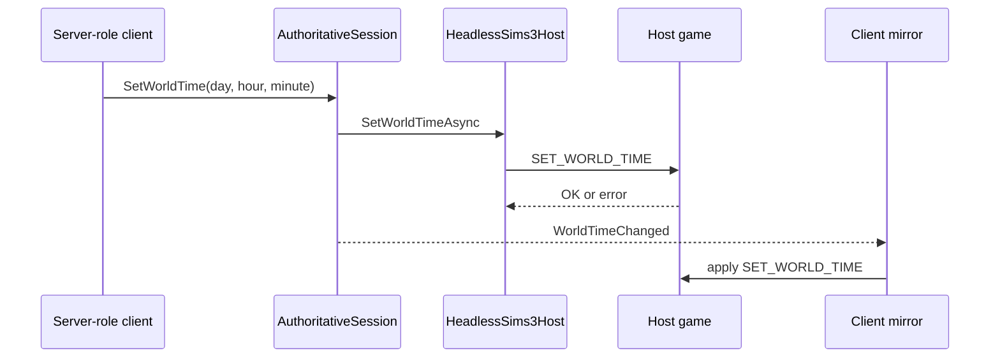

# World clock synchronization

The public clock command carries a day of week, hour, and minute. The server session is the authority; the in-game host applies the value through `SET_WORLD_TIME`, and the session publishes `WorldTimeChanged` so mirror clients can apply the same time. This is a clock state update, not a save or a change to `GameSpeed`.

## Public flow

`ClientCommand.SetWorldTime` represents a player's request. `AuthoritativeSession` validates the player and server role, stores the accepted `WorldTime`, broadcasts `ServerEvent.WorldTimeChanged`, and includes the known value when a client joins after the first clock set. The host bridge command is `BridgeCommand.SetWorldTime`; `HeadlessSims3Host` sends it and `ServerHostMain.HandleSetWorldTime` applies it to the game.



Relevant source types are `ClientCommand.SetWorldTime`, `ServerEvent.WorldTimeChanged`, `BridgeCommand.SetWorldTime`, and `WorldClockSet`.

## Accepted range and bridge fields

The bridge line is represented as `SET_WORLD_TIME|<correlation>|<day>|<hours>|<minutes>`. `ServerHostMain.HandleSetWorldTime` requires all three values, requires the game to be in-world, parses invariant-culture integers, and rejects out-of-range values.

| Field | Accepted values |
|---|---|
| `day` | `0..6`, Sunday through Saturday |
| `hours` | `0..23` |
| `minutes` | `0..59` |

Example bridge payload:

```text
SET_WORLD_TIME|<correlation-id>|3|16|30
```

Here `3|16|30` means Wednesday at 16:30 under the command's day numbering. The correlation value is supplied by the bridge caller; the example is not an executable shell command.

## Why the clock moves by a delta

`WorldClockSet.DeltaTicks` converts current ticks to a minute-of-week, computes the target minute, then chooses the shortest signed movement within half a week. `TicksPerTwoMinutes` is `75`, corresponding to the engine's 37.5 ticks per minute. If the current clock already displays the requested minute, the method returns zero and the handler skips changing `SimClock.StartTime`.

This avoids a week-zero reset when calling the game's absolute setter and avoids repeatedly stepping a client backward when it is only a few seconds ahead of a server value that is carried at minute precision. A nonzero result adjusts `SimClock.StartTime` by the computed delta and refreshes the UI clock alarms/caption through `RefreshUiClocks`.

| Current display vs target | Delta policy |
|---|---|
| Same displayed minute | No change; count as skipped |
| Forward difference at most half-week | Move forward |
| Backward difference shorter than forward path | Move backward |
| Exactly half a week | Current code's `>` comparison keeps the positive direction |

The wire value carries no week number. The nearest-week rule assumes server and client are already in the same week, which is normally true when the client loads the server's checkpoint. It cannot express an arbitrary multi-week jump.

## Distinguish clock from speed

`SetGameSpeed` and `SetWorldTime` are separate commands. Speed controls pause/normal/fast simulation behavior; clock synchronization sets the displayed calendar position. Do not infer that a paused world clock and a paused simulation are the same state, or that sending a clock update changes speed.

## Failure behavior and limits

- A request before world load is rejected by the host bridge.
- Day/hour/minute values outside the listed ranges return an error.
- A malformed integer may fail parsing rather than being normalized.
- A no-op target minute returns success without changing `StartTime`.
- Private engine UI members can be absent; `RefreshUiClocks` catches lookup failures and uses `-1` for unavailable diagnostic timing, without changing the synchronization contract.
- Because alarms are tied to simulation time, jumps can affect due alarms. Avoid treating the clock operation as cosmetic-only when testing game behavior.
- The wire cannot communicate a week number or arbitrary absolute tick value.

## Verification

The deterministic arithmetic is in `SimsOnlineServerHostMod/WorldClockSet.cs`. Protocol and session tests are in `DedicatedServer.Tests/Program.cs`, including `AuthoritativeSession.SetWorldTimeRejectsClientRole`, `EventToBridgeCommandTranslator.WorldTimeChangedEmitsSetWorldTime`, and `MirrorEngine.WorldTimeChangedDispatchesSetWorldTimeToHost`. `DedicatedServer.Tests/WireJsonPinningTests.cs` includes the public `set_world_time` command shape. These tests do not establish that every in-game alarm or UI element behaves identically after a live clock jump.

Related: [Persistence overview](overview.md), [Protocol](../protocol.md), [Testing](../testing.md), [Troubleshooting](../troubleshooting.md).

## Arithmetic and boundaries in `WorldClockSet`

`WorldClockSet` is deliberately a small pure arithmetic helper. It has no Sims 3 engine types and is also compiled into the .NET test project. The conversion uses integer arithmetic to avoid floating-point rounding around half-minute boundaries:

| Constant | Value | Role |
|---|---:|---|
| `TicksPerTwoMinutes` | 75 | The exact integer numerator for two game minutes |
| `MinutesPerDay` | 1,440 | 24 × 60 |
| `MinutesPerWeek` | 10,080 | 7 × 1,440 |

`DeltaTicks(currentTicks, day, hours, minutes)` computes the current minute as `(currentTicks * 2) / 75`, reduces it modulo the week, computes target minute-of-week, normalizes the difference to `0..10,079`, then subtracts a week when that difference is greater than 5,040. A same-minute request returns zero. The result is `MinuteStartTicks(currentMinute + move) - currentTicks`, not simply `move * 37.5`, because odd-minute boundaries alternate between half ticks.

Example arithmetic in concept:

```text
current display: Monday 08:10
requested:       Monday 08:10
move:            0 minutes
DeltaTicks:      0; handler returns OK without writing StartTime
```

For an actual change, `ServerHostMain.HandleSetWorldTime` assigns `new DateAndTime(SimClock.StartTime.Ticks + delta)`, increments its set counter, stores the signed delta for diagnostics, refreshes UI alarms, and replies `OK`.

## Why a no-op matters

The public command has minute granularity. If the server publishes 08:10 while a client reads 08:10:20, setting that client back to the start of the minute on every reconcile would create repeated small clock jumps. `DeltaTicks` returns zero for the already-displayed minute, intentionally allowing those seconds of difference instead of repeatedly rewinding.

The shortest-week policy also avoids forcing the local save's absolute week to week zero. It is an assumption, not a globally absolute timestamp: the request has no week index. If a client loads a different calendar week than the server, the command cannot express which week was intended.

## Game clock versus wall clock

The engine clock uses simulation ticks rather than the system wall clock. The public implementation reflects that distinction: `WorldClockSet` deals only in engine ticks and calendar minutes; `AuthoritativeSession` sends `WorldTime` values; it does not transmit a UTC timestamp. A host/server system clock change is not a world-time update.

`GameSpeed` is another orthogonal value. `ClientCommand.SetGameSpeed` updates simulation speed; `SetWorldTime` updates calendar time. A paused game may not advance its simulation clock, and a time set does not itself unpause it.

## Alarm and UI consequences

Alarm schedules are game-time state. A forward jump can make one or more due alarms eligible on a subsequent simulation update; a backward jump can delay alarms whose absolute due dates are now farther away. The exact native alarm scheduling implementation is not shipped in this repository, so avoid promising how every game alarm handles a jump. The mod does explicitly refresh the UI clock after a successful set: it computes the next minute start using `MinuteStartTicks`, adjusts the HUD's `mUpdateClockAlarm` when that field is available, and calls the minute-change repaint path. Reflection failures are caught, and the clock command can still be accepted if a UI member is missing.

The diagnostic helper `HudClockDueMinutes` returns `-1` when the HUD or reflected alarm field cannot be read. A negative value is not a clock-time sentinel; it is “UI diagnostic unavailable.” The host also counts moved sets and skipped same-minute requests in `DIAG_STATE` output.

## Session authorization and ordering

The session accepts `SetWorldTime` only for a joined server-role player. The resulting `WorldTimeChanged` event is global rather than actor-scoped, so `MirrorEventFilter` must not discard it based on a client-owned Sim. On a new join, the session replays its current known time along with the join state. This prevents a late joiner from keeping only the clock value from the save it loaded.

A robust test sequence is:

1. Join a player with server role.
2. Submit a valid day/hour/minute and assert `WorldTimeChanged` is emitted.
3. Assert the bridge translator creates `BridgeCommand.SetWorldTime` with the same `WorldTime`.
4. Submit the same value again after the producer already reads that minute and expect the game-side helper to compute a no-op.
5. Join a second client and assert the stored clock is included in join replay.
6. Attempt the command as a client-role player and assert rejection.

Existing code-level tests cover steps 2, 3, 5 and 6; only a live Sims 3 process can validate step 4 against the UI and game alarms.

## Test names and sources

`DedicatedServer.Tests/Program.cs` includes the world-time session and translator tests. `DedicatedServer.Tests/WireJsonPinningTests.cs` pins the public `set_world_time` JSON payload. `SimsOnlineServerHostMod/WorldClockSet.cs` is the arithmetic source; `SimsOnlineServerHostMod/ServerHostMain.cs` is the actual game bridge handler; `DedicatedServer/Authority/AuthoritativeSession.cs` owns session authority and join replay.

`WorldTimeReconcilePolicy` is a separate mirror cadence policy in `DedicatedServer/Authority/WorldTimeReconcilePolicy.cs`. Do not infer its cadence from `WorldClockSet`; one computes a target delta, the other decides whether another server-to-client correction is necessary.

## Boundaries for user-facing examples

The JSON below describes a public command, with the identifier abbreviated for readability:

```json
{
  "$type": "set_world_time",
  "commandId": "<command-guid>",
  "playerId": 1,
  "time": { "day": 3, "hour": 16, "minute": 30 }
}
```

The actual property spellings and enum serialization are pinned in `WireJsonPinningTests.cs`. Bridge examples should use the bridge codec rather than hand-assembling unescaped text in production code. `BridgeLineCodec` owns the command serialization and correlation token.


## Clock tests and boundaries

The `WorldClockSet` command converts a target day/hour/minute into the engine tick coordinate. The contract accepts day `0..6`, hour `0..23`, and minute `0..59`. A timestamp outside those ranges is rejected before the host write. The target is compared with the current week-relative simulation time, and the shortest valid week-relative adjustment is selected.

The conversion uses 75 simulation ticks per two minutes. This constant is specific to the game's clock representation; it is not a general “75 ticks per minute” unit. Keep conversion arithmetic in one place to avoid inconsistent rounding among the controller, protocol and host mod.

When the requested time equals the current target minute, the handler skips an unnecessary write. This matters because a no-op clock change can still trigger downstream UI/state callbacks if it is pushed into the game unconditionally.

## Week wrap example

Suppose the current time is late on day 6 and the target is shortly after midnight on day 0. A naive absolute comparison says the target is far in the past; the week-relative comparison sees a small forward distance across the boundary. Conversely, if the shortest direction is backward, the policy uses the minimal relative change rather than advancing almost an entire week.

The accepted clock is authoritative server state. A client's wall clock, operating-system timezone, or local game pause is not a substitute for server simulation time. Events carry the server's logical day/hour/minute values; consumers should not derive calendar state from network arrival time.

## Clock versus game speed

Clock changes and speed changes are separate events. `GameSpeedChanged` says the accepted simulation speed; `WorldTimeChanged` says the authoritative calendar position. A modal dialog pause on a client must not be sent as global speed intent. A save/load cycle may initialize time from the native save and then receive the session's authoritative clock event.

| Reported issue | Check |
|---|---|
| Clock moves but animation state does not | Clock event doesn't replay animation operations |
| Client paused while server advances | Local modal/dialog or client speed-intent path |
| Day appears offset by one | Day range/index convention and UI formatting |
| Time jumps near week boundary | Week-relative conversion and tick rounding |
| Same timestamp causes repeated writes | No-op detection in `WorldClockSet` handler |
| Restart resets time | Native save clock and post-load authoritative event order |

## Tests and source map

Tests validate accepted/rejected ranges, week-relative direction and same-minute no-op behavior. `WorldTimeReconcilePolicy` defines session reconciliation; `AuthoritativeSession` routes the command and broadcasts `WorldTimeChanged`; the host bridge codec formats the bridge event; `ServerHostMain` applies it to the game clock.

The tests can prove conversion and session policy. They cannot establish that the game's UI visibly updates at the intended point in a live lifecycle; for that, compare the local calendar/time UI after the bridge response and inspect the server's next clock observation.

## Clock synchronization test matrix

A robust test set should exercise both input validation and event/application behavior:

| Case | Expected contract |
|---|---|
| Day `0`, time `00:00` | Accepted boundary |
| Day `6`, time `23:59` | Accepted boundary |
| Day `-1` or `7` | Rejected before host call |
| Hour `-1` or `24` | Rejected before host call |
| Minute `-1` or `60` | Rejected before host call |
| Target equals current minute | No redundant set operation |
| Near week wrap | Shortest week-relative adjustment |
| Duplicate clock event | Does not change unrelated speed/ownership state |
| New client joins | Current server clock is delivered in join history |
| Client sends local pause | Not translated as authoritative clock or speed unless explicit intent policy says so |

When testing week wrap, use controlled values near midnight and day-6/day-0 boundary. Avoid relying on wall-clock time in tests; simulation time should be injected or fixed for deterministic assertions.

## Precision and presentation

The game's internal tick coordinate has finer granularity than the public minute fields. The public time event represents a calendar minute. Rounding from ticks to minutes can make two internal ticks display as the same minute; a no-op comparison at minute precision is correct for that public contract. Do not promise sub-minute synchronization from the `WorldTimeChanged` event.

The client should render the same logical day/hour/minute irrespective of its local machine timezone. Formatting may differ by locale (12-hour versus 24-hour display), but the underlying calendar values should match. Tests should compare values, not localized display strings.

## Save and clock interaction

Native save files carry their own world time. On a fresh load, the controller and game may briefly have different observed times until the authoritative session event applies. A write to the client clock is a presentation/state correction, not a save operation. If the server is checkpointing, the checkpoint's time is determined by the authoritative game at save time; the client mirror should not write its local clock back as a competing save source.

If time resets after reconnect, inspect join ordering: host save load, initial snapshot/time event, and later clock broadcasts. If it resets only after a cold load, inspect the native checkpoint and not the client snapshot delta.

## Event ownership and replay

`WorldTimeChanged` is authoritative session state and is replayed to a joining client as part of the join baseline/history path. A newly connected client should not infer that the first snapshot timestamp is the latest world time if the event stream carries an explicit clock value. Conversely, an event that arrives before the local save finishes loading may need to be held or applied after readiness; event ordering is part of startup correctness.

For diagnostics, record both the accepted server time and client-applied time as day/hour/minute values. Do not compare local OS timestamps, timezone offsets or log wall-clock stamps as if they were simulation time.

## Week boundary arithmetic fixtures

Use explicit integer examples in tests. If the current coordinate is the final minute of day 6 and the target is minute 1 of day 0, the shortest route across the boundary is two minutes, not nearly seven days. If the current point is minute 1 of day 0 and target is the final minute of day 6, the shortest adjustment may be backward by two minutes. These examples catch absolute-day arithmetic that ignores weekly wrap.

The implementation's tick conversion has a known granularity. Test exact representable boundaries and values where division rounds; do not assume every integer minute maps to an arbitrary tick without rounding. The protocol is a calendar-time contract, not a raw-tick API.

## Clock ownership during join

A joining client can receive initial world state and a clock event in close succession. The server should include the current authoritative time in the join baseline/history path so that the local game does not remain at a stale save time. If the client host loads after the clock event, the event may be applied too early; the current startup sequence loads the world before beginning normal public event dispatch.

After reconnect, compare the event sequence and local clock readback. A repeated clock event is safe to apply if it is the current server time; it should not be interpreted as a player changing speed or as a save request.

## Save gate example matrix

| Fresh merged export? | Policy | Result |
|---:|---|---|
| Yes | `RejectWhenUnreconciled` | Checkpoint can proceed |
| No | `RejectWhenUnreconciled` | Request export and reject/defer checkpoint |
| Stale | `RejectWhenUnreconciled` | Treat as unreconciled and request again when debounce allows |
| No | `AllowWithDataLossRisk` | Checkpoint may proceed with explicit risk |

This matrix concerns lot reconciliation before save, not household deep import. Keep the two separate in operator messaging.

## Time event audit checklist

When changing the clock path, verify DTO schema, JSON pinning, session range validation, host conversion constants, same-minute no-op, join-history replay, client bridge application and normal live broadcast. Confirm that game speed is not modified and that local wall-clock timezone is not used as an input.
