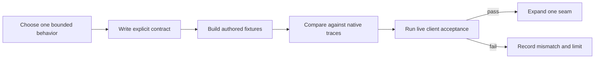

# Clean-room server feasibility

## Question

Could the game-backed server be replaced by an independently implemented
simulation kernel, while the original game remains the client renderer? The
study separated this from the immediate multiplayer question. Keeping one
simulator in the existing game and replacing that simulator are different
product choices.

## Findings

The familiar precedent of reimplementing a game engine is not directly
transferable. Some games expose most behavior as portable data interpreted by
a small virtual machine. Sims 3 gameplay instead relies heavily on compiled
managed interaction classes and native runtime services. Its tunable data can
parameterize behavior, but it does not contain all the behavior needed to
execute interactions.

The native engine also drives managed gameplay through callbacks and internal
services. Rehosting managed assemblies without their native execution
environment would not be a thin compatibility shim. Routing is a particularly
difficult boundary: the game does not expose a complete portable navigation
graph as ordinary save data, and a replacement planner can disagree with what
the client game considers traversable.

## What a clean-room kernel can still provide

| Potential responsibility | Why it is a plausible seam | Remaining concern |
|---|---|---|
| Session and claim authority | Explicit state machine and testable ownership | Must preserve command, reconnect and lease semantics. |
| Public protocol and server front door | Ordinary process/network code can own sockets and framing | Must preserve client-visible messages and backpressure behavior. |
| Bounded route planning | Can be specified against authored graph fixtures | Real-world graph extraction and native parity remain difficult. |
| Time or coordination services | Explicit state can be modeled without reproducing every interaction | Must not claim game-wide parity from a narrow service. |
| Save orchestration | The kernel can request and transport game-produced saves | It cannot synthesize the native save format from snapshots. |

## Why a wholesale replacement is expensive

- Hundreds of interaction behaviors are compiled code, not a single portable
script VM.
- Native callbacks, routing, physics and engine services remain dependencies
even if managed assemblies can be read.
- A clean-room implementation must decide whether it seeks compatibility with
existing game rules or defines a new game.
- The client still needs native content, rendering and presentation behavior.
- A new server does not automatically solve the client-side throughput or
animation-replication problem.

## Staged evaluation

A useful replacement study records both parity and non-parity goals. If it
aims to match the game, compare outputs on the same inputs and save state. If
it defines new gameplay, report that as a product change rather than
compatibility.

## Consequences

The Rust kernel track can provide real value without immediately replacing the
game simulation. It can remove controller responsibilities in stages, make
ownership explicit, or provide a bounded navigation planner. But retaining the
original game as client renderer keeps platform dependencies and native
presentation requirements in scope.

## Failure modes and limits

- "The code is decompiled" does not mean the runtime can execute it outside
the game process.
- Tuning files alone do not reproduce the compiled interaction logic they
parameterize.
- Matching a handful of route fixtures does not prove that a new planner
matches every lot.
- A server can be headless while clients still require the original game.
- A working kernel library is not a deployed end-to-end server.

Related pages: [scope](decision-scope.md), [Rust kernel
overview](rust-kernel-overview.md), [road placement](rust-road-placement.md),
[architecture](../architecture.md), [status](../status.md).

## Feasibility questions by subsystem

A clean-room estimate should be decomposed by data availability and native coupling, not by source-code volume alone. A small public method can sit atop a large undocumented native contract; a large pure state machine can be easier to reproduce if its input and output are observable. The highest-risk areas are those where the game supplies hidden geometry, schedules work through native callbacks, or persists state in engine-owned structures.

| Subsystem | Data or behavior available | Feasibility signal |
|---|---|---|
| Interaction rules | Compiled managed implementations plus tuning | High behavioral breadth; expensive parity surface |
| Routing | Native search and geometry, limited portable topology | Requires authored data and live differential |
| Clock and alarms | Explicit time/state interfaces exist | Bounded service is plausible; callback ordering still matters |
| Saves | Native serializer and game-owned object graph | Keep game save boundary; do not infer format from snapshots |
| Animation | Native clips and process-local decisions | Record decisions or accept presentation differences |
| Public session | Ordinary connection and ownership state | Strong candidate for standalone service ownership |

## A useful decision gate

Before starting a subsystem replacement, answer the following in a short contract: what exact behavior is being replaced; what data is required; where that data comes from; whether parity or new rules are the objective; how the client consumes the result; how persistence behaves; and what test would prove the replacement did not silently call the old path. An unresolved dependency should be an explicit stop condition.

## Why the client remains in scope

A server that no longer runs game rendering can still depend on clients running the original game. Client presentation needs native assets and renderer behavior. A Rust authority service may reduce the need for a visible server desktop, but it does not by itself create a new client or replace the game's rendering and interaction UI.

## Example: native-assembly rehosting

Rehosting managed assemblies sounds less expensive than reimplementing them. The feasibility study found that native runtime callbacks and internal calls are not peripheral: game systems call back into managed code, managed code requests native services, and route data is not exposed as a complete portable graph. A replacement must provide those services or keep the original process. This makes the proposal a full engine/runtime reimplementation in disguise, not a thin shim.

## How to verify/test

- Select one bounded seam and build a public-safe authored fixture.
- Run a clean checkout without ignored private oracle files.
- Compare output against the native path on identical input where possible.
- Test malformed inputs and named refusal behavior.
- Test the client display and save/restart path, not only the pure kernel call.
- Report estimate assumptions separately from measured results.

Related pages: [architecture options](rust-architecture-options.md), [kernel obligations](rust-kernel-obligations.md), [scope decision](decision-scope.md).

## Estimating parity cost

A useful estimate separates discovery, implementation, validation and ongoing compatibility. Discovery finds the actual observable contract and its hidden inputs. Implementation recreates the bounded behavior. Validation compares against game behavior across representative cases. Compatibility repeats that work when the game build, save, expansion set or client changes. A prototype that counts only implementation lines misses most of this cost.

| Cost driver | Why it grows |
|---|---|
| Behavior variants | Many interaction classes encode distinct rules |
| Native boundary | Callbacks and services create hidden dependencies |
| Data extraction | Topology or tuning may not be portable or complete |
| Client parity | Native renderer expects specific state transitions |
| Persistence | Save invariants exceed the network snapshot schema |
| Version drift | Native layout and behavior can change across builds |

## Keep client/server product goals distinct

A new authoritative server can choose either to approximate the original game or to define a simpler compatible experience. Approximation requires measuring mismatches against the native engine. A new-rules server can be less expensive but changes the product contract and may still need a native client to display outcomes. A hybrid must state which subsystems are authoritative in which process and how transitions cross the boundary.

## How to verify/test

Before a feasibility conclusion, include one small implementation probe, one native comparison, one client presentation check and one persistence/recovery check. If a key dependency cannot be tested without proprietary data, record that limitation instead of copying the data into a public fixture.

Related pages: [scope](decision-scope.md), [architecture options](rust-architecture-options.md), [road placement](rust-road-placement.md).

## Interpreting a feasibility result

A feasibility finding is strongest when it distinguishes a demonstrated seam from an estimate. For example, a compiler that accepts public authored graphs demonstrates that graph validation can be implemented independently. It does not show that an arbitrary game lot can supply equivalent topology or that the native game will follow every planned route. Record separately: what was implemented, what was compared, what remained simulated, and which dependency blocks broader coverage.

This separation prevents two common errors. First, a kernel prototype is not described as an engine replacement merely because it runs in a separate process. Second, an unresolved native dependency is not treated as proof that no part of the system can be clean-room implemented.

| Claim | Appropriate evidence |
|---|---|
| A bounded planner is deterministic | Repeated authored-fixture test |
| A graph format is safe to load | Malformed and round-trip tests |
| Native route parity is acceptable | Differential run in representative worlds |
| Clients can present the route | Live movement and recovery scenario |
| The simulator can be removed | End-to-end path with no hidden native authority |

## Review checklist

When revisiting feasibility, use the same inputs for the existing game and the candidate implementation whenever possible. Compare semantic outcomes rather than incidental byte ordering unless the wire contract requires byte identity. Keep non-public assets and traces out of public fixtures. If comparison is impossible, explicitly state which behavior is unobserved and what assumption fills the gap.

Related pages: [Rust pilot](rust-kernel-pilot.md), [divergence forensics](rust-divergence-forensics.md), [open problems](open-problems.md).
