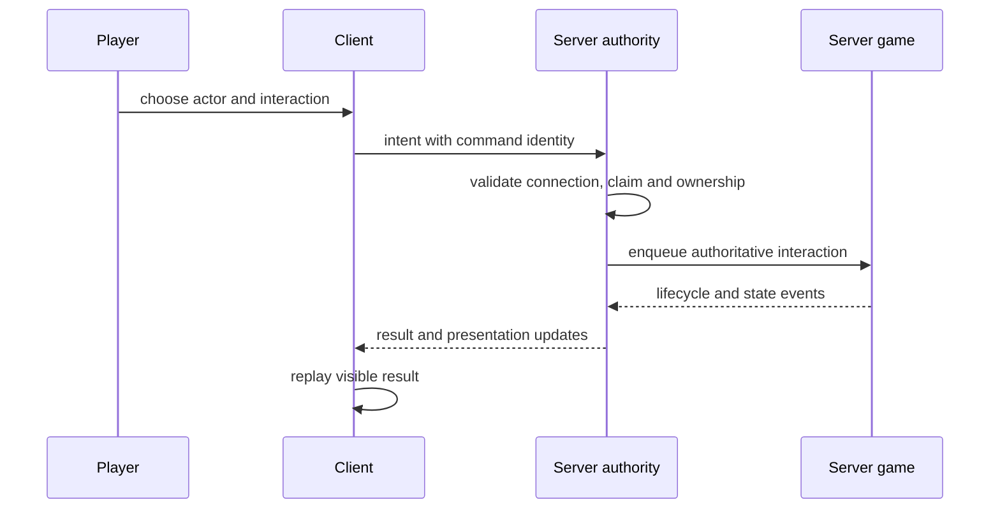

# Decision record: simulation authority and ownership

## Context

Sims 3 is a complex, non-deterministic engine. Game processes do not execute
in lockstep, and many rules live in compiled interaction code or native
systems. The project considered independent client simulation, activity-gated
simulation, lot-based authority and a single authority with client mirroring.

## Decision

1. The server game process owns gameplay simulation and authoritative
outcomes.
2. A client sends an interaction intent with actor and target identity; local
tests do not prove acceptance.
3. Sim claims identify which player may drive an actor. A player cannot take
over an actor already claimed by another player.
4. Local autonomy is suppressed for remote-owned Sims to avoid competing
client behavior.
5. Clients present server-produced state and presentation events. Server
validation remains decisive.



## Alternatives and rationale

| Alternative | Attraction | Reason it was not the selected baseline |
|---|---|---|
| Lockstep clients | Each client computes its own outcome | The engine is not deterministic enough to assume identical state evolution. |
| Client-computed outcomes | Reduces server work | Lets stale or untrusted clients determine shared outcomes. |
| Lot-local simulation | Keeps local gameplay native | Cross-lot authority transfer needs export/merge reconciliation; independent simulations still diverge. |
| Mirror-only clients | Clear trust boundary | Still needs a complete presentation stream and accurate local UI state. |
| Activity-gated simulation | Limits work to active areas | Requires clean authority transitions without double simulation. |

The selected model retains the game's interaction catalog and narrows
multiplayer responsibility to intent routing, ownership, synchronization and
presentation. It does not claim that the engine is headless or that a few
copied fields reproduce every game rule.

## Ownership lifecycle

| Event | Rule | Expected transition |
|---|---|---|
| Join | Connection must be admitted before it can claim Sims | Connection associates with a player identity. |
| Claim | Actor is unclaimed or already owned by this player | Claim is assigned; duplicate same-owner claims are idempotent. |
| Conflicting claim | Another player owns the actor | Request is refused; existing owner remains. |
| Interaction intent | Actor must be sender-owned or explicitly allowed as unowned | Unauthorized intent is rejected before enqueue. |
| Release | Only current owner may release | Claim is removed and a release event is published. |
| Disconnect/superseding connection | Old claims must not leak indefinitely | Release or transfer by an explicit lifecycle rule. |

The exact connection and claim lifecycle is implemented across server
components; see the [protocol reference](../protocol.md) and
[architecture](../architecture.md).

## Consequences

- The game process remains necessary for gameplay depending on native
behavior.
- The network service must serialize authority decisions even though gameplay
simulation is non-deterministic.
- Autonomy and locally generated effects are divergence sources to suppress or
identify.
- Server-side refusal is a normal result and should be visible to the player.
- A replacement kernel can be introduced incrementally only where its contract
is bounded and compared with the game-backed authority.

## Failure modes and limits

- A stale client can show a menu option the server rejects.
- Continued local autonomy can create local-only interactions, props or mood
effects.
- Claims govern player input, not every server simulation driver.
- Identity mismatches can make a valid intent target an unknown object.
- The experimental service has no promised authentication or encryption; do
not expose it to untrusted networks.

Related pages: [principles](principles.md),
[transport](decision-transport.md), [presentation](decision-presentation.md),
[protocol](../protocol.md), [open problems](open-problems.md).


## Command decision procedure

A command reaches gameplay only after the server can answer a sequence of questions. Is the peer in a valid session? Is this command well-formed and within the frame budget? Is its command identity a retry of an already processed request? Is the player allowed to act on this actor? Does the target still exist in the authoritative world? Only then should the game receive an operation that needs native simulation. The rejection should be specific enough to distinguish a stale target from an ownership conflict or an invalid interaction.

```text
receive frame
  -> decode and validate
  -> deduplicate command identity
  -> validate joined player and actor claim
  -> resolve public identity to game identity
  -> submit to authoritative game
  -> publish result and observed state
```

Each step prevents a different class of ambiguity. Deduplication must happen before a non-idempotent game command is applied; ownership must be checked before invoking the engine; identity mapping must not silently truncate or reuse an identifier. A transport ACK means the service accepted the frame for processing, not necessarily that the game interaction completed.

## Authority and autonomy are separate controls

The server can reject unauthorized player input and still allow its own autonomous game systems to act. Conversely, client-side autonomy may run even when all human input is server-authoritative. The two controls therefore need separate tests:

| Control | What it prevents | Example verification |
|---|---|---|
| Command ownership check | A player queues an action for another player's actor | Submit the same command under owner and non-owner identities |
| Server autonomy policy | Shared world stops producing eligible NPC/Sims actions | Observe server behavior under declared scope |
| Client puppet suppression | Client copies do not generate local-only actions | Compare local queue and effect records on each client |
| Presentation-only apply | Mirrored updates are not interpreted as new input | Replay a server event and check no echo command is emitted |

The distinction is important because a local-only interaction can cause follow-on position, prop and mood differences. Fixing the command gate alone would not suppress that local simulation.

## Ownership transfer and fencing

Claims need a clear release boundary. On graceful leave, release before the connection is considered gone. On abrupt disconnect, cleanup must run from the socket lifecycle. On a replacement connection for the same player, the prior lease must be fenced so that a late command from the old socket cannot act after the new one owns the session. A generation or epoch is useful when identifiers can be reused.

| Transition | Required property |
|---|---|
| Claim | Unique owner or idempotent same-owner result |
| Release | Stale release cannot drop a newer claim |
| Supersede | Old connection can no longer mutate authority |
| Rejoin | New connection obtains a valid snapshot baseline |
| World reload | Old game-object mapping cannot cross the new epoch |

## How to verify/test

1. Exercise claim by a joined owner and confirm the resulting event.
2. Repeat the same claim and assert no duplicate ownership transition.
3. Attempt a conflicting claim and verify existing ownership remains unchanged.
4. Queue from a non-owner and verify the game never receives the command.
5. Disconnect without a leave frame and verify claim cleanup.
6. Reconnect and verify a stale command from the old peer is fenced.
7. Check both the service response and the client-visible outcome; they are different stages.

Use the [protocol reference](../protocol.md) for current request/reply fields and [testing](../testing.md) for supported runners.


## Authority decision examples

A client changing game speed should send an intent; the server decides and broadcasts accepted speed. A client selecting an interaction should send actor, target and definition identity; the server evaluates the actual test. A client rendering an animation should apply a server record without being treated as an authority source. A client requesting a save should ask the server game to perform it; a network snapshot cannot fulfill that request.

These examples share the same pattern: the client supplies intent or presentation work, while the component that owns the state validates and commits it.

| Operation | Authority owner | Client role |
|---|---|---|
| Interaction outcome | Server game | Request and present |
| Actor claim | Session/kernel | Request and observe |
| World clock | Server game | Request speed change, apply time |
| Durable save | Server game | Request or receive transfer |
| Local rendering | Client game | Apply authoritative state |

## How to verify/test

For any command, trace the call path from client capture to the final mutator. Confirm there is no alternate client-side commit. Test authorized and unauthorized identities, duplicate retries and command refusal. For state that the client applies, confirm the mirror is not reflected back as a new authority request.
