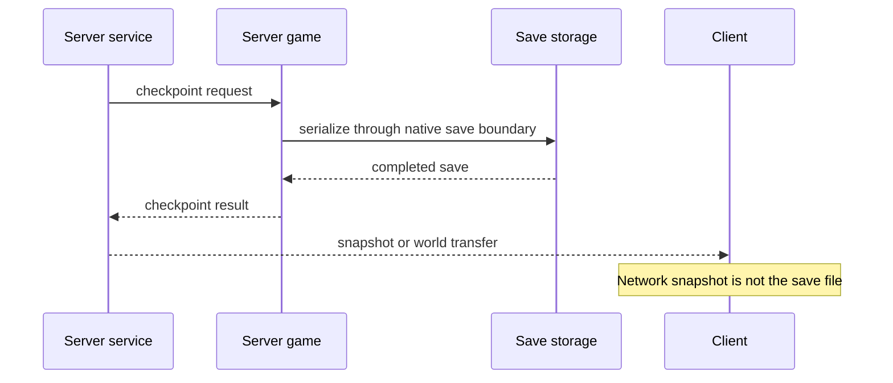
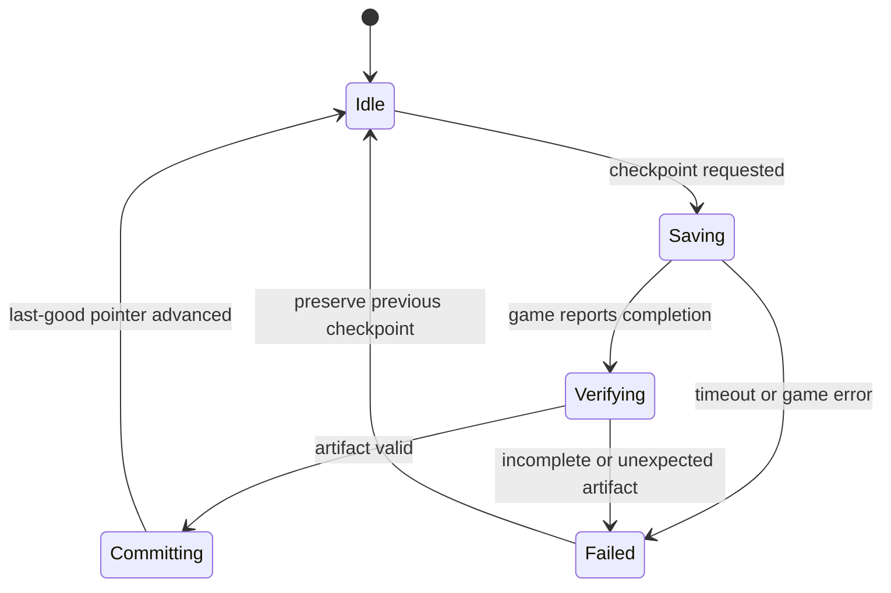

# Decision record: persistence and world time

## Context

Multiplayer synchronization needs both ephemeral client state and durable
state that survives server restart. A network snapshot is a projection for
presentation and reconciliation; it is not the complete serialized world. The
game engine owns save semantics, including object and household state that may
not be represented in the multiplayer schema.

World time has the same split: the server game advances the authoritative
clock while clients need updates to align simulation and display. The game
clock and the visible clock are related but distinct state.

## Decision

1. The server game owns durable world state and performs native save
operations.
2. The multiplayer service may manage checkpoints or last-good-save rotation,
but the game-produced save remains the durable artifact.
3. Clients receive snapshots and deltas for synchronization; do not
reconstruct a save from those projections.
4. The server owns world-time and game-speed decisions. Client input that
changes speed is an intent, not an independent time authority.
5. Reconciliation distinguishes a clock change from refreshing the client's
visible clock display.

## Durable save versus synchronization snapshot

| Property | Game save | Full snapshot | Delta update |
|---|---|---|---|
| Purpose | Continue after shutdown or restart | Bootstrap a connected client | Apply changes since a known tick |
| Owner | Server game and save boundary | Server snapshot producer | Snapshot producer and stream policy |
| Completeness | Engine-defined durable representation | Declared multiplayer-visible fields | Changes in supported categories |
| Recovery role | Cold join/restart source | Warm synchronization source | Incremental repair between full snapshots |
| Synthesizable from other data? | No | Not applicable | Not applicable |

A save transfer can be chunked, but chunks are transport pieces of the saved
artifact, not a second save format. The receiver should validate completeness
before using the reconstructed file.

## Clock synchronization model

The server game advances time and speed. A service can read a validated
observation, compare it with its last published value and wall-clock sample,
then decide when to emit an update. Thresholds avoid spamming clients for tiny
floating-point changes while bounding visible drift.

| Signal | Meaning |
|---|---|
| Clock value | Authoritative day and time observed from the game |
| Game speed | Current simulation speed or pause state |
| Wall stamp | Time at which the observation was sampled |
| Last published clock | Value clients are expected to have received |
| Reconcile reason | Drift threshold, elapsed interval, or day transition |

Setting the simulation clock without triggering the game's UI refresh can
leave a client HUD stale even while the underlying clock reads correctly.
Tests must inspect both the simulation clock and visible refresh behavior.

## Commit and recovery principles

- Write to a staged destination and verify completion before replacing the
known-good checkpoint.
- Preserve the previous good save until a new save passes its validation
boundary.
- Treat incomplete chunks, timeouts and parse failures as failed transfers
rather than partial success.
- Define whether rejoin loads a saved world (cold) or uses the currently
loaded world (warm).
- Release a departing connection's claims even if its process exits
unexpectedly.

## Consequences

- A correct snapshot is not necessarily sufficient to restart the world.
- Save failures need separate diagnostics from protocol or snapshot failures.
- Matching clock values does not prove that the HUD or every timed subsystem
is aligned.
- Save-format and game-version changes are compatibility boundaries requiring
explicit tests.

## Failure modes and limits

- Snapshot schemas can omit engine state necessary to reproduce a save.
- A checkpoint may complete while a client transfer is incomplete.
- Warm rejoin works only while the matching world remains loaded.
- Sparse sampling can hide slow clock disagreement.
- A clock event may correct simulation time without refreshing a UI element
that listens for another notification.

Related pages: [persistence and time](../persistence-and-time.md),
[protocol](../protocol.md), [two-player
gameplay](milestone-two-player-gameplay.md), [open
problems](open-problems.md).

## Checkpoint lifecycle

A robust checkpoint operation is a state machine, not a file copy. It begins with a request associated with the loaded world, asks the game to perform its native save, waits for completion, validates that the expected artifact is present, and only then updates the last-good pointer. Recovery keeps the prior good artifact until the new one is accepted. A crash or timeout in the middle must not expose a partially written save as current.

The service should make the operation observable: request identity, loaded save identity, start and completion time, validation result, and whether the previous checkpoint remains available. It should avoid logging private save contents or local filesystem paths in public diagnostics.

## Cold and warm join

A warm join uses a world already loaded in the authoritative game. A cold join needs a save or world transfer and must verify that the requested world is the one the server loaded. The joiner cannot safely combine a full snapshot from one epoch with deltas from another. A world epoch or equivalent generation should bind bootstrap data, object identities and event sequences together.

| Join condition | Server work | Client requirement |
|---|---|---|
| Warm, same world | Reuse current world and issue current bootstrap | Apply snapshot, then acknowledge its tick |
| Cold, saved world | Load/transfer game-produced save and wait for readiness | Reconstruct transfer and verify completeness |
| Stale saved world | Refuse or explicitly select current save | Do not merge old object IDs into new world state |
| Restart during transfer | Restart from last-good checkpoint | Discard partial file and request fresh transfer |

## Clock reconciliation example

A service can model reconciliation as: accept only a validated clock observation; compare it with the last published value; publish immediately when drift exceeds a configured threshold; otherwise publish after a bounded wall-clock interval; and separately trigger the client UI refresh path. Day changes require a policy because the visible time wraps while the monotonic session timeline does not. Tests should include midnight, pause/speed changes, large forward jumps and a world reload.

## How to verify/test

- Force save success, save refusal, timeout and process exit during save.
- Corrupt or truncate a transferred artifact and ensure validation rejects it.
- Restart with both a valid last-good and a newer incomplete checkpoint present.
- Join warm and cold; assert both paths identify the same world epoch.
- Delay an acknowledgement and verify the server does not advance the delta base.
- Change clock and speed independently; inspect server clock, client simulation clock and HUD display.

Related pages: [persistence and time](../persistence-and-time.md), [two-player synchronization](milestone-two-player-gameplay.md), [open problems](open-problems.md).
