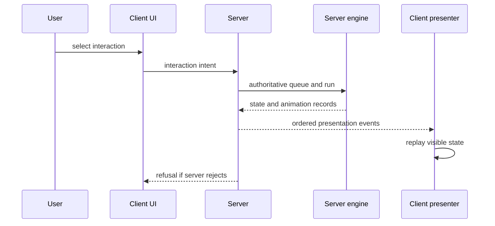

# Decision record: presentation and interaction replay

## Context

The server can execute a complete interaction, but a client must show the
result without running an independent copy of the interaction. Rerunning
gameplay locally inherits local routing, timing, random draws, autonomy,
object state and native animation behavior. Matching an interaction's name is
not enough to reproduce the visible trajectory.

## Decision

- Forward player input as an intent to the authoritative server.
- Prefer replaying recorded server outcomes at engine boundaries over
rerunning interaction implementation on clients.
- Suppress local autonomy for remote-owned Sims so their copies do not
generate competing outcomes.
- Keep presentation records ordered; do not coalesce emitted interaction
events if that changes replay semantics.
- Treat local menu construction as a separate UI consistency problem. Mirror
state read by menu tests where practical and relay server refusals when local
tests disagree.



## Why not interaction replay?

A replay that reruns game code inherits local environmental assumptions. It
can route differently, choose a different loop count, react to different
outfit/model readiness, or generate extra effects. The reliable record is the
server's actual output, not a request to repeat the server's input.

| Strategy | Benefit | Main risk |
|---|---|---|
| Rerun same interaction locally | Uses familiar game behavior | Recomputes decisions and can diverge in timing or state. |
| Apply coarse snapshot positions | Simple correction | Omits animation, posture, attachment and lifecycle detail. |
| Record/replay shared engine seams | Captures actual server outputs | Requires complete capture, ordering and useful event vocabulary. |
| Query server for each menu option | Exact local menu verdict | Adds synchronous round trips or requires live menu updates. |
| Mirror menu-relevant state | Responsive local menu | Every new state dependency needs a mirror or fallback. |

## State needed for an honest menu

Pie menus run tests against the local client world. A test may inspect
inventory, object use, part occupancy, posture class, or object model flags.
If those copies differ from the server, an entry can be shown when the server
rejects it or hidden when it would allow it.

A practical design combines two mechanisms:

1. Mirror high-value state at its source when the client can apply it safely,
such as object use or inventory changes.
2. Relay a server refusal and temporarily grey the corresponding local entry,
with a reason where supported.

This differs from querying the server for every menu entry. Many tests may run
during menu construction, and synchronous evaluation would either block the UI
or require updating a menu after opening.

## Presentation event contract

| Concern | Contract question |
|---|---|
| Identity | Which server object and actor does this event refer to locally? |
| Ordering | Is sequence monotonic per recipient, and how is a gap detected? |
| Timing | Apply immediately or schedule relative to a server tick? |
| Lifecycle | How are start, completion, cancellation and failure represented? |
| State replacement | Does a snapshot supersede earlier incremental events? |
| Join history | Which recent events does a late joiner need to see an in-progress action? |
| Duplicate delivery | Is reapplying a record harmless, or is event identity required? |

## Consequences

- Presentation is a first-class stream, not merely a side effect of snapshots.
- Local simulation still runs code that must be disabled or fenced for
remote-owned actors.
- Menu honesty can require both mirrored state and server-derived refusals.
- Event ordering matters even though animation itself can vary by frame
timing.

## Failure modes and limits

- Missing a recorder seam leaves a visible transition unrepresented.
- Applying an event to the wrong local object can silently no-op or report a
false refusal.
- Asynchronous callbacks make timestamps later than the native event.
- Coarse replay that omits attachment changes can create props or postures
absent on the server.
- A mirrored field can make a menu test pass while deeper server preconditions
still fail.

Related pages: [simulation](../simulation.md), [menu
honesty](menu-honesty.md), [runtime timing](runtime-timing.md), [divergence
forensics](rust-divergence-forensics.md).


## Recorder-to-presenter walkthrough

A presentation event begins at a server engine boundary. The recorder assigns or observes an event identity, captures actor/target references and relevant state, and makes the event available to the server stream. The stream orders and routes it to interested clients. A client translates server identity to its local copy, applies the state change, and records the applied sequence or tick. If a target is missing, the presenter should report a named diagnostic rather than silently applying the event to a guessed object.

```text
engine seam -> typed record -> stream ordering/filter -> client identity map
            -> local apply -> applied watermark -> gap detection
```

The event should include enough context to replay the outcome, but not a copy of proprietary game code or a hidden native data dump. Captured payloads must be bounded and sanitized for public diagnostics.

## Snapshot and event ordering

Snapshots repair durable mirror fields; event records carry transitions that may be too transient to infer from periodic state. A protocol must define whether the snapshot includes all events through its tick. A common rule is that the snapshot marks a watermark, and later events are delivered after that boundary. On a gap, the client requests or receives a full repair and discards incompatible pre-epoch data.

| Sequence case | Presenter behavior |
|---|---|
| Expected next sequence | Apply and advance watermark |
| Duplicate sequence | Ignore only if event application is idempotent |
| Sequence gap | Mark stream stale and request repair |
| Older epoch | Drop as stale |
| Unknown actor/target | Keep diagnostic; do not guess an identity |
| Snapshot supersedes old event | Apply by documented tick ordering |

## Animation timing versus state correctness

Two clients can receive byte-identical animation records and still display different durations because native clip selection, rendering load or model readiness is process-local. A fixed network delay cannot correct a different local loop boundary. The presenter can guarantee event ordering and declared timing policy; it cannot guarantee native animation parity unless the selection itself is captured and replayed or the client is otherwise constrained to match it.

## How to verify/test

1. Test recorder encoding with absent, present and stale actor/target identities.
2. Deliver duplicate, reordered and missing event sequences.
3. Apply an event after a full snapshot boundary and verify correct ordering.
4. Join during a long-running interaction and check required history is delivered.
5. Compare both clients' event records separately from their displayed animation timing.
6. Verify a local mirror operation does not generate a new player command.

Related pages: [simulation](../simulation.md), [menu honesty](menu-honesty.md), [social-session research](social-session-research.md), [runtime timing](runtime-timing.md).


## Event-family checklist

Before adding a presentation record, classify it as a durable field update, a transient event, an animation instruction or a relationship between entities. Durable fields can often be repaired from a snapshot. Transient events may need history for late join. Animation instructions may depend on native clip catalogs and local model readiness. Relationship events such as attachment or paired social state need both endpoints to be represented.

| Family | Snapshot repair | History needed for late join | Typical duplicate risk |
|---|---|---|---|
| Position | Usually | Limited | Repeated correction can interrupt movement |
| Inventory | Often | No, if current inventory is complete | Duplicate add/remove |
| Interaction lifecycle | Partial | Yes for in-progress action | Double start or completion |
| Animation clip | Rarely | Sometimes | Replaying old clip after completion |
| Attach/detach | Current relation may repair | Maybe | Duplicate attachment or orphan prop |
| Social pair | Partial | Yes for active session | Relationship/effect applied twice |

## How to verify/test

Test each event family with a full snapshot before and after the event, then inject a late join between the two. Confirm the snapshot and event history compose to one final state. A duplicate delivery should be harmless or rejected by event identity.
