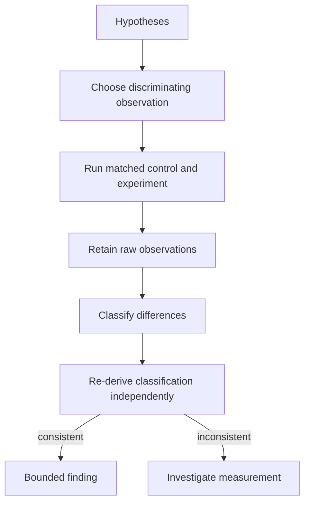

# Decision record: measurement and tooling

## Context

The game is a large black box at the points where managed code meets native
simulation. Architectural debate from intuition alone tends to turn guesses
into implementation commitments. Early investigations therefore treated a
probe as a small experiment designed to distinguish among plausible
explanations.

## Decision

- Prefer a narrow, repeatable measurement over a large speculative rewrite.
- Keep probes independent from the behavior they observe where possible.
- Record inputs, environment, timings, outputs and failure conditions
together.
- Compare server and client observations in matched passes, and preserve raw
records so classifications can be recomputed.
- Treat tool output as evidence only for the conditions it actually sampled.

## Probe design checklist

| Element | Question |
|---|---|
| Hypothesis | What competing explanations could produce the symptom? |
| Discriminator | What observation differs between those explanations? |
| Scope | Which save, actors, object types, processes and time window are included? |
| Control | What known-good or negative case rules out a broken probe? |
| Raw evidence | Can a reviewer inspect the unclassified observations? |
| Repetition | Is the result deterministic, per boot, or variable across runs? |
| Stop rule | What result ends the experiment or makes it inconclusive? |
| Safety | Does the probe mutate saves or game state, and can it cleanly stop? |

## Comparison methodology

A server/client state comparison is meaningful only if the compared values
refer to the same semantic state and time window. A moving actor can differ
between sequential reads even when both copies are behaving as designed. For
motion, record multiple samples and inspect change within each process, not
only the raw cross-process difference.



## Tool roles

| Tool category | Appropriate use | Guardrail |
|---|---|---|
| Snapshot diff | Compare fields at a bounded point | Confirm sampling order and identity mapping. |
| Event recorder | Observe transitions at shared seams | Preserve ordering and avoid expensive work in callback context. |
| Live scenario runner | Repeat a user-visible behavior | Name pass/fail conditions before the run. |
| Differential harness | Compare implementations against the same input | Include expected differences and both raw outputs. |
| Static inspection | Understand code or binary boundaries | Do not mistake a symbol or inferred name for runtime proof. |

## Consequences

- A negative result can be useful when the probe had a positive control and an
explicit coverage statement.
- A test harness is part of the measurement contract; a defective harness can
produce a false bug report.
- More probes are not automatically stronger evidence if they reuse the same
biased observation path.
- Live test runs should be reproducible without relying on private workstation
details.

## Failure modes and limits

- Single-pass sampling can mistake normal motion for drift.
- Stale packages can make a new source change appear absent at runtime.
- A probe may target a placeholder identity and test the wrong object.
- Logs can omit the event under investigation unless the observation seam is
chosen correctly.
- Screenshots can show a symptom but rarely prove its authoritative cause.

Related pages: [principles](principles.md), [probe results](probe-results.md),
[divergence forensics](rust-divergence-forensics.md),
[testing](../testing.md), [tooling](../tooling.md).


## Evidence record template

A useful public-safe finding can be summarized without exposing private run directories. Record the question, environment at a category level, procedure, expected positive control, raw observation format, result, inference, and limits. Keep exact local machine paths and personal identifiers out of published examples. For binary investigation, publish method names and behavioral contracts only where necessary; do not copy proprietary disassembly or symbol tables.

```text
Question: Does the client receive a server-owned object-use transition?
Setup: One server process and two clients; one shared object is used.
Control: Observe the same actor before the use begins.
Observation: Server and client object-use state at matched event boundaries.
Result: State agrees after the event; one stale sample preceded delivery.
Limit: One object category and one world configuration.
```

## Differential harness design

A differential harness should normalize only irrelevant representation differences. It must not erase the behavior under review. If IDs are process-local, map them through an explicit identity relation; do not compare names as a silent substitute. If timestamps have known jitter, compare bounded intervals while retaining raw times. If floating-point values require tolerance, define the tolerance before seeing the result and report both raw and normalized values.

| Normalization | Safe when | Unsafe when |
|---|---|---|
| Map IDs | Mapping is one-to-one and epoch-scoped | IDs can alias after reload |
| Time window | Native callback is known asynchronous | Window can hide missed state transitions |
| Numeric tolerance | Units and expected precision are declared | Threshold chosen after observing mismatch |
| Ignore ordering | Events are provably commutative | Lifecycle order affects replay |
| Collapse duplicates | Event semantics are idempotent | Duplicate indicates an echo bug |

## Reproducibility and test tiers

A good workflow has distinct tiers: parser/unit tests for deterministic contracts, process tests for socket and shutdown behavior, recorded-trace tests for compatibility, then live tests for engine-dependent behavior. Each tier should emit a result that can be consumed by the next tier without pretending it covers the next one.

## How to verify/test

- Ensure the probe itself has a positive control before interpreting a negative result.
- Run a probe twice without changes to estimate ordinary variability.
- Keep raw records and derive summaries with a separate, testable classifier.
- Add a synthetic counterexample that should be classified differently.
- Confirm a failed live scenario is caused by the code under test, not a stale package or invalid actor ID.
- Record the exact command and result in the relevant engineering report.

Related pages: [testing](../testing.md), [troubleshooting](../troubleshooting.md), [probe results](probe-results.md), [divergence forensics](rust-divergence-forensics.md).


## Tool safety and provenance

A tool that inspects a live game can mutate the world even if its purpose is observational. Classify commands as read-only, state-changing, save-changing or process-control. Prefer a disposable test world for mutation, and retain an explicit stop condition. A probe should never make a public report depend on a private workstation path or a personal account name.

| Tool action | Risk | Guardrail |
|---|---|---|
| Read snapshot | Inconsistent sample | Record tick and identity context |
| Set position or motive | Alters gameplay state | Use controlled test save and restore/cleanup |
| Save/load | Replaces durable state | Preserve known-good checkpoint |
| Start/stop process | Affects shared test environment | Confirm ownership of test instance |
| Inspect binary | Proprietary material exposure | Publish behavior summary, not source dump |
| Export trace | Sensitive or game-derived content | Sanitize before sharing |

## Evidence provenance

A conclusion should be traceable from a summarized claim back to a test command and a raw output category. Avoid publishing raw proprietary data. Hashes and version labels can establish which build was tested without publishing binaries. If evidence came from a simulation-only harness, say so; if it came from a live game, state its narrow scope.

## How to verify/test

Review tool permissions before live use, test its output on a known case, and check that it fails safely when the game is absent. After a run, inspect repository status and generated artifacts to ensure only intended public files remain.

Related pages: [probe results](probe-results.md), [testing](../testing.md).
