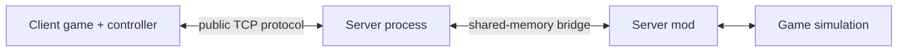

# Decision record: process boundaries and transport

## Context

The game-backed authority, multiplayer controller and player clients are
separate processes. The game exposes a mod bridge used by the controller;
clients need a public network connection for input and events. These links
have different constraints and are separate contracts.

The game's managed environment does not provide the general socket facilities
expected of a standalone service. The controller therefore communicates with
the mod through a process-memory bridge. A separate TCP listener provides
client networking.

## Decision

- Keep a narrow controller-to-mod bridge using the mod's shared-memory region
and framed requests/replies.
- Keep client networking outside the game process. Clients connect to a server
listener, not a socket opened by game script code.
- Treat the bridge protocol and public client protocol as separate contracts
with distinct versions, size limits and tests.
- Keep public networking, session state, and the bridge driver outside the game
  process. The repository now includes an experimental Rust line-v1 front door;
  it does not replace the established .NET server or prove gameplay parity.
  Retain the game as simulator until a replacement is proven.



## Boundary responsibilities

| Link | Purpose | Payloads | Failure boundary |
|---|---|---|---|
| Client to listener | Join, claims, intents, snapshots, deltas and presentation | Public commands and server events; large transfers handled separately | Disconnect, invalid command, backpressure, stale state |
| Controller to mod | Apply commands and observe authoritative state | Bridge verbs, replies, diagnostics, event pushes and bulk snapshots | Version mismatch, timeout, malformed frame, missing acknowledgement |
| Client controller to client mod | Apply local presentation and inspect game objects | Local process-memory commands; not a public network API | Client process unavailable or local hook mismatch |

The inner bridge needs strict layout agreement. Shared constants appear on
both sides, so compile-time size and offset assertions protect against drift.
Large snapshot payloads should not be forced into small control frames; chunk
or bulk-slot mechanisms let control traffic remain responsive.

## Protocol vocabulary

| Identifier | Current scope | What it establishes |
|---|---|---|
| JSON `commandId` | Established .NET JSON command/event records | Correlates `command_accepted` or `command_rejected` with a request; it is not a general duplicate-suppression guarantee. |
| Line-v1 `corr` | Experimental public line-v1 connection | Correlates a command with its reply on that connection. |
| Line-v1 `commandId` | Rust line-v1 session | Deduplicates within the server's 32-entry per-connection window; an in-window retry returns the cached reply. |
| Line-v1 event `seq` and `epoch` | Rust line-v1 event stream | Identifies ordered events and the server epoch used by warm-resume cursors. |
| Snapshot tick / acknowledgement | Snapshot synchronization | Identifies an authoritative state boundary and the latest tick a client reports applied. |
| Protocol version | A specific versioned channel | Line-v1 negotiates in `HELLO`; the process-memory bridge has separate layout/protocol/hello versions. The JSON protocol has no version handshake. |

These identifiers are not interchangeable. The JSON `commandId` is useful for matching
the command result, but callers must not treat it as an idempotency key. Line-v1 has a
separate, bounded replay contract. Bridge correlations match requests and replies; they
do not by themselves prove that repeating a game operation is safe.

The distinction follows the current implementations: the JSON listener passes decoded
commands to `AuthoritativeSession` and returns a result keyed by `CommandId`; the Rust
line-v1 `Connection` stores a bounded command-reply window. See
[`ClientCommand.cs`](https://github.com/ObsidianNetwork/Sims3Online/blob/main/SimsOnline.Protocol/ClientCommand.cs),
[`ClientListenerServer.cs`](https://github.com/ObsidianNetwork/Sims3Online/blob/main/DedicatedServer/Network/ClientListenerServer.cs),
[`session.rs`](https://github.com/ObsidianNetwork/Sims3Online/blob/main/rust/simlink_headless_server/src/session.rs),
and [`messages.rs`](https://github.com/ObsidianNetwork/Sims3Online/blob/main/rust/simlink_headless_server/src/messages.rs).

## Failure handling

A malformed or unauthorized command must not be forwarded to the game. The
response shape depends on the transport: the JSON listener reports decoded
policy failures as `command_rejected` and malformed input as `server_error`,
both with free-text details; line-v1 uses an `ERR` frame with a closed refusal
code. A bridge timeout is not equivalent to a game-level rejection: no
authoritative result may have been observed. A client must not treat a timeout
as success.

For bridge requests, bound frame sizes, validate sender/sequence/length fields
and avoid reusing a slot before acknowledgement. For the public listener, each
peer needs independent read framing, serialized writes, an output-queue policy
and cleanup that releases connection-owned state.

## Consequences

- The game mod remains unaware of public socket lifecycle and client
identities.
- The controller can validate ownership before invoking game commands.
- The Rust implementation must preserve bridge and public protocol semantics, not
only kernel decisions.
- Mixed-version clients require deliberate compatibility; additive extensions
are safer than silently changing a field's meaning.
- A loopback listener is not automatically safe under every trust model. Bind
scope and authorization remain explicit operational concerns.

## Failure modes and limits

- Duplicated bridge constants can drift unless layout witnesses are checked.
- Large snapshot transfers can exceed ordinary read timeouts if sent as
simulator-tick chunks.
- Serializing writes prevents frame interleaving but can grow a queue when a
client is slow.
- Listener readiness does not prove that the game bridge is available.
- Neither public protocol provides remote authentication or encryption.

Related pages: [architecture](../architecture.md), [bridge and
formats](../bridge-and-formats.md), [protocol](../protocol.md), [Rust front
door](rust-kernel-front-door.md), [open problems](open-problems.md).


## Framing and queue walkthrough

A TCP read can return a partial line, multiple lines, or a line split at any byte. The connection layer must assemble frames without assuming one read equals one command. It should reject an over-limit line before parsing unbounded data. Writes need serialization so two asynchronous producers cannot interleave JSON or line bytes. If delivery is slower than production, a bounded queue needs an explicit drop or disconnect policy rather than unbounded memory growth.

For the memory bridge, the equivalent rules are expressed in shared slots: ownership stamps identify the producer, sequence fields distinguish reused slots, and payload length is checked before decoding. A control slot and a bulk slot serve different purposes; placing a large snapshot into a small control message can block unrelated commands.

| Boundary condition | Public listener response | Memory bridge response |
|---|---|---|
| Partial frame | Continue reading until terminator or deadline | Wait for matching sequence/length state |
| Oversize frame | Reject and close or isolate the peer | Return named frame error; do not read beyond slot |
| Duplicate request | JSON: command ID correlates the result; no general replay cache is promised. Line-v1: Rust session caches replies for its 32-entry per-connection command-ID window. | Correlation matches a reply; it does not by itself deduplicate the underlying operation. |
| Slow consumer | Apply bounded queue policy | Do not overwrite an unconsumed slot |
| Peer closes | Release connection-owned claims | Mark bridge unavailable and report transport failure |
| Version mismatch | Refuse incompatible hello | Refuse incompatible bridge handshake |

## Protocol evolution example

An additive optional field can be ignored by an older decoder if the format explicitly allows it. Changing an integer from a full-width ID to a truncated value is not additive: it changes identity semantics and can create collisions. Similarly, changing a reply from "command accepted" to "interaction completed" without changing its name makes the client infer a guarantee the server did not make.

```json
{
  "commandId": "example-unique-command",
  "playerId": 2,
  "actorObjectId": 1234567890123,
  "interaction": "GoHere"
}
```

This illustrative payload is not a complete schema; see the public [protocol page](../protocol.md) for actual fields and types.

## Readiness is more than bind success

A service can open a port while the game is still loading, while the bridge handshake has failed, or while the world snapshot is unavailable. A readiness check should report these states separately. Likewise, a successful bridge handshake proves that the shared region is reachable and compatible enough to exchange frames; it does not prove that every verb has been implemented correctly.

## How to verify/test

- Feed the decoder empty, partial, valid, malformed and oversized frames.
- Send concurrent outbound events and assert complete frames do not interleave.
- Fill the outbound queue and assert the documented backpressure behavior.
- Close a peer during a write and verify cleanup runs once.
- Test version mismatch and ensure no gameplay command is dispatched.
- Verify a large snapshot uses its bulk path and does not starve control messages.

Related references: [server CLI](../server-cli.md), [bridge and formats](../bridge-and-formats.md), [troubleshooting](../troubleshooting.md).


## Timeout semantics

Timeouts should be attached to a stage, not treated as one global failure. A connect timeout means no peer was established. A bridge response timeout may mean the request was delivered but its reply was lost. A world-load timeout may mean the game is still active but not ready. An acknowledgement timeout means the client may be behind. Each case has a different safe retry behavior.

| Timeout | Is side effect known? | Safe default |
|---|---|---|
| Before connection | No command sent | Retry connection with bounded backoff |
| After command dispatch | Possibly applied | Treat the outcome as unknown. Do not assume JSON or bridge deduplication; query observable state or inspect server/game evidence where possible. Line-v1 retries are protected only within its documented per-connection window and must reuse the same command ID. |
| During bulk transfer | Partial data may exist | Discard incomplete transfer and restart |
| Waiting for snapshot ack | Snapshot may be applied | Resend/repair only with tick identity |
| During shutdown | In-flight work uncertain | Stop accepts and report final state |

## How to verify/test

Use a fake transport to trigger each timeout boundary. Test the JSON and bridge behavior without assuming they deduplicate commands; separately verify that a line-v1 duplicate inside the retained window returns the original reply without a second effect. Confirm logs identify the timed-out stage and do not expose credentials or private machine paths.
