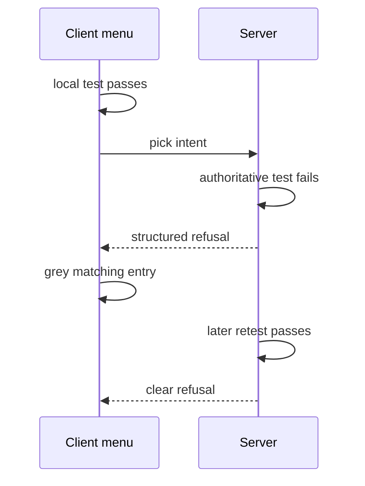

# Menu honesty, refusals, and mirrored UI

## Problem

A client pie menu is assembled by testing candidate interactions against the
client's local copy of the world. The server later runs its own test. If the
two worlds differ, a visible entry may be refused by the server, or a valid
server entry may be absent from the client menu.

A measured bookshelf case showed the underlying pattern: a client copy
retained an inventory item after the server Sim had taken it, so its local
"read" test passed while the server's test failed. Other observed differences
involved old newspapers, object use, occupied seat parts and posture-specific
menu entries.

## What the UI needs to agree on

| Test input | Example divergence | Why the client can be stale |
|---|---|---|
| Inventory membership | Client sees an item still in a shelf | The server moved it into a Sim's inventory. |
| Object model flags | Client sees an object as usable | Server copy has an old, flattened or otherwise invalid state. |
| Object use list | Client offers an action on an in-use object | Use ownership is present only in the server copy. |
| Part occupancy | Client considers a seat available | Server has a Sim occupying the part. |
| Posture type/capabilities | Client omits or adds posture-specific socials | A generic puppet posture does not answer the same concrete tests. |
| Recent social topics | Client offers an option based on stale conversation state | The server's conversation history differs. |

## Two complementary mechanisms

**Mirror the state** when the source is clear and the client can apply the
change safely. Inventory and object-use mirrors can fix several tests at their
root and improve other UI surfaces too.

**Relay server refusal** when the server already established that a locally
passing choice is not currently valid. The refusal can be associated with
actor, target, interaction definition and optional tooltip, then cleared when
the server's retest passes. This avoids a server round trip for every menu
candidate.



## Why not query on menu open?

A menu can contain hundreds of entries, each with a separate test. Querying
the server synchronously during menu construction would add latency on every
menu open or require a second pass that updates an already-open menu. The
server-side verdict is exact, but the interaction cost and coupling to UI
internals are high. State mirrors and refusal feedback provide a local
responsive UI with a bounded fallback.

## Refusal lifetime and presentation

A refusal should be keyed to enough identity to avoid greying unrelated
actions. The server may hold a failed entry and periodically retest it; when
the condition clears, it sends a clear event. The client can additionally
expire stale local refusal records after a bounded duration. The displayed
tooltip should distinguish a server refusal from a locally disabled
interaction, and it should not imply a permanent ban.

The reason string has compatibility implications: newer peers may provide a
server tooltip while older clients fall back to generic wording. The current
public docs describe protocol behavior; this page records the design lesson
rather than freezing a private wire layout.

## Social and posture caveat

Social interactions are often paired and stateful. Their availability can
depend on both participants' posture, conversation state, relationship,
animation context and effect persistence. Mirroring a single social terminal
or menu entry without understanding the full session lifecycle can produce
mismatched state. Treat social-session behavior as a separate contract and use
paired live tests.

## Consequences

- Menu parity is an observable part of presentation quality, not just a server
correctness concern.
- Refusal memory complements authoritative checks; it does not replace them.
- Mirrors can prevent a known stale-state case, but every distinct test
dependency may expose another one.
- A structured refusal event is more useful than display text alone because
the client needs to match it to an entry.

## Failure modes and limits

- A stale refusal remains after the condition cleared because the clear event
was lost.
- A refusal is keyed to a server object ID that was not mapped to the client's
copy.
- A menu entry's definition identity is unstable across versions.
- A client grey tooltip implies a detailed reason that the server did not
actually provide.
- Social behavior is treated as a single entry when it is a coupled
interaction session.

Related pages: [presentation decisions](decision-presentation.md),
[simulation](../simulation.md), [protocol](../protocol.md), [open
problems](open-problems.md).


## Refusal lifecycle and bounded cache

A refusal record should capture only facts needed to reconcile the menu: server actor identity, server target identity, stable interaction type/name, refusal state, optional server tooltip and expiry or clear condition. The client maps actor and target IDs to its own world objects before asking the menu hook whether to grey the entry. A missing mapping is not a reason to guess by object name.

```text
refused(actor, target, type, name, tooltip)
  -> resolve local actor and target
  -> local menu test passes?
       yes: show disabled with server-refusal indication
       no: preserve local test behavior
  -> server retest passes: clear matching refusal
```

A bounded cache limits stale entries if a clear event is lost. Expiration is a fallback, not the primary truth: the authoritative server should clear the refusal when its own test changes. Keying only by interaction display name is unsafe because names can collide across targets or definition variants.

## Mirroring source state

When a menu mismatch comes from an observable state transition, prefer mirroring that state at its producer. Inventory mirroring can move the corresponding object on the client; object-use mirroring can update both an object's user set and an occupied part. The mirror should be idempotent and should not produce a new command. A full snapshot can repair missed changes, while a refusal event covers state that is impractical to mirror completely.

## Compatibility behavior

An older client may understand a refusal marker but not a detailed tooltip. The fallback should remain truthful and concise. A new client that receives an empty reason must not invent a specific explanation. If definition identity changes between game versions, the client should fail open only for presentation (show the local option) while preserving server authority, or use a safe generic disabled state according to the product decision. The server still rejects the invalid pick either way.

## How to verify/test

1. Reproduce one stale inventory or use-state case with a named actor and target.
2. Compare server and client menu results before the mirror/refusal event.
3. Apply the mirror and confirm the local test now agrees without generating input.
4. Exercise a server refusal and verify only the matching entry is greyed.
5. Change server state and verify clear event restores the entry.
6. Drop the clear event and check bounded expiry.
7. Test a missing local target mapping and a tooltip-less old-version message.

Related pages: [presentation](decision-presentation.md), [social-session research](social-session-research.md), [protocol](../protocol.md), [testing](../testing.md).


## Menu diff interpretation

A menu comparison has three useful classes: entries shown locally but refused by the server, entries offered by the server but missing locally, and entries visible only on the client. The first class creates a misleading affordance; the second hides a valid action; the third can expose a locally generated option the server does not recognize. Keep these classes separate because they imply different fixes.

| Difference | User impact | Candidate response |
|---|---|---|
| Client shows, server refuses | Failed click after visible choice | Mirror test state or hold refusal memory |
| Server offers, client hides | Missing capability | Mirror posture/state or server-authoritative menu response |
| Client-only option | Potential misleading or unsupported behavior | Inspect local test and definition availability |
| Both pass but outcome differs | Deeper simulation divergence | Trace authoritative interaction and replay |

## Decision guide

Choose a state mirror when the dependency is understood, reusable beyond the menu and safe to apply. Choose refusal memory when the server already knows the exact failed definition and a prompt response is available. Query the server on menu open only if latency is acceptable and the UI has a supported asynchronous update path. If none are available, preserve the server rejection and explain the limitation rather than presenting a false guarantee.

## How to verify/test

For each menu case, capture the same actor/target menu on server and clients, classify all differences, then click one deliberately refused entry and verify the refusal clears when state changes. Include both object-target and Sim-target interactions and one posture-specific case.
