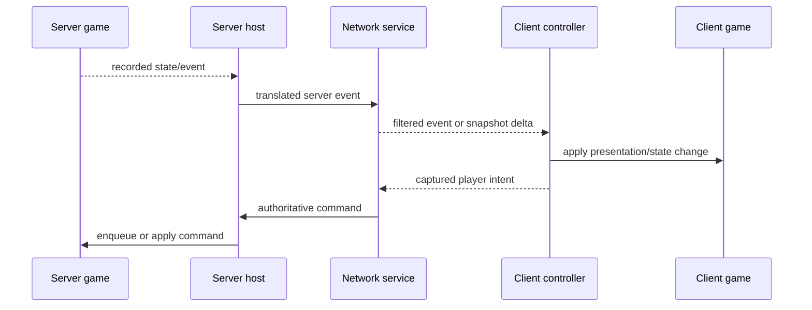

# Retrospective: client game mirroring

## Purpose

After two processes could coordinate ownership and commands, the next problem
was making a client game look like the server game. The client was not
promoted to simulation authority. Instead, it received state updates and
replayed selected server outcomes into its local game process.

This page summarizes the technical progression without reproducing the
original work ledger. The current component responsibilities are in
[architecture](../architecture.md), [simulation](../simulation.md), and
[bridge and formats](../bridge-and-formats.md).

## Mirror loop



The direction matters: server-generated outcomes flow toward the client;
client-generated input flows toward the server. A client mirror must not
accidentally echo its own applied state back as fresh authority.

## State surface explored

| State family | Why it matters | Main mirror concern |
|---|---|---|
| Position and facing | Makes remote Sims appear in the shared world | Local routing and animation can move the copy between updates. |
| Motives and skills | Drives visible status and menu tests | Values can have different update cadence and precision. |
| Household cash | Shared economic display | Must map to the right household and avoid client-originated edits. |
| Interaction queue | Shows current and pending activity | Queue identity, lifecycle and cancellation need consistent handling. |
| Autonomy | Prevents a client copy generating its own behavior | Suppression must be specific to remote-owned actors and persist. |
| Game speed and time | Keeps sessions temporally aligned | Input ownership, server authority and HUD refresh are distinct. |
| Object and posture state | Affects menus, use and visible pose | Object identity and local class-specific tests may differ. |

## Input capture and authority

The mirror path also needs a reverse direction for player actions. The client
captures intent at a common input boundary and forwards it; it does not apply
the command as if it were already accepted. The server reply or resulting
state stream provides confirmation. This prevents a local optimistic queue
operation from being mistaken for authoritative state.

A consumed-marker or equivalent handoff helps separate captured input from
replayed input. Without such a boundary, a server-applied event can be
observed again as a client action and create an echo loop.

## Drift detection and resynchronization

Incremental updates reduce traffic but create a recovery obligation. The
server and client track snapshot progress; acknowledgements identify which
state boundary the client has applied. When a client falls too far behind or
an event sequence gap is detected, the service can send a full snapshot and
resume deltas after the acknowledged watermark.

A snapshot is a repair point, not proof that every presentation detail is
synchronized. Animation, transient effects and object lifecycle may use
separate record streams.

## Evidence and limits

The milestone verified selected round trips for positions, motives, cash,
skills, queues and autonomy, and integrated the mirror loop with client
processes. It also exposed that state mirroring is not a single generic copy
operation: each field family has distinct serialization, identity and
lifecycle rules.

- A test of one field does not prove all fields are mirrored.
- A startup snapshot can agree while later autonomous activity diverges.
- A mirror may be correct while the client's UI tests still read unmirrored
state.
- A state delta can be dropped, duplicated or applied after the object is
gone.
- Replay-based presentation can reduce divergence without making client
simulation deterministic.

## Failure modes and limits

- Local autonomy creates extra queue entries or effects on a client.
- A state update reaches the wrong local copy because IDs are not mapped.
- The client mirrors state but feeds the resulting change back as player
input.
- Resync chooses an invalid tick watermark and omits changes between
snapshots.
- A full snapshot completes but the animation history required for an
in-progress action is absent.

Related pages: [two-process coordination](milestone-two-process.md),
[two-player gameplay](milestone-two-player-gameplay.md), [presentation
decisions](decision-presentation.md), [protocol](../protocol.md).


## Field-family contracts

Mirroring is safer when each state family specifies its source, identity, cadence and apply rule. A position update should not inadvertently create a route request. An autonomy update should not overwrite a server-owned queue. A cash update should identify the correct household. An interaction queue update should distinguish an observed server queue from a client input awaiting acceptance.

| Field family | Suggested apply rule | Stale/recovery signal |
|---|---|---|
| Position/facing | Apply as server correction at a defined boundary | Snapshot tick and repeated motion samples |
| Motives | Replace or reconcile by typed field and version | Full snapshot or field-level update sequence |
| Cash | Apply to authoritative household identity | Household mapping and ledger sequence |
| Queue | Reconcile lifecycle by interaction identity | Queue version or full queue state |
| Autonomy gate | Set only for remote-owned copy | Claim/release acknowledgement |
| Object use | Update actor/part occupancy on matched local object | Snapshot or use-state event sequence |
| Speed/time | Apply server observation and notify UI | Clock sample and game-speed event |

## Echo avoidance

The server emits an outcome that the client applies, while the client also observes local game events. If the same seam records both, the client can re-submit a mirrored change as new input. A consumed marker, origin tag or explicit presenter-only apply path prevents this loop. The marker must be cleared on every completion and error path; a stuck marker can hide a genuine player action.

## Interest filter versus authority scope

A per-client interest filter selects which records to send. It should not decide which process simulates an actor. A player may need to see a remote Sim without owning it, and two clients may both need the same interaction lifecycle. Keep recipient filtering and claim policy as separately testable modules.

## How to verify/test

- Compare each mirrored field on server, client one and client two after a known command.
- Assert that apply produces no outbound input echo.
- Remove or replace an object, then deliver a delayed event and verify it is not applied to a reused identity.
- Drop one delta and verify gap detection leads to a full repair.
- Join while an interaction is underway and test history plus current snapshot.
- Recheck autonomy after claim, release, save/reload and resync.

Related pages: [presentation](decision-presentation.md), [ownership](rust-kernel-ownership.md), [protocol](../protocol.md), [open problems](open-problems.md).


## Reconstructing the milestone's main loop

The server mod records state where native and managed gameplay meet. The controller translates that observation into a protocol event. The listener chooses recipients and preserves ordering. The client controller maps server identities to its own game objects, then applies the update through the client bridge. Input capture follows the reverse direction but is not a mirror: it carries intent for server validation.

At each step, a failure should be attributable. A missing event can mean no recorder output, translation omission, filtering error or transport loss. A present event with no visual effect can mean identity mapping, apply failure, local game override or a renderer limitation. This is why comparing only final snapshots leaves important gaps.

## Minimal mirror event example

```text
source: server observation
identity: actor public ID and target public ID
order: connection epoch plus event sequence
state: typed field or presentation payload
result: applied / skipped-stale / rejected-unknown-target
```

This is a conceptual checklist, not a wire schema. The current [bridge and formats](../bridge-and-formats.md) and [protocol](../protocol.md) pages describe public contracts.

## How to verify/test

For each state family, test initial snapshot, one incremental change, duplicate delivery, target disappearance and full resync. Keep one observer client that does not own the actor; it verifies that interest filtering and authority claims are independent.
