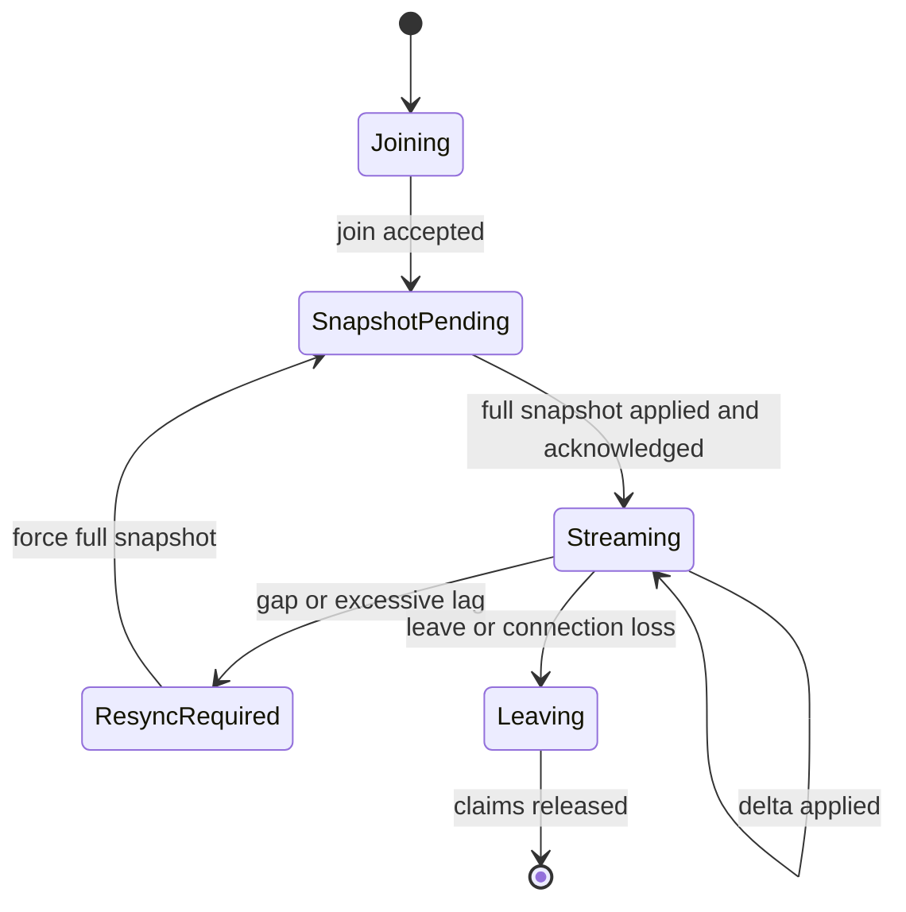

# Retrospective: two-player gameplay and synchronization

## Purpose

The two-player milestone moved from infrastructure to shared play: both
clients had to observe a single session, submit input under explicit
ownership, and remain close enough to the server's state to continue
interacting. The work expanded snapshot cadence, incremental updates,
acknowledgements, game-speed control, save checkpoints and resynchronization.

## State progression



## Synchronization pieces

| Mechanism | Role | Important invariant |
|---|---|---|
| Full snapshot | Bootstrap or repair point | Represents one explicit server tick boundary. |
| Delta broadcast | Carry changed state between full snapshots | Must be based on a state the client has acknowledged. |
| Client acknowledgement | Report applied progress | Monotonic per player; not a global minimum for all peers. |
| Watermark | Identify the last safe delta base | Never advance beyond successfully delivered/applied state. |
| Force-full latch | Prevent repeatedly sending full snapshots | Clear only when the corresponding full snapshot is acknowledged. |
| Interest filter | Avoid sending irrelevant entity detail | Changing interest must not silently lose required world state. |
| Save checkpoint | Preserve durable world continuity | Use the game's save boundary, not a network snapshot. |
| Speed/time event | Keep clients aligned with server clock | Server state wins; UI display refresh is separately verified. |

The early implementation used a chunked full snapshot transport that could
take roughly a minute or more in the tested world. Delta synchronization was
introduced to avoid making every routine update pay that cost. Snapshot lag
policies can slow broadcast cadence as acknowledgements fall behind and
request one full repair beyond a hard threshold.

## Operational flow

A healthy join first identifies the player, obtains the relevant world state,
joins the session, and then receives a full snapshot with speed/time and
presentation context. A warm rejoin can reuse a loaded world; a cold rejoin
must fetch or reload a durable save. After bootstrap, the service sends deltas
relative to acknowledged progress.

```text
join -> authoritative state bootstrap -> full snapshot -> apply -> acknowledge
     -> periodic deltas -> acknowledge -> (gap or hard lag) -> force full
```

The exact user-visible protocol is documented in [protocol](../protocol.md),
and save behavior in [persistence and time](../persistence-and-time.md).

## Evidence that shaped the work

- Server-side autonomy suppression was needed when a client took ownership of
a Sim; otherwise a local copy could continue to choose actions.
- Game-speed changes required a server event loop and a client input path
rather than independent local controls.
- Snapshot delivery and acknowledgement state needed explicit watermarks to
avoid skipping updates during recovery.
- Interest filtering reduced unnecessary mirror work, but the boundary had to
preserve data required by presentation and join bootstrap.
- A unified resynchronization policy was designed to replace scattered ad hoc
snapshot requests.

## What the milestone did not prove

An interactive two-client run does not prove full-world coverage,
second-machine/network acceptance, sustained reliability, or restart/reconnect
correctness. The original plan included more than the early milestone's
implementation and test evidence. Current status should be checked in
[status](../status.md).

## Failure modes and limits

- A client that has not acknowledged a full snapshot cannot safely apply
deltas based on it.
- A lost event can leave a client apparently active but stale until a gap or
lag threshold is noticed.
- Too-aggressive full resync can saturate a slow client; too-lax thresholds
prolong drift.
- Clock equality does not prove HUD correctness or synchronized animation
phase.
- A save checkpoint can succeed while the network replica remains behind.
- A second client on the same host is not a substitute for testing across
separate machines and real network jitter.

Related pages: [client mirroring](milestone-client-mirroring.md), [probe
results](probe-results.md), [persistence](decision-persistence.md),
[protocol](../protocol.md), [open problems](open-problems.md).


## Resynchronization policy walkthrough

Each connected client tracks its own acknowledged tick and whether a forced full snapshot is outstanding. When lag is modest, the server can lengthen the update interval gradually. When lag crosses a hard bound, it requests a full snapshot once and holds further forced snapshots until the client acknowledges the matching tick. A valid acknowledgement must never move backward. No valid baseline means the server should not send a delta that assumes one.

| State | Action | Exit condition |
|---|---|---|
| Current | Send ordinary delta cadence | Lag enters warning range |
| Warning | Increase interval within configured clamp | Lag recovers or reaches hard bound |
| Full pending | Suppress repeated full repairs | Matching full tick acknowledged |
| No valid ack | Avoid delta based on unknown client state | Full bootstrap accepted |
| Disconnect | Remove per-peer cadence state | New connection lifecycle |

## Speed authority and visible time

A client may ask to change game speed, but the server's speed is the shared result. The server broadcasts its accepted state and clients apply it to their copies. World time additionally needs periodic or drift-triggered reconciliation. A test that reads the game clock can pass even when the HUD display did not refresh; both should be asserted.

## Checkpoint versus live stream

The game can complete a save while a client is still behind on deltas. A checkpoint therefore does not serve as an acknowledgement for a connected mirror. Conversely, an up-to-date snapshot does not constitute a durable save. Tests should exercise the two paths independently and then verify recovery from a restart.

## Scenario checklist

- Two players join and claim separate actors.
- Conflicting claim is rejected without corrupting existing ownership.
- A player queues an interaction on its own actor and the other client observes it.
- Client speed input is reflected from server authority.
- One client is delayed long enough to trigger the full-repair policy.
- A late join receives world state and any required active presentation history.
- One client disconnects abruptly; claims are released and remaining client continues.
- A server checkpoint is followed by restart and cold rejoin.

## How to verify/test

Run unit tests for cadence and watermark transitions, subprocess tests for peer lifecycle and wire behavior, then live scenarios for native simulation and presentation. Record the world, number of clients, join type, injected delay and exact result. Do not combine a same-host smoke test with a WAN acceptance claim.

Related pages: [persistence](decision-persistence.md), [probe results](probe-results.md), [open problems](open-problems.md).


## Distinguishing the two clients

A two-player result should be evaluated from the server and each client independently. The server verifies the command and world outcome; the acting client verifies input feedback and presentation; the observing client verifies broadcast delivery and remote actor state. If only the actor's client is inspected, an event-routing bug to other peers remains hidden.

```text
assert(server: authoritative actor/queue/state)
assert(client A: input result and rendered actor)
assert(client B: broadcast result and rendered actor)
assert(stream: expected sequence and acknowledgement per peer)
```

## Controlled degradation

A slow client should not stall the authoritative game or all other clients. Per-peer output backpressure, lag tracking and forced resync isolate the slow path. If the peer cannot recover within configured bounds, disconnecting it with a named reason is safer than silently delivering an unbounded stale stream. The remaining players should continue with stable authority.

## How to verify/test

Run the same scenario with one client intentionally delayed, then compare the healthy peer's event cadence and game state. Confirm that the delayed peer either catches up from a full snapshot or disconnects cleanly; it must not receive deltas based on an unknown baseline.
