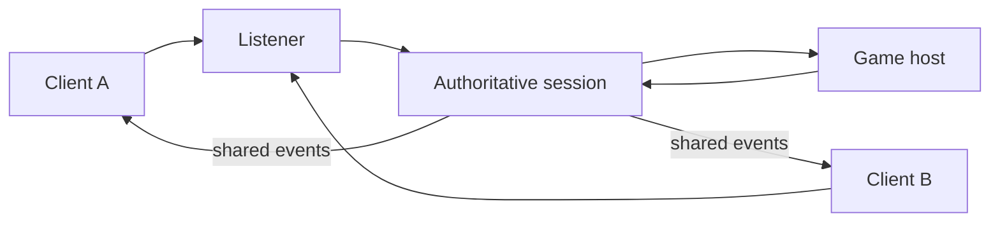

# Retrospective: two-process coordination

## Purpose

The first multiplayer server milestone moved from a single process handling
local commands to a server process that could accept more than one independent
client connection. Its central engineering result was not the TCP listener
itself: it established an ownership model and made one authoritative session
observable by multiple clients.

The work is historical. The current [protocol](../protocol.md) and
[architecture](../architecture.md) pages describe the public-facing design;
this retrospective explains what the early milestone demonstrated and what it
did not.

## Coordination model



Each connection has its own read lifecycle. The session owns player membership
and Sim claims. Events caused by shared state changes are broadcast; command
acknowledgements and snapshots can be requester-specific. A listener
coordinates delivery but should not become an alternative simulation
authority.

## Implemented concepts

| Capability | Contract established |
|---|---|
| Public listener | Accept a client connection, decode commands, and return events. |
| Session join | Associate a player identity with a connection before actions are accepted. |
| Claim arbitration | Prevent different players from claiming the same Sim concurrently. |
| Idempotent claim | A same-owner repeat does not create a second claim transition. |
| Disconnect cleanup | Release the departing player's claims and leave the session. |
| Command ownership | Reject a queued interaction when the sender does not own its actor. |
| Event fan-out | Deliver shared lifecycle and ownership events to connected peers. |
| Snapshot bootstrap | Provide an initial world view, even though its original chunked path was slow. |

A representative conceptual sequence is:

```text
join -> session_joined
claim actor -> sim_claimed
queue interaction -> accepted or named refusal
leave/disconnect -> sim_released
```

The exact message names and fields should be checked in the [protocol
reference](../protocol.md), not inferred from this historical outline.

## What the milestone taught

1. **Connection state is not player authority.** A socket can carry a player
identifier, but the server must first establish that the player joined and
that the actor is theirs.
2. **Disconnect is a state transition.** Claims cannot be left dangling
because the peer vanished without a graceful leave.
3. **Broadcast and response routing differ.** Some events belong to every
participant, while a snapshot or command result belongs to one requester.
4. **A full snapshot is not a cheap hot-path update.** The original chunked
snapshot transfer could take tens of seconds, leading to the later delta and
interest-management work.
5. **Tests and live runs answer different questions.** Local ownership tests
can prove arbitration logic; an end-to-end run proves the listener, game host
and event routing work together in that configuration.

## Failure modes and limits

- A connection can disconnect between command acceptance and event delivery.
- Reusing a player identity on a second connection needs a lease or
supersession rule.
- Large bootstrap snapshots can dominate join time.
- A broadcast event may arrive before a requester-specific response unless
ordering is explicit.
- An early milestone's successful two-process smoke test does not establish
sustained multi-client reliability.

## Related work

Later client-mirroring work added state projection and player input capture.
Two-player gameplay work expanded snapshot cadence, acknowledgements,
speed/time handling and resynchronization. See [client
mirroring](milestone-client-mirroring.md), [two-player
gameplay](milestone-two-player-gameplay.md), and [probe
results](probe-results.md).

Related pages: [architecture](../architecture.md), [protocol](../protocol.md),
[server CLI](../server-cli.md), [troubleshooting](../troubleshooting.md).


## Connection actor responsibilities

A connection has a lifecycle independent of the player's in-game actor. The transport reads complete frames, validates them, then passes decoded commands to the session. The session returns a command outcome and any events. Connection code decides whether an outcome is reply-only or broadcast, serializes writes, and invokes cleanup when the peer closes. This separation keeps socket details out of gameplay authority while still allowing disconnect to release claims.

| Component concern | State that belongs there | State that should not be duplicated there |
|---|---|---|
| Peer transport | Socket, input buffer, output queue, write lock | Gameplay interaction outcome |
| Session | Joined player, claims, command lifecycle | TCP partial-frame bytes |
| Game host | Native actors and world behavior | Public peer address |
| Stream | Broadcast cadence and recipient filters | Save serialization |

## Request and event routing example

A claim command can have a direct acknowledgement to its requester and a state event broadcast to all clients. A full snapshot is generally requester-specific. An interaction lifecycle event may be broadcast if all participants need to animate the result. A command rejection must remain tied to its command identity so that the client can show the right error.

```text
client A: JOIN -> direct session reply
client A: CLAIM actor-1 -> direct command result
server:   SIM_CLAIMED(actor-1, player-A) -> all joined clients
client B: receives claim event but cannot claim actor-1
```

This illustration names conceptual outcomes; use the [current protocol](../protocol.md) for wire spelling and payload shape.

## Snapshot bottleneck and next design pressure

The original bootstrap path transferred snapshot chunks at a cadence tied to simulator ticks. In the tested world this made snapshot retrieval take around a minute. Increasing socket read timeout hid the symptom but did not solve the architecture. The follow-on design introduced deltas, per-client acknowledgement and a repair path. This is a useful example of why operational symptoms often identify a missing abstraction rather than a timeout constant.

## How to verify/test

- Test two peers concurrently and assert only the appropriate reply is private.
- Kill one client without a leave command and verify cleanup.
- Send malformed JSON or a line exceeding the configured maximum.
- Reconnect with the same player identity and inspect lease/supersession behavior.
- Measure snapshot wall time separately from server game load time.
- Confirm no processes or sockets remain after the test runner exits.

Related pages: [transport decision](decision-transport.md), [client mirroring](milestone-client-mirroring.md), [two-player gameplay](milestone-two-player-gameplay.md).


## Concurrency and ordering

Per-connection reads can proceed concurrently, but shared session mutations need a serialized rule boundary. Otherwise two peers can race to claim the same actor or one peer can observe a release before the prior claim event. A session actor, lock or equivalent serialization mechanism must define the order of state changes. Event fan-out should publish the committed transition, not an intermediate mutation.

The output path also needs a policy for partial writes. If a peer disconnects mid-event, the server should not assume the event was delivered. Event sequence and subsequent snapshot acknowledgement let the client detect a gap. The next join or reconnect should receive a coherent state baseline rather than resume an arbitrary socket cursor.

## How to verify/test

Race two claims for the same unowned actor repeatedly and assert exactly one owner. Race release against disconnect and verify one release event. Force a partial write/disconnect and ensure the remaining peer still receives the event. Reconnect and verify the snapshot reflects the final claim state.


## What was portable to later milestones

The durable lesson from the first process split was that transport, membership and gameplay authority have different lifetimes. A TCP connection can disappear without the player state being immediately discarded; a player can remain a session member while releasing one actor; and a game interaction can remain in progress after its originating command was acknowledged. Later synchronization work depends on preserving these distinctions rather than flattening them into a single connected/disconnected flag.

The session boundary also created an explicit place to validate commands before they reach the game host. This improves testability, but it does not mean every game rule belongs in the listener. Claims and membership are session concerns; interaction outcomes remain native simulation outcomes unless a separately tested kernel contract takes ownership.

## Acceptance lessons

A useful test plan separates transport acceptance from game acceptance. First validate framing, size bounds and malformed input. Then validate join, claim and disconnect transitions. Finally exercise a real gameplay action with two clients and verify that both the result and ownership view converge. The test report should identify which stages were automated and which required a live game.

| Stage | Example assertion |
|---|---|
| Decode | One bounded frame produces one command |
| Session | Unjoined player cannot claim an actor |
| Arbitration | Competing claims result in one owner |
| Recovery | Abrupt disconnect releases claims once |
| Gameplay | Native outcome is visible to both clients |

Related pages: [authority](decision-authority.md), [transport](decision-transport.md), [two-player gameplay](milestone-two-player-gameplay.md).
