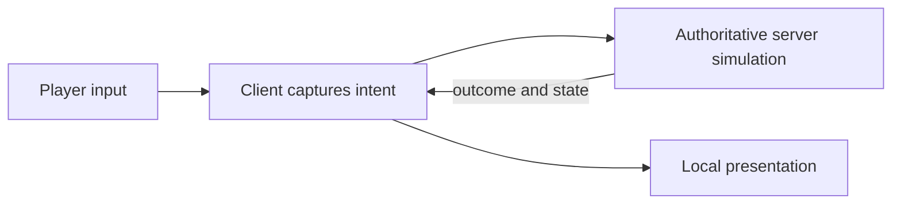

# Design principles

These principles summarize recurring choices across multiplayer design and
clean-room kernel experiments. They help evaluate proposals but do not
override the current implementation or public contracts.

## One place decides outcomes

The server game process is the sole simulator in the current model. A client
expresses intent; it does not prove that an interaction will succeed or that
local simulation is authoritative. The clients run the game for visual
presentation, not as competing authorities.



This avoids assuming deterministic lockstep between non-deterministic game
processes. A client's local menu test can improve responsiveness, but the
server's validation remains decisive.

## Record at shared engine boundaries

When several gameplay paths produce the same effect, instrument the narrow
common boundary rather than a single interaction. A queue operation, state
transition, posture update, or animation event is a more durable seam than a
named interaction. A seam must carry enough information to replay the outcome,
and hooks inside native callbacks must record bounded work rather than yield
or throw.

## Measure before expanding the model

Small probes answered specific unknowns before a broad synchronization
strategy was chosen: autonomy suppression, identity across save/reload,
snapshot enumeration, and state-injection survival. Evidence has explicit
scope:

| Evidence | Establishes | Does not establish |
|---|---|---|
| Unit test | Local contract for covered inputs | Live engine compatibility |
| Recorded trace comparison | Agreement on captured events and ordering | Coverage of unseen traces |
| One live probe | Behavior in its save, process and scenario | General behavior across worlds |
| Multi-run campaign | Repeated behavior in declared conditions | All content or unbounded reliability |

## Name one owner for each state

State needs one owner and clear invalidation boundaries. A client copy can be
stale; repair it through authoritative events or a snapshot rather than
silently promoting it to truth. Claims, connection lifecycle and command
authority are explicit server concerns.

## Separate simulation from presentation

The server can run a complete interaction while a client replays visible
outcomes without running that gameplay locally. This prevents local autonomy,
routing, random choices or effects from becoming a second simulation. The
separation is incomplete for UI state: menus inspect local objects, inventory,
posture and use flags, so presentation correctness includes exposing state
needed for an honest menu.

## Preserve save-game semantics

A snapshot is a synchronization projection, not the game's complete save
format. Durable state is written by the game-backed server through the native
save boundary. Reconstructing saves from network snapshots would require
hidden invariants and is not considered equivalent.

## Replace in stages and compare

A new kernel or transport should be compared against the existing authority
using identical input traces or matched live runs. The old implementation is a
temporary oracle, not the final specification; observable contracts must be
recorded so replacement does not inherit accidental internals.

A successful build is not completion. A replacement must own lifecycle,
validation, state, errors, recovery and diagnostics. Differential checks
should cover wire output, event ordering, snapshots, claims, persistence and
recovery.

## State limitations directly

Partial implementation, historical evidence and live verification are
different states. Documentation should say which applies. A design proposal,
fixture or narrow probe does not demonstrate full player-ready support.

## Common failure modes

- Separate game processes can diverge despite similar input and elapsed time.
- A recorder can miss effects produced outside its seam.
- Non-atomic server/client sampling can make moving state look inconsistent.
- A mirrored field can make a menu more accurate without satisfying the
server's deeper preconditions.
- Deterministic kernel output does not guarantee a native client displays the
same route or animation.

Related pages: [authority](decision-authority.md),
[presentation](decision-presentation.md), [probes](probe-results.md),
[divergence forensics](rust-divergence-forensics.md).


## Applying the principles to a change

A design review can turn the principles into a small set of concrete questions. First identify which process currently owns the result. Then locate the narrowest boundary that sees every producer of that result. Define the inputs and state transitions at that boundary, and decide how a client learns the result. Finally, name the evidence needed to distinguish a correct implementation from an implementation that merely compiles.

| Review step | Example question | Evidence to request |
|---|---|---|
| Authority | Which process decides whether this command succeeds? | Positive and unauthorized command cases |
| Boundary | Which shared seam observes every producer? | Call-path or event-corpus coverage |
| State owner | Who writes the value and when is its cache invalidated? | Ownership table and lifecycle test |
| Presentation | What does each client do with the outcome? | Two-client observation and replay trace |
| Persistence | Is this durable or transient state? | Save/reload boundary test |
| Failure | What happens when transport or process disappears? | Injected disconnect or malformed frame |
| Verification | Which claim is live-tested, not only unit-tested? | Exact command and result |

## Example: reviewing a new interaction mirror

Suppose a new interaction moves an object and changes the actor's posture. A narrow, interaction-specific patch might make one demo look correct, but it does not satisfy the shared-boundary principle. The contributor should identify the common object movement and posture recorders, verify whether the target's object identity is available on clients, and test that local autonomy does not independently create another movement. The result should carry an event order or snapshot tick so the presenter can detect stale state. A save test is needed only if the moved object or posture is durable; animation itself may be ephemeral.

```text
input -> authority check -> server queue -> engine boundary records
      -> ordered event stream -> client apply -> visible assertion
```

## Example: interpreting a failed comparison

A single server/client mismatch is a symptom. The next steps are to verify identity, sample time, and source ownership before changing code. If the server's value changed between its own observation and the client read, the comparison is non-atomic. If the server never produced the observed prop, adding a destroy mirror treats the symptom rather than the cause. See [divergence forensics](rust-divergence-forensics.md) for a repeatable comparison method.

## How to verify/test

- Run the smallest unit suite for the changed state rule.
- Add a negative case for wrong owner, missing identity, or stale generation.
- Retain a raw event trace for ordering-sensitive behavior.
- If a native seam changes, run an end-to-end live scenario separately from unit tests.
- Inspect documentation links and status wording after the code/test evidence is known.
- Report unavailable checks as unrun; do not describe them as passed.

Related pages: [tooling decision](decision-tooling.md), [probe results](probe-results.md), [testing](../testing.md).


## Review checklist by change type

**Protocol change:** name the versioning behavior, maximum frame size, malformed-input response, retry semantics and clients affected.

**State-mirror change:** name the authoritative producer, local apply path, identity mapping, echo-prevention rule and full-snapshot recovery behavior.

**Kernel change:** name the deterministic inputs, named errors, ordering rules, authored fixture and live differential still owed.

**Persistence change:** name the game save boundary, staging and validation steps, last-good behavior and interrupted-transfer result.

**UI change:** state whether the value is locally tested or server-derived, how a refusal is represented, and how the UI refreshes after a clock or state update.

These checks turn the general principles into a practical review without imposing the same validation on every subsystem.

## How to verify/test

A reviewer can ask for one positive case, one adversarial case and one recovery case per boundary. The adversarial case should test the invariant most likely to be violated; the recovery case should test the next stable state after failure. Where no live test is feasible, document the reason and the narrower evidence that is available.
