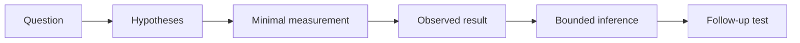

# Probe results and what they establish

## Purpose

Early probes were selected to answer high-risk questions before building
multi-client synchronization. The findings below are historical and bounded to
the tested save, process and scenario. They are useful as design evidence, not
universal compatibility claims.

## Summary

| Probe | Result | Design consequence |
|---|---|---|
| Autonomy suppression | Tested suppression and restoration calls worked for the sampled Sim. | Remote-owned client copies can be prevented from generating autonomous work in the tested path. |
| Object identity across save/reload | Sampled Sim and object identifiers remained stable across a save, fresh process and reload. | Persistent object identity was viable for the sampled ownership map. |
| Sim enumeration | The tested world exposed the same encodable Sim population at several load stages. | Snapshot bootstrap could begin after a defined readiness point, with lifecycle still observed. |
| State injection during route | A direct position update survived a route and appeared in a later snapshot. | Controlled server correction was technically viable; it did not prove arbitrary injection safety. |
| World load path comparison | Direct transition and menu path reached the same tested world state; the menu path was slower in that run. | The direct transition could remain the host path for the tested save. |

## Selected details

### Autonomy suppression

The test disabled autonomy for a Sim, observed the disabled state through a
diagnostic report, then re-enabled it. This established a viable control for a
sampled actor. It did not establish that the gate is sticky through every
lifecycle transition or that every client-side effect is caused by autonomy.

### Object identity

A sample of five Sims and five objects retained its identifiers through a
save, fresh game process and reload. This provided evidence that an object
identity could be used for ownership across that particular save cycle. A
sample is not a guarantee for every object class, every travel transition or a
different save.

### Enumeration lifecycle

The tested world reported 71 snapshot-encodable Sims at the observed
world-load and first-snapshot stages. The probe found the active enumeration
source populated at those checkpoints. It did not prove that a single event is
the universal readiness gate for every world.

### Position injection

A Sim was relocated while a route was underway; the game remained alive, and
the next snapshot reported the requested position. This demonstrated one
operation survived the tested route. It did not prove interaction safety, path
continuity, or that clients would present the correction identically.

### Load path

Both the direct transition path and the menu-driven transition reached the
same tested world and snapshot counts. The menu path took about 5.6 seconds
longer in that run. The finding supports the direct path for the tested
starting state; it does not establish a general performance profile.

## Probe quality and interpretation

A useful probe keeps four things distinct: observed behavior, inferred cause,
proposed design consequence, and untested scope. For example, stable identity
in a sample supports identity use but does not prove universal persistence. A
successful state write shows that one call returned a result, not that every
downstream subsystem remained consistent.

## Failure modes and limits

- A probe can run against stale binaries or a stale installed mod.
- A low sample count can hide an identity or lifecycle exception.
- A snapshot may omit state that matters to the behavior under study.
- A diagnostic hook can observe a different stage than the user-visible
result.
- A live success does not replace automated regression tests.

## Related pages

The broader synchronization tradeoffs are discussed in [synchronization
research](synchronization-research.md). The multiplayer sequence is summarized
in [two-process coordination](milestone-two-process.md), [client
mirroring](milestone-client-mirroring.md), and [two-player
gameplay](milestone-two-player-gameplay.md).

Related pages: [testing](../testing.md),
[troubleshooting](../troubleshooting.md), [principles](principles.md).

## Reconstructing the load-path measurement

The load comparison used separate fresh game processes for each path. Both paths reached the same tested world and reported the same Sim and object counts. The direct transition reached readiness in about 66.7 seconds; the menu-mediated route took about 72.3 seconds in that run. The difference is consistent with the menu path repeating metadata work, but the result is one save and one machine condition. It justifies keeping the direct path for that tested transition, not removing the menu path from every possible scenario.

## Reading the autonomy result carefully

The tested disable operation incremented a per-Sim suppression state, and the diagnostic reported autonomy disabled; the matching enable operation restored it. This supports a mechanism, not a universal policy. A client copy may later reset suppression, and the server may still run autonomy as the one authority. A robust acceptance test samples the gate across claim, release, save/reload and resync boundaries.

## Positive controls and invalid probes

A probe can fail because its assumption is invalid rather than because the product is broken. Examples include using a placeholder object identifier, issuing a claim before joining, or installing an old package because packaging and installation ran concurrently. A positive control proves that the intended channel and target are observable before interpreting the test case.

| Probe validity check | Example assertion |
|---|---|
| Target identity | Resolved actor and target appear in a fresh snapshot |
| Session state | Join acknowledgement precedes claim request |
| Package freshness | Runtime build reports the expected version or marker |
| Diagnostic reachability | Known-good report returns before the mutation |
| Cleanup | Game/controller processes and test sockets close afterward |

## Reusable probe report

A concise report should include: purpose, exact controlled variables, observed values, whether the positive control passed, the result, inference, and limits. Keep raw logs separate from the summary. If a probe compares multiple clients, report each process's values and the sampling order. If a result is inconclusive, name the missing observation rather than converting it to pass or fail.

## How to verify/test

- Re-run the standard unit tests for the changed host or protocol contract.
- Verify the live package is the package built from the inspected source.
- Run a matched baseline and experiment in the same declared world configuration.
- Capture pre- and post-state, including server-side state, not only the client symptom.
- Confirm cleanup and artifact privacy before publishing evidence.

Related pages: [synchronization research](synchronization-research.md), [tooling decision](decision-tooling.md), [divergence forensics](rust-divergence-forensics.md).

## How the evidence feeds architecture

The autonomy probe supported a control seam for remote copies. Identity stability supported using saved object IDs for a bounded ownership map. Enumeration timing identified candidate readiness events. State injection established that a controlled correction could survive one active route. The load-path comparison selected a faster tested path without claiming universal load behavior. Together, the probes reduced uncertainty enough to build multi-process coordination; none solved presentation completeness by itself.

## Probe reproducibility checklist

Before a repeat run, pin the game build category and save identity, list the actors and object sample rule, verify the host and client packages correspond to the current source, and capture the diagnostics required to interpret the result. If one client reconnects or a process restarts mid-run, mark the pass as a new lifecycle rather than silently combining it with earlier observations.

| Artifact | Why retain it |
|---|---|
| Input parameters | Reproduce controlled state changes |
| Pre-state snapshot | Confirm initial conditions |
| Raw event log | Analyze ordering and missing events |
| Post-state snapshot | Establish observed outcome |
| Build/version marker | Rule out stale package installation |
| Cleanup result | Ensure next run starts from a known state |

## Confidence labels

Use "observed" for direct output, "supports" for a bounded inference, "consistent with" for a plausible explanation, and "unverified" where the discriminator is missing. Avoid absolute words such as "always" when the sample is finite. A negative probe result is useful only when the measurement could have detected the behavior.

## How to verify/test

A second contributor should be able to repeat the procedure from the public command and scenario description without access to internal run paths. If the exact game asset is not suitable for public redistribution, identify the test by a generic world category and keep the private input out of the documentation.
