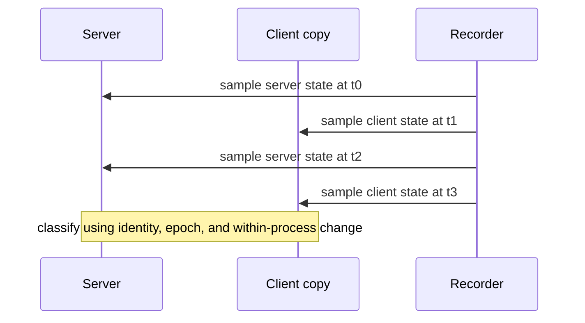

# Server/client divergence forensics

A divergence report is a triage artifact, not a verdict. Separate a true mirror defect from local simulation, missing lifecycle events, identity errors, and a measurement artifact caused by comparing changing state at different times.

## Classify by cause, not field

| Observation | Candidate cause | Discriminating check |
|---|---|---|
| Client queue contains an action absent from the server | Local simulation or input echo | Trace the queue producer and check whether the autonomy gate is active. |
| Server object exists but client copy does not | Missing creation/mirror event | Compare object inventory and recorder output for the same world epoch. |
| Object appears only on a client | Local effect or missing server-side lifecycle transition | Establish whether the server created the object and whether attach/detach or destroy was recorded. |
| Position or heading differs | Replay error, identity mismatch, or non-atomic sample | Sample both processes repeatedly and compare each process's own movement over the interval. |
| Command result is unexpected | Probe handshake/identity, authority policy, or transport | Verify join state and command identity before interpreting the reply. |

A position mismatch can be downstream of a client-only interaction or wrong actor mapping. Do not repair each resulting field independently until the initiating cause is understood.

## Compare moving state safely

Sequential server and client reads are not necessarily observations of the same motion phase. Preserve raw records and sample each process more than once:

1. Verify both observations identify the same semantic actor and world epoch.
2. Retain the raw server and client records, not only a derived mismatch flag.
3. Determine whether the server itself changed during the comparison window.
4. Compare displacement, heading change, and phase across repeated observations.
5. Recompute the classification from the raw observations after changing a rule.
6. Keep unresolved movement fidelity separate from a conclusion that a single comparison was non-atomic.

Repeated samples can identify a timing artifact; they do not prove that the client tracks the server correctly. A fixed-position replay or a sufficiently detailed time series may still reveal systematic speed or turn-rate differences.

## Repair the source of the mismatch

If a client runs an interaction the server never queued, investigate local autonomy or input capture before cancelling the interaction after the fact. If the server created an object but the client missed its destruction or detach, investigate object and slot recording. If the server never created the object, determine whether local simulation produced it rather than adding a compensating mirror update.

The current C# authority policy is in `DedicatedServer/Mirroring/ClientAuthorityPolicy.cs`. In the present implementation, `GateReplacesAutonomySuppression` is false: the script-level authority gate does not replace the separate autonomy-suppression request. The test `MirrorEngine.AutonomySuppressionSurvivesEnforcingGate` checks that behavior. `ClientAuthorityPolicy.NativeSetFollowsLotMode` and `ClientAuthorityPolicy.PublishesOnChange` cover related policy selection and publication behavior. These are unit-level contracts, not live-game measurements.

For current authority and scope details, see [authority and ownership](../architecture-deep-dive/authority-and-ownership.md) and [scope hooks and authority modes](../architecture-deep-dive/scope-hooks-and-authority-modes.md). The latter also documents the current malformed-scope handler atomicity edge.

## State and event evidence

A state mismatch says snapshots disagree. An event mismatch says the processes received or applied different transitions. Keep both views: an event can be present in the stream but fail at application, or final state can agree after a transient event was missed.

| Final state | Event history | Interpretation to investigate |
|---|---|---|
| Agrees | Agrees | No mismatch observed in this window. |
| Agrees | Differs | A transient sequence or repair may have hidden a gap. |
| Differs | Agrees | Apply semantics or local engine behavior may differ. |
| Differs | Differs | Recording, filtering, identity, or apply may be wrong. |

For durable fields, compare snapshot ticks and save boundaries. For transient fields, inspect event sequence and local apply completion.

## Evidence hygiene and limits

- Preserve the exact raw input to a classifier separately from its output.
- Use synthetic actor labels and omit private host paths, identifiers, save contents, and proprietary implementation details from public reports.
- A screenshot is supplementary; state and event records are usually more diagnostic.
- A reduced mismatch count is not closure unless the scenario exercises the proposed cause and a nearby negative control remains correct.
- Unit tests and fake-driver tests do not establish native engine parity or live process behavior.

## Related pages

- [Principles](principles.md)
- [Probe results](probe-results.md)
- [Presentation decision](decision-presentation.md)
- [Runtime timing](runtime-timing.md)
- [Open problems](open-problems.md)
- [Rust kernel pilot](rust-kernel-pilot.md)
