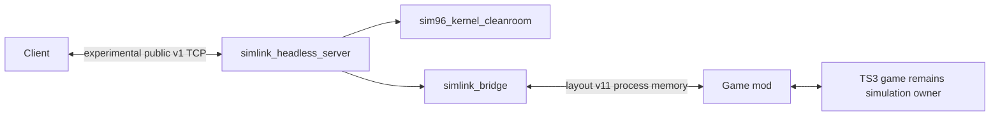

# Rust kernel, bridge, and server

The Rust tree contains three independent Cargo workspaces: a no-unsafe clean-room kernel, a process-memory bridge crate, and an experimental server binary. The original C# runtime remains the established player path. Both Rust service crate READMEs say the components are experimental and not supported player releases; code presence and passing tests must not be presented as release acceptance.

## Crates and dependency direction

| Crate | Current role | Source anchors |
|---|---|---|
| `sim96_kernel_cleanroom` | Typed rules, state containers, planners, wire helpers, save models and other isolated contracts | `rust/sim96_kernel_cleanroom/src/lib.rs`, `Cargo.toml` |
| `simlink_bridge` | Attach to a game process, discover layout-v11 memory, exchange frames and decode typed replies | `rust/simlink_bridge/src/lib.rs`, `layout.rs`, `driver.rs` |
| `simlink_headless_server` | Listener, session/claim rules, line codec, streams, save/rejoin and bridge driving | `rust/simlink_headless_server/src/main.rs`, `session.rs`, `wire_v1.rs` |

The headless server depends on both other crates. The kernel does not depend on either process bridge or server crate. This keeps pure rule tests independent of sockets and game memory. In the bridge crate, the root denies `unsafe_code` and allows it only for `ffi`; the kernel and headless server forbid unsafe code.



This is the Rust experiment's topology. It does not describe the default C# server path and does not claim that Rust replaces the native simulation.

## Kernel types and constraints

`lib.rs` exports `ObjectGuid(u64)`, `SimId(u32)`, `LotId(u32)`, and `ObjectId(u64)`. Do not infer that every wrapper has an independent 64-bit allocation space: `ObjectArena<T>` wraps `SimArena<T>` and converts its internal 32-bit handle to `ObjectId`; lookups reject values that do not fit in `u32`.

The crate currently has two distinct generation-handle implementations:

- `SimArena<T>` in `lib.rs` packs a 16-bit slot index and 16-bit generation in `SimId`. A slot whose generation reaches `u16::MAX` is not reused. `LotArena` and `ObjectArena` wrap this representation.
- `HandleArena<T>` in `handles.rs` returns `GenHandle { index: u32, generation: u32 }`. `GenHandle` is `repr(C)`, exactly 8 bytes, with offsets 0 and 4. `remove` increments generation with saturation; slots at `u32::MAX` are retired instead of wrapping to an earlier identity.

They are not interchangeable. The former backs typed arena ids; the latter is a separate generic API with explicit error results (`UnknownHandle`, `StaleObjectHandle`, `SlotRetired`, among other gameplay-level errors).

The kernel's Rust manifest declares `unsafe_code = "forbid"` and Clippy `all = "deny"`. `private-oracles` is an optional feature; the ordinary clean-checkout build selects `kernel_default` for `KernelRng` and `KernelSlots`. The module list in `lib.rs` includes authority, interaction, persistence, route, social, economy and world-integration surfaces, but a declared module alone does not mean a running server uses it.

## Bridge contract

The bridge copies the C# shared-memory contract: layout version 11, bridge wire protocol 23, HELLO version 6, 16 control slots of 4096 bytes, and four bulk slots of 524288 bytes. `layout.rs` pins the control region (65,600 bytes), bulk region (2,097,216 bytes), and total region (2,162,816 bytes) with compile-time assertions. The capability text is `multi-slot=16,bulk=4x512k,layout=11,snapshot2=1`.

`simlink_bridge::ffi` is the only module that contains unsafe platform calls; its public API uses safe wrappers. The crate's README identifies the implementation as a Windows process-memory bridge. The source comment mentions Linux `process_vm_readv` only as a later possibility, not as a currently supported implementation.

The fake-memory integration tests in `rust/simlink_bridge/tests/driver_fake_mod.rs` cover attach/handshake, slots, size rejection, sequencing, corrupt frames, and bulk state. For example, `an_oversized_frame_is_refused_before_any_write` verifies that an over-limit line is refused before the simulated memory is modified. This is not a live `TS3W.exe` compatibility result.

## Rust server protocol and session behavior

`simlink_headless_server` implements its own public protocol version 1 in `messages.rs` and `wire_v1.rs`. It is independent of bridge versions 11/23/6 and of the existing JSON protocol. A line is UTF-8, pipe-separated, LF-terminated on the wire, and capped at 4,194,304 content bytes (LF excluded). The codec has `HELLO`, `WELCOME`, `CMD`, `ACK`, `ERR`, `EV`, `BULK`, and `Rf` frame tags. The raw maximum for a single bulk chunk is 3,145,632 bytes so base64 plus frame overhead stays within the line cap.

Illustrative wire shapes from the codec:

```text
HELLO|1|<caps>
WELCOME|1|<epoch>|<server-caps>
CMD|<corr>|<Verb>|<commandId>|<playerId>|<arg>...
ACK|<corr>|<Verb>|<field>...
ERR|<corr>|<code>|<verb-or->|<detail>
EV|<seq>|<kind>|<field>...
```

`split` rejects invalid UTF-8, embedded CR/LF, overlong content, or a missing wire LF; it accepts one CR immediately before LF. `line` rejects field separator characters and enforces the same length cap. The exact field encoding is in `messages.rs`; see the public [protocol](../protocol.md) for the established C# contract.

In `session.rs`, each `Connection` stores `last_corr`, a per-client event sequence beginning at 1, an idempotency window of `COMMAND_ID_WINDOW` (32) cached command replies, join/supersede state, and resume lease fields. A duplicate `commandId` within the retained window returns the cached reply bytes rather than dispatching a second effect. A later join using the same player id supersedes the prior connection. `IdMap` maps external `u64` ids injectively to kernel `SimId(u32)` values, reserving `SERVER_PRIMARY_SIM`; exhaustion is a named `IdSpaceFull` refusal rather than integer truncation.

Useful test names include `command_and_ack_frames_round_trip`, `over_long_line_is_refused_both_directions` (in `tests/wire_v1.rs`), `replayed_command_id_returns_the_original_reply_byte_for_byte`, `a_new_command_must_have_a_strictly_increasing_corr`, and `a_rejoin_supersedes_the_earlier_connection` (in `tests/session.rs`).

## Running and operating the experiment

From the repository root, bind-only is the non-resident default. Resident mode needs an explicit driver choice; the source accepts `--fake-driver`, `--pid <pid>`, or Windows-only `--attach-ts3w`. Public binding is opt-in via `--public <host>:<port>`; without it, `BindPosture::default_loopback()` uses `127.0.0.1`. `--connections` defaults to 32. The program warns for non-loopback binds, but the protocol has no authentication; do not expose it to untrusted networks.

```powershell
cargo run --manifest-path rust/simlink_headless_server/Cargo.toml -- --serve --fake-driver
```

The example is for local experiment/test only and does not connect to a real game. A live attach requires the supported bridge host and a valid game process; the binary cannot replace the game's simulation. The crate README explicitly disclaims supported release status.

## Verification boundaries

Run focused Rust tests from the root:

```powershell
cargo test --manifest-path rust/sim96_kernel_cleanroom/Cargo.toml
cargo test --manifest-path rust/simlink_bridge/Cargo.toml
cargo test --manifest-path rust/simlink_headless_server/Cargo.toml
```

Kernel tests establish the tested pure contracts; fake-driver tests establish the simulated bridge behavior; server tests establish the server crate's codec/session state. None alone establishes live parity, safe public deployment, full interaction coverage, or the absence of the native game dependency.

## Related pages

- [Kernel ownership and handles](rust-kernel-ownership.md)
- [Rust server front door](rust-kernel-front-door.md)
- [Kernel routing obligations](rust-kernel-obligations.md)
- [Road placement](rust-road-placement.md)
- [Architecture options](rust-architecture-options.md)
