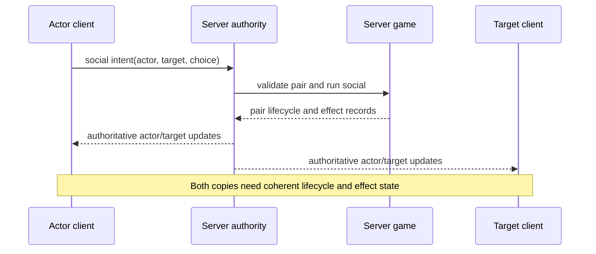

# Social-session research summary

## Scope

The archived social pre-probe examined how a social interaction is assembled
and observed across two Sims, rather than treating a social as a single button
press. Its research threads included call-flow mapping, the social-interaction
family, server/client echo behavior, effect persistence, adversarial
counterexamples and whether the protocol carried enough information for
distributed observation.

The material was exploratory. It did not establish that every social
interaction is ready for general multiplayer mirroring, and this summary does
not claim that a complete social-session implementation has passed live
acceptance.

## Why a social is a session

A social action has at least two participants and can change more than the
active Sim's queue. The recipient may have an animation, posture, relationship
update, conversation context, mood effect or follow-up state. A client sees a
projected copy of both participants, so a one-sided event can leave the pair
in inconsistent states.

| Concern | Questions the probe raised |
|---|---|
| Participants | Are actor and target identities stable on every peer? |
| Pair lifecycle | How are offer, acceptance, start, turn and end represented? |
| Local selection | Can a client independently choose a different social response? |
| Effects | Which changes are transient, persistent, or owned by the save? |
| Echoes | Can a replayed event be mistaken for a new local social input? |
| Failure | What happens when one participant leaves, routes away or becomes unavailable? |
| Transport | Are all required events ordered and visible to both participants? |

## Research method

The call-flow audit is useful for discovering the boundary between a chooser,
a paired interaction and its effects. A family-level audit avoids concluding
from one social class that all socials use the same path. A mirror audit
checks both peers and both participants. Persistence analysis asks whether
effects survive save/reload or should be replayed as ephemeral presentation.
Adversarial review looks for asymmetric disconnect, refusal and
duplicate-delivery cases.

## Design implications

- Treat a social as a paired state machine, not just a queued interaction
name.
- Keep server selection authoritative; client-side social choosers may be
stale.
- Preserve both participant identities in event correlation and refusal
reporting.
- Distinguish durable relationship data from short-lived conversation,
animation and mood state.
- Define the result of disconnect or travel during a pair before adding
automatic recovery.
- Avoid merging or coalescing lifecycle events until their effect on replay
has been measured.

## Current evidence boundary

The research notes explicitly treated social-session evidence as a
prerequisite to mirroring certain social terminal behavior. This is a
conservative boundary: a social that looks correct in one live run may still
leave the other participant, relationship state or persisted effects
inconsistent. The project's current generic protocol documentation should not
be read as proof of full social parity.

## Suggested acceptance matrix

| Test | Required observation |
|---|---|
| Both Sims idle | Same social choices and test outcomes on server and clients |
| One participant seated | Correct posture-sensitive options and animations |
| Pair starts | Same actor, target and lifecycle state on all clients |
| Pair completes | Relationship and transient effects match their intended durability |
| One client disconnects | Server resolves or terminates the pair without orphaning it |
| Save and reload | Durable effects persist; ephemeral presentation is not duplicated |
| Duplicate command | Idempotent result without starting a second social |

## Failure modes and limits

- One participant receives a start event while the other does not.
- A client locally reselects an interaction after the server has chosen it.
- A replayed relationship change is applied twice after retry.
- A transient mood effect is persisted incorrectly or omitted from a live
client.
- A test of standing Sims is generalized to seated or otherwise constrained
posture.

Related pages: [menu honesty](menu-honesty.md), [presentation
decisions](decision-presentation.md), [multi-household
behavior](multi-household.md), [protocol](../protocol.md), [open
problems](open-problems.md).

## Leaving an active conversation

A later conversation-lifecycle investigation used a single player-input choke
point for a leave intent, then routed it through the existing cancellation
path. The technical lesson is to capture a participant's leave once and use
the established server cancel lane rather than adding separate cancellation
logic to each conversation type. The archived verification record did not
establish the full live two-client behavior, so client-visible completion and
partner attribution still require an end-to-end test.

The leave command needs enough information to identify the active pair when
the initiating Sim alone is ambiguous. A stale or missing partner ID should
produce a named refusal or a safe no-op; it should not cancel an unrelated
conversation.

## Social-state verification worksheet

For each tested social family, record the initiating actor, target, pre-interaction posture, selected interaction, server result, participant lifecycle events, relationship delta, transient effects, and post-save behavior. Repeat with the initiator and target exchanged. This reveals asymmetric actor/target assumptions that a single direction misses.

| Capture | Actor side | Target side | Observer side |
|---|---|---|---|
| Menu entries | Locally available choice | Locally available response | What a third client sees |
| Lifecycle | Queue/start/end | Accepted/start/end | Broadcast order |
| Posture | Before and after | Before and after | Replayed pose |
| Relationship | Before and after | Before and after | Snapshot consistency |
| Effects | Durable or transient | Durable or transient | Duplication or omission |

Related pages: [menu honesty](menu-honesty.md), [multi-household behavior](multi-household.md).

## Conversation leave and cancellation

A leave action should be modeled as an intent from one participant that resolves through the established cancellation lane. The server must know the active pair and which participant initiated departure. If both clients leave at nearly the same time, cancellation should be idempotent and produce one terminal state. If only one participant leaves, the remaining Sim should not retain an orphaned "in conversation" state.

| Leave case | Expected behavior |
|---|---|
| Actor leaves | Cancel the matching pair and notify target |
| Target leaves | Cancel the matching pair and notify actor |
| Both leave | One terminal cancellation, no duplicate effect |
| Pair already completed | Safe no-op or named stale-session refusal |
| Missing partner identity | Do not cancel an unrelated pair |

## How to verify/test

Run leave tests from both participants, then test simultaneous leave, disconnect, cancel after completion and a second active conversation on a different pair. Verify no unrelated conversation is cancelled and both clients observe the same terminal result.
