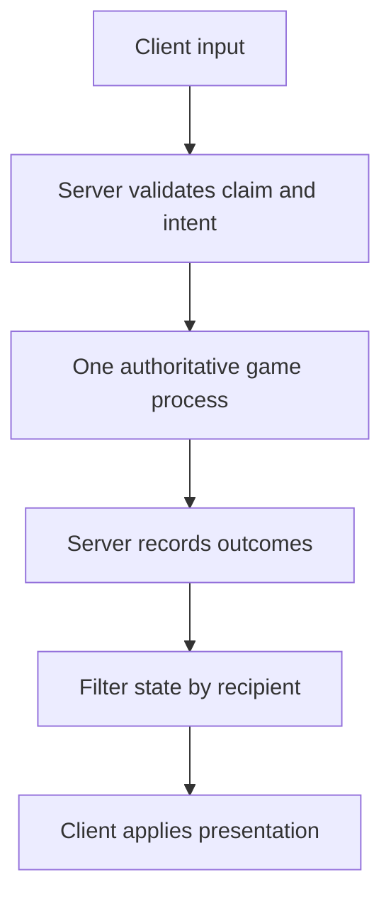

# Synchronization architecture research

## The design question

Once two processes could exchange commands, the harder question was how much
simulation each client should perform and what state each client should
receive. The research compared authoritative mirroring, activity-gated client
simulation, lot sharding, and semantic identity/reconciliation strategies.

## Options considered

| Option | Description | Strength | Cost or risk |
|---|---|---|---|
| Mirror-only client | Server simulates; client receives state and presents it | One outcome authority | Requires sufficiently complete state and presentation capture. |
| Activity-gated local simulation | Client simulates selected actors only when active | Can reduce central work | Authority handoffs and local engine state become complex. |
| Lot-sharded authority | Different processes own different lots | Potentially distributes simulation | Cross-lot travel requires ownership transfer and merge rules. |
| Semantic key layer | Map durable gameplay identity beyond transient object IDs | Can survive some representation changes | Requires a stable semantic identity model and reconciliation. |

## Evidence that shifted the decision

The key distinction is between reducing transmitted state and deciding who
owns simulation. Interest management can filter which entities or details a
client needs without making that client authoritative. Absolute clock setting
can align time without giving the client control of time. Unclaimed-Sim policy
can prevent two sides from making independent choices even when actors are not
directly controlled by a player.

These questions were tested separately because a single experiment could not
distinguish whether a problem came from bandwidth, clock drift, autonomous
behavior or authority overlap.

## Selected model and refinement

The accepted baseline is one simulator with clients as input and presentation
endpoints. This refines earlier server-authority language by making clear that
clients do not run the same interactions as independent authorities. The
evidence supporting presentation replay was strong in sampled categories but
incomplete for under-sampled activities such as computer use and eating. That
limitation remains important: a recommendation based on partial category
coverage is not a universal proof.

## Interest management and resynchronization

Interest filtering limits unnecessary entity detail, but a client may still
need world-level context, clock information, or presentation history for an
action in progress. A late joiner therefore needs a bootstrap path that is
coherent with subsequent deltas.

Delta synchronization depends on an acknowledged base. Without it, the server
cannot know whether a client has applied the state from which a delta was
derived. A force-full policy should be per client, and a full snapshot should
clear its in-flight latch only after acknowledgement.

## What was rejected or deferred

- Lockstep requires deterministic simulation that the game engine does not
provide.
- Client-computed outcomes transfer authority to copies that may be stale or
untrusted.
- Lot-local simulation was not selected as the baseline because of travel and
merge complexity.
- A clean-room kernel was treated as a staged research track, not a
prerequisite for the immediate multiplayer design.
- Some state categories still need additional recorder or mirror coverage.

## Consequences

The design accepts the cost of a central simulator and a rich presentation
path in exchange for clear outcome authority. It does not claim that a single
snapshot contains all state or that a client can exactly reproduce every
native animation. Where the client lacks state needed to render or construct
an honest UI, a separate mirror or refusal mechanism is required.

## Failure modes and limits

- Interest filtering can omit state a later menu or interaction needs.
- Deltas without a valid acknowledged baseline can permanently diverge.
- Presentation replay can differ in frame timing despite identical event
records.
- Server-only simulation concentrates load and makes server availability
important.
- Partial evaluation can overstate the success of one option.

Related pages: [authority](decision-authority.md), [two-player
gameplay](milestone-two-player-gameplay.md), [clean-room
feasibility](clean-room-feasibility.md), [protocol](../protocol.md),
[status](../status.md).

## Framing decision: behavioral authority versus regional optimization

The research separated two strategies that can look similar in a topology diagram. Interest management decides what state is sent to a client. Regional authority decides which process simulates that state. Filtering an event stream does not require allowing the receiving client to make gameplay decisions. Keeping those questions separate enabled a single simulator while still limiting mirror traffic to the relevant actors and details.

The selected one-simulator model was supported by a presentation-replay comparison, but the sample did not cover all requested activity categories. The result favored recorded presentation over interaction re-execution for the observed cases; it did not prove that the event vocabulary covers every interaction family.

## Clock and unclaimed Sims

Absolute time and speed are independent controls. A client may receive the server's speed but still have a different world-time offset; conversely, setting time may not refresh the visible HUD. Likewise, an unclaimed Sim still needs one simulation owner. "No player owns this Sim" must not mean ?every client may simulate it.? The server remains the default authority for unclaimed world behavior under the selected model.

| Question | Correct dimension | Incorrect shortcut |
|---|---|---|
| Which details should a client receive? | Interest filter | Give client authority over nearby actors |
| What time is it? | Authoritative clock observation and reconciliation | Infer from local wall time |
| Who simulates an NPC? | One default authority rule | Allow every copy to run autonomy |
| Can a late joiner see an active action? | Snapshot plus presentation history | Assume the next delta contains its start |

## Traffic and cadence trade-off

A full snapshot is useful as a repair baseline but expensive for routine updates. Deltas reduce repeated data but require the server to know the client's acknowledged base. Interest filtering reduces detail, but a client can need information outside its immediate lot for menus, household state, clock or travel. Cadence should be tied to per-client lag and the cost of repair rather than a single global timer alone.

## How to verify/test

1. Measure full snapshot transfer size and wall time in the declared world.
2. Compare delta volume for active and inactive scopes.
3. Delay one client's acknowledgements while another remains current.
4. Verify the slow client gets a full repair without changing the fast client's baseline.
5. Join during a long-running interaction and inspect both snapshot and event history.
6. Compare simulation clock, speed and HUD after a large time correction.

Related pages: [two-player gameplay](milestone-two-player-gameplay.md), [persistence](decision-persistence.md), [status](../status.md).

## A concrete drift budget

Synchronization policies should identify which quantity is bounded: event latency, snapshot age, acknowledgement lag, clock drift, or animation phase. A single "sync delay" hides different causes. For each, define a warning threshold, hard threshold and action. The service can adapt delta cadence when acknowledgement lag grows, but it should not slow the authoritative game simulation simply because one client is behind.

| Metric | Warning response | Hard response |
|---|---|---|
| Snapshot age | Increase cadence attention | Force full bootstrap |
| Event sequence gap | Mark stream stale | Repair from snapshot/history |
| Clock drift | Publish authoritative time | Reconcile clock and UI |
| Presentation delay | Measure queue and local apply | Drop/repair only under explicit policy |
| Client output backlog | Apply backpressure | Disconnect or resync slow peer |

## Why server timestamps need context

Wall-clock timestamps are useful for latency, while simulation ticks are useful for logical ordering. They are not interchangeable. Pausing or changing game speed changes the relation between them. A report should include both where available and name whether a field is server event time, client receipt time, callback processing time or display completion time.

## Interest-filter test cases

Test a nearby claimed actor, a remote unclaimed actor, an actor entering/leaving interest, a late joiner and an in-progress interaction. Verify that every client receives its own actor state, required shared events, and the minimum world context necessary for menus and UI. Ensure that filtering an event for one recipient does not change the server's authority decision or suppress delivery to another peer.

## How to verify/test

Introduce controlled network delay and loss in a disposable local environment. Measure per-peer lag, event gaps, repair count and output backlog. Compare active and inactive-lot traffic. Then repeat without injected delay to ensure the policy does not degrade the normal path.
