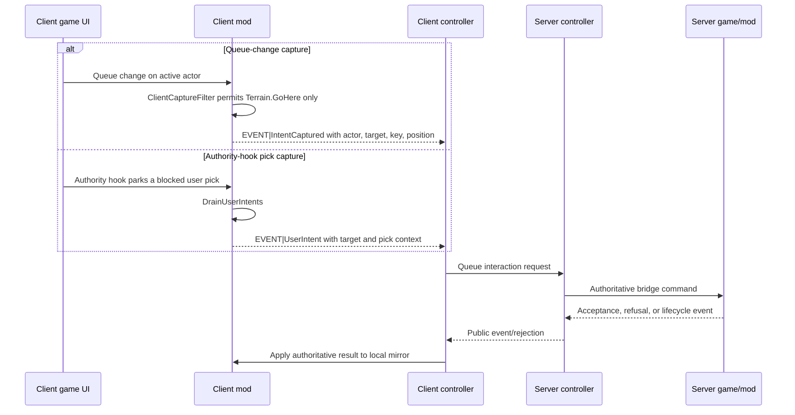

# Capture and input pipeline

A player action travels from the local game UI to the client mod, through the client controller and public session protocol, then through server validation and authoritative execution. The client also receives the authoritative echo for its mirror. The main safety property is that local queue activity is not automatically treated as a user click.

## Capture stages

`SimsOnlineServerHostMod/ClientCaptureFilter.cs` permits only the supported `Terrain.GoHere` definition forms (`Terrain.GoHere` and a reflected `Terrain+GoHere` name). It rejects null/empty keys and other `UserDirected` queue entries. The client/server allowlists must stay aligned; otherwise an engine-generated reaction can be misreported as a player command and then rejected by the server.

These are separate producers in `SimsOnlineServerHostMod/ServerHostMain.cs`:
`InterceptClientInteraction` emits `EventIntentCaptured` after the queue-change filter,
while `DrainUserIntents` drains the authority hook's captured picks into `EventUserIntent`.
The latter depends on the local authority-hook integration; removing maintainer-local
hook sources from the public tree does not make that integration available in a clean checkout.

## Captured pick context

`UserIntentWire` keeps UI selection context in compact text fields:

| Field | Wire form | Meaning |
|---|---|---|
| Hit | `type:objectId:layerMask` | Game hit classification and target details. |
| Picked objects | `s<ID>,o<ID>,d<ID>` | Selected Sim, object, or SimDescription IDs; `-` means no selection. |
| Hit point | Three coordinates | Optional world-space point. |
| Definition/name/path | Hex-encoded strings on bridge line | Identifies the selected interaction. |

For example, `FormatHit(4, 42, 3)` produces `4:42:3`; selected Sim 1 and object 2 format as `s1,o2`. `TryParseHit` rejects malformed numeric parts. `TryParsePicked` rejects unknown kinds or IDs without a numeric suffix.

## Refusal feedback

A command may pass transport but fail the server game's interaction test. `PickFailed` includes command correlation, actor, interaction, and reason; the server can append a flattened tooltip as ` | tooltip: <text>`. Only `NotRun` and `FailedToStart` request the extra tooltip, because `ObjectInUse` and `RouteFailed` already explain the refusal. The client surfaces a rejection rather than pretending the action succeeded.

## Tests and limits

`DedicatedServer.Tests/Program.cs` contains focused checks for `UserIntentWire.RoundTrips`, `UserIntent.DecodesAndEncodesAsQueueInteraction`, and `ClientCaptureFilter` behavior. `DedicatedServer.Tests/OutboundListenerTests.cs` verifies a failed queued pick is returned to the player that issued it. Current capture support is intentionally narrower than every interaction visible in the game UI; unsupported picks must fail closed.

## Related pages

[Run clients](run-client.md) | [Client options](client-options.md) | [Scenario catalog](scenario-catalog.md) | [Protocol](../protocol.md) | [Testing](../testing.md)
