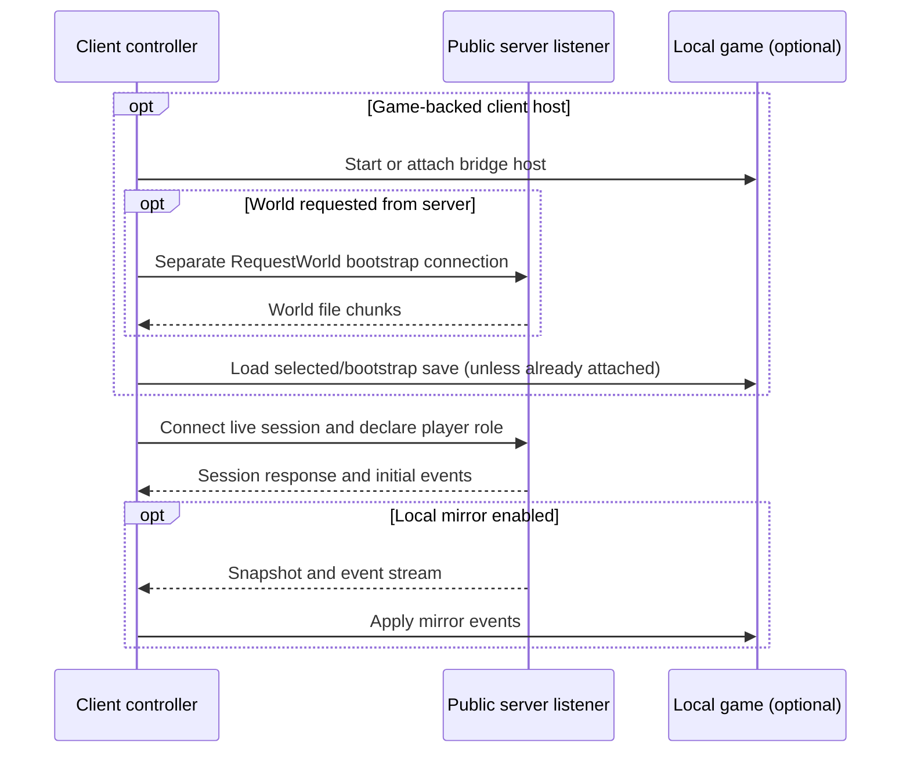

# Run clients

A client can exercise the public session protocol without a local game, or mirror server events into an attached client game. Those are different validation levels: a successful socket join does not prove the local mirror applied a baseline.

## Boot a development client

With a local server already ready and both controllers already built:

```powershell
python scripts/stackctl.py boot-client
python scripts/stackctl.py status --strict
```

`boot-client` starts the first mirrored client and polls readiness. `boot-client2` and `boot-client3` start additional roles where their local profiles and isolation are configured. `stackctl` gives each role separate run files and bridge endpoints; on Windows, it uses Sandboxie box settings, while Linux client roles use separate Wine prefixes. Confirm the local isolation before launching multiple games; do not point two processes at one mutable profile.

The [first live session](first-live-session.md) shows how to prebuild both controllers, launch the mirror with a disposable save, and verify baseline application. Building the client while the server is running can hit a Windows executable lock.

Leaving out `--build` reuses the managed controller. The launcher can still run `make-mod.ps1` when workspace mod sources differ from the installed copy. After installing a matching mod package yourself, add `--skip-mod-sync` to launch with that package.

The direct controller supports protocol-only mode by default. `--enable-mirror` enables event application, while a game-backed mirror also needs a game executable and save. `--client-world-from-server` requests the server's world; this additionally needs the correct local Saves directory.

## Join progression



`SimsOnline.Client/Program.cs` starts the owned host and loads its save before the live
session's `tcp.ConnectAsync`. Fetching a server world uses a separate bootstrap connection;
it is not the later live receive loop. An attach-to-existing host skips the save load.
Record the last confirmed stage: local host ready (when used), transport connected,
player joined, baseline received, and mirror applied. For logs, capture both sides
around the same join attempt. The server may reject a join or command even when transport succeeds.

## Multiple clients

Assign distinct player IDs and isolated game processes/profiles. Use `stackctl boot-client2` or `boot-client3` rather than launching a second controller with copied state files. Check each role's player identity and bridge endpoint. A two-client test is only valid if both joins are visible on the same intended server.

## Common failures

| Symptom | Likely boundary |
|---|---|
| Connection refused | Server listener, endpoint, or network reachability. |
| Joined but no baseline | Server synchronization, wire mode, or snapshot decode. |
| Baseline received but no local change | Mirror is disabled or local host bridge failed. |
| Second client controls the wrong game | Process/profile/role mapping is incorrect. |
| Join succeeds but player action is rejected | Server ownership, allowed command, or world precondition. |

## Related pages

[Client options](client-options.md) | [Run a server](run-server.md) | [Scenario catalog](scenario-catalog.md) | [Reattach workflow](reattach-workflow.md) | [Tester kit](tester-kit.md)
