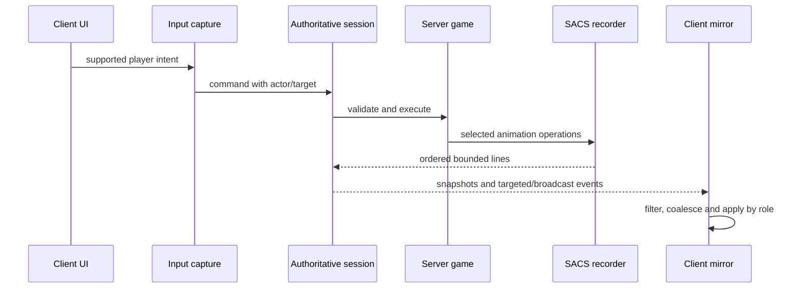

# Client presentation

Presentation is a host-observed, client-applied view of selected shared behavior. The server validates intent and runs authoritative gameplay; clients receive selected state, interaction/presentation events and owner-targeted UI. No one stream is a complete simulation replica. The docs separate capture, display, SACS recording, interaction replay, resynchronization, local runtime, UI honesty and scenario evidence.

| Page | Question answered |
|---|---|
| [Presentation stream](presentation-stream.md) | How do SACS calls become bounded events, target sets and late-join history? |
| [Presentation ownership](presentation-ownership.md) | Which process owns each decision, and what is not replayed? |
| [Input capture pipeline](capture-input-pipeline.md) | Which local player inputs can be forwarded, and where are they validated? |
| [Remote dialogs](remote-dialogs.md) | How are server questions routed to the owner and answers authorized? |
| [Menu honesty](menu-honesty.md) | How are stale menu choices greyed or explained after rejection? |
| [Recording and replay](recording-and-replay.md) | How do SACS presentation, interaction replay, snapshots and frame logs differ? |
| [Client mirroring](client-mirroring.md) | How are events queued, filtered, coalesced and resynchronized? |
| [Client game runtime](client-vm.md) | What does the local game process own, and which mirror modes exist? |
| [Presentation scenarios](presentation-scenarios.md) | Which tests and live scenarios support specific player-facing claims? |

## Flow

A capture predicate test proves only local filtering; a bridge success proves only a handler boundary; visual equivalence requires a live comparison. A refusal, dialog, missing alias, decode failure and local writer conflict are different failures and should be investigated at their specific boundary.
