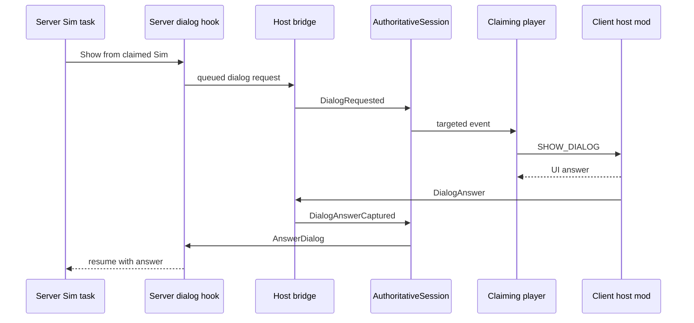

# Remote dialogs and player responses

A modal created inside the authoritative game can block the Sim task that opened it. The user controlling that Sim is connected to a different process, so a server-only dialog would be invisible and an unhandled server dialog can leave the task waiting. The remote-dialog path forwards a bounded request to the owner, displays it in that player's local game, and returns the answer under the original request identity.

This path is separate from pie-menu choice forwarding. A pie-menu pick is an intent submitted before the authoritative interaction runs; a remote dialog is a question raised later while the interaction is already running.

## Data contract

`SimsOnline.Protocol/ServerEvent.cs` declares:

```csharp
public sealed record DialogRequested(
    int RequestId,
    ulong SimObjectId,
    string Kind,
    IReadOnlyList<string> Args) : ServerEvent;

public sealed record DialogAnswerCaptured(
    int RequestId,
    ulong SimObjectId,
    string? Answer) : ServerEvent;
```

The public command is `ClientCommand.AnswerDialog(CommandId, PlayerId, RequestId, SimObjectId, Answer)`. Request identity and Sim identity are both carried: the request id correlates one interaction's question, and the Sim id provides the ownership boundary. `Answer` is nullable; the bridge uses `-` for no answer, which preserves the dialog's default/cancel behavior.

Example event JSON (arguments are representative, not a universal catalog):

```json
{
  "$type": "dialog_requested",
  "requestId": 21,
  "simObjectId": 7787,
  "kind": "TwoButton",
  "args": ["Confirm action", "Continue?", "Yes", "No"]
}
```

The shape deliberately transports text and simple arguments, not an engine `Dialog` instance. Objects, callbacks, localization objects, and closures are process-local and cannot be serialized as dialog UI objects.

## Request lifecycle



Each boundary has a distinct responsibility:

1. The server-side UI hook decides whether a dialog is remotely answerable or must be suppressed to its default.
2. The bridge emits `DialogRequested` with request id, Sim id, kind, and string arguments.
3. `ClientListenerServer.TryQueueAuthoritativeEvent` finds the Sim's current claim and targets only that player's active connection. Unclaimed Sims' requests are not broadcast.
4. The client controller calls `ShowDialogAsync` on its mirror host. With a local TS3 host, this becomes `SHOW_DIALOG`; `RemoteDialogRunner` schedules the UI work on a simulator task.
5. The client mod emits `DialogAnswerCaptured` only when it receives the UI answer, then the controller sends `AnswerDialog`.
6. `AuthoritativeSession` validates that `RequestId` and `SimObjectId` match and that the submitting player owns the Sim before forwarding `DIALOG_ANSWER`.
7. The server hook consumes the answer or continues with the documented default after timeout/disconnect.

## Ownership and security boundary

The server does not trust a client-provided player id alone. `GateOwnedActorCommand` verifies the actor claim for `AnswerDialog`; the request's `SimObjectId` is the actor scope. `ClientListenerServer` independently routes the original event only to the owner. This prevents another connected player from seeing or answering a dialog opened for someone else's Sim.

A client can disconnect, lose the claim, or return an old request id. Those cases are not a reason to block the authoritative task forever. The server-side hook's timeout/default behavior is essential: a dialog response is player input, not a mandatory lockstep vote.

The correlation id (`CommandId`) deduplicates/reports a public command; it is not the dialog request id. Do not mix these identities when tracing logs.

## Server and client bridge roles

`ServerHostMain` registers `DIALOG_ANSWER`, `SHOW_DIALOG`, and `DIALOG_AUTOANSWER` handlers. The server answer handler requires server role and the UI fork's dialog hook; it stores the decoded response against the request id. The client display handler requires client role, parses the dialog kind and args, and schedules `RemoteDialogRunner` on the simulator task queue. The test-only auto-answer handler logs requested content and supplies a selected response without opening a dialog.

Wire outline:

```text
SHOW_DIALOG|corr|requestId|simObjectId|hexKind|argCount|hexArg...
DIALOG_ANSWER|corr|requestId|hexAnswer
```

Text is hex-encoded UTF-8 so delimiters and line endings in button labels or messages cannot split fields. `-` denotes a missing answer; an empty string is distinct from `-` in the bridge representation.

## Supported behavior and limits

The current adapters support simple messages, text input, button choices, `ObjectPicker`, notifications and one-way `Sting` playback. The supported set is defined by the server UI hook and client `RemoteDialogRunner`, not by every engine class derived from `ModalDialog`.

| Behavior | Current boundary |
|---|---|
| Button choice | Returned as a simple response value; server code receives the answer expected by that dialog kind |
| Text input | Text is returned through a string answer |
| Message | `SimpleMessageDialog` is shown locally and produces no answer |
| Notification | One-way presentation; client maps server object IDs for portraits when available |
| Object picker | Supported through a text-only adapter; returns selected `tab:row` keys to the server-side row objects |
| Sting | One-way sound playback; no answer, local Sim mapping when available |
| Picker visuals | Thumbnails are not carried; rows are rebuilt from text columns |
| Arbitrary custom modal | Unsupported unless explicitly adapted by the hook and runner |
| Local game callback/object reference | Cannot cross process; must be represented by a stable request id and data |
| Dialog on an unclaimed Sim | Not routed to a player; server suppression/default policy prevents a stranded task |

A dialog's text/args are not equivalent to its game-side behavior. The server interaction remains authoritative and interprets the returned answer. The client only presents the question and returns a choice; it does not execute the interaction locally as a consequence of showing UI. For `ObjectPicker`, the hook serializes tab and row display data, while the returned `tab:row` value selects the original server-side row object. This preserves the server object reference without sending it across processes, but omitting thumbnails can change the picker's visual affordances.

## Timeout and late-answer behavior

The server-side hook keeps a pending request while the Sim task waits. At timeout it removes the wait and chooses the same default the game would use when remote UI is unavailable. The host bridge notes that an answer received after timeout can remain in the answer map. This is a bounded but real edge case; request ids must not be reused while a late answer could collide, and cleanup policy must remain aligned between hook and controller.

| Condition | Expected result |
|---|---|
| Owner answers before timeout | Answer is stored and the Sim task resumes with it |
| Owner cancels | Cancel/default response is delivered according to dialog kind |
| Owner disconnects | The server falls back rather than waiting indefinitely |
| No mirror host on client controller | UI cannot be shown; best-effort display path returns without affecting other event dispatch |
| Client UI throws | `dialog_show_failed` is logged; server timeout/default remains the recovery path |
| Answer from non-owner | Session rejects it; it does not reach the server UI hook |
| Answer request id/Sim mismatch | Session rejects the stale or mismatched response |
| Answer arrives after timeout | Hook may retain an unread answer entry; surfaced as a cleanup/telemetry concern |

## Dialog pause and speed intent

A modal UI can pause simulation time. A client-side pause must not be mistaken for the player's global speed choice and mirrored back as an authoritative speed change. The client bridge tracks the remote-dialog interval for its speed-intent logic; this is part of keeping a dialog local to its owner instead of freezing every participant.

The server's own simulation speed remains a separate authority stream (`GameSpeedChanged` / `SpeedIntentCaptured`). A dialog answer does not imply a speed change. Tests should exercise both the dialog and speed paths because an apparently successful dialog may otherwise pause the entire session.

## Diagnosing a missing dialog

Follow the boundary order rather than assuming UI failure:

1. Did the server hook create a request for the Sim task?
2. Does the decoded `DialogRequested` contain the expected `RequestId`, `SimObjectId`, `Kind`, and argument count?
3. Does the session claim that Sim for the intended player at routing time?
4. Was a targeted event enqueued to an active connection?
5. Did the client controller have a mirror host capable of `ShowDialogAsync`?
6. Did the client bridge accept `SHOW_DIALOG` with client role?
7. Did `RemoteDialogRunner` recognize the kind and create/show the expected stock UI?
8. Did the returned answer use the same request and Sim ids?
9. Did session authorization accept and forward `DIALOG_ANSWER`?
10. Did the server hook still have a pending request when the answer arrived?

Logs can prove that a request or bridge command was accepted. Only a live UI observation proves that a player saw the intended dialog, and only the server-side interaction outcome proves that its answer was interpreted correctly.

## Tests and source map

`DedicatedServer.Tests/Program.cs` includes `RemoteDialogs.EncodeDecodeAndGateAnswers`. `DedicatedServer.Tests/JoinTraceTests.cs` covers owner-specific event delivery (`ClientListenerServer.SendsDialogToOwnerOnly`). Protocol wire pinning lives in `DedicatedServer.Tests/WireJsonPinningTests.cs`.

Implementation entry points:

- `SimsOnline.Protocol/ServerEvent.cs` — request and captured-answer records.
- `SimsOnline.Protocol/ClientCommand.cs` — `AnswerDialog` command shape.
- `DedicatedServer/Network/ClientListenerServer.cs` — owner-only targeted delivery.
- `DedicatedServer/Authority/AuthoritativeSession.cs` — actor ownership gate and host forwarding.
- `DedicatedServer/HostBridge/BridgeLineCodec.cs` — event/answer bridge conversion.
- `SimsOnline.Client/Program.cs` — event dispatch and `TryShowRemoteDialogAsync`.
- `SimsOnlineServerHostMod/ServerHostMain.cs` — role-gated bridge handlers and dialog hook integration.

Controller tests do not prove a specific game dialog class is adapted correctly. Add a test for each new serializable kind and verify its answer interpretation in the server interaction. See [Menu honesty and refusals](menu-honesty.md) for the adjacent but separate pie-menu path.

## Request lifecycle invariants

The request should be considered pending only on the server hook after a valid claimed Sim is known. The controller does not open a dialog for every connected client, and a client cannot route a response by changing only the `PlayerId` field. The session derives the actor owner from its claim table.

| Invariant | Boundary that enforces it |
|---|---|
| Request uses one correlation id per pending dialog | Server UI hook |
| Request identifies the Sim whose interaction is waiting | `DialogRequested.SimObjectId` |
| Only the current owner receives the request | `ClientListenerServer.TryQueueAuthoritativeEvent` |
| Only that owner can answer | `AuthoritativeSession` `GateOwnedActorCommand` path |
| Bridge UI is shown only in client role | `HandleShowDialog` |
| Server answer is written only in server role | `HandleDialogAnswer` |
| Lost client cannot hold server task forever | Hook timeout/default |

Tests should cover both sides of each ownership check. An event-routing test alone does not test the answer authorization branch.

## Supported kind argument conventions

`Kind` is a string because the bridge may adapt multiple stock UI types without coupling the public protocol to engine assemblies. `Args` is an ordered list; its interpretation depends on `Kind` and must match between server hook and client runner. Adding a kind requires synchronized changes to both adapters.

Before adding a new kind, document:

- how many arguments are required and which may be empty;
- whether the response is a button index, boolean, string, or no response;
- what `null`/`-` means for that particular game call;
- whether the kind is modal or a one-way notification;
- how local object references or pick rows map back to authoritative objects;
- what default is selected on timeout and disconnect.

The generic event type cannot enforce those kind-specific contracts. Codec tests should reject malformed count/arity at the adapter boundary rather than letting an unexpected index access crash the simulator task.

## Failure observability

`TryShowRemoteDialogAsync` logs `dialog_shown` when the host adapter returns successfully and `dialog_show_failed` on an exception. A successful return from the bridge can mean the task was scheduled; it does not necessarily mean the player saw a window. The UI can be covered, the local Sim can be absent, or the game can reject the dialog kind.

When investigating a timeout, correlate the request id across server hook, public event, client host command and answer command. Avoid logging sensitive free-form text beyond what is needed; dialog arguments can contain player-created content. Request ids and event kind are generally safer diagnostics than full serialized args.

A notification is one-way and should not produce a fake `AnswerDialog`. A dialog cancellation should use the kind's documented cancellation representation. Treating every empty string as cancellation is unsafe where empty text is a valid user response.

## Additional join, disconnect and replay tests

The owner-only dialog test should include two active player connections and verify that exactly one receives a dialog for a claimed Sim. Repeat with no claim and with the claim changing between request and answer. `AnswerDialog` should fail closed if the owner changed or the request is no longer pending.

A reconnect test should ensure that pending answers from the prior connection are not accepted as a fresh response unless the same request is still valid. Rejoining can resend current presentation history, but should not resurrect a dialog whose server task already timed out.

## User experience tradeoffs

A timeout default keeps the authoritative simulation moving, but it can surprise a player who left a dialog open. The client should make the timeout visible if the event path can do so without creating a second modal; otherwise the next gameplay result may look like an unexplained cancel. Keep timeout duration and default behavior consistent across supported dialog kinds.

For accessibility and localization, prefer the game's stock local dialog classes for display rather than rebuilding controls in the controller. The transport should preserve the strings/choices the server supplied. If a custom dialog kind cannot be reconstructed faithfully, use an explicit safe default and mark the kind unsupported rather than showing a misleading approximation.
