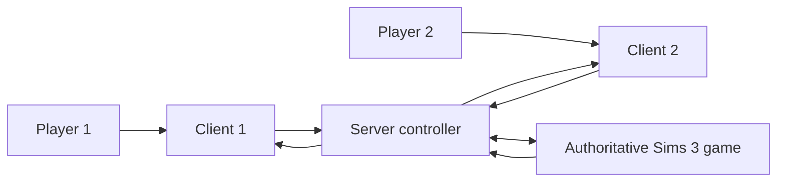
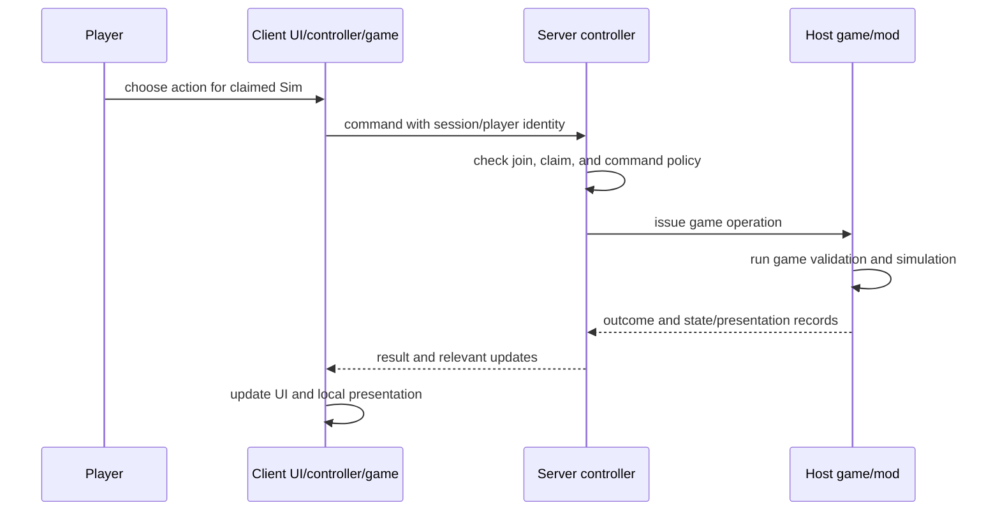

# What is Sims3Online?

Sims3Online is an experimental multiplayer project that connects players to one shared
Sims 3 simulation. A server-side game process runs the simulation. Each player's
client game forwards intent and displays selected authoritative results.

The controller manages session and protocol state around the game process. A game mod
exposes integration points inside Sims 3. Client controllers convert player choices
into server requests and apply host state/presentation updates locally. The server
checks ownership and game-side validity before an action changes the shared world.

## Why one simulator?

A life simulation contains autonomous decisions, random outcomes, object state,
household data, alarms, and long-running interactions. Re-running an interaction on
two machines can produce different results even when both accept the same command. One
authoritative simulator avoids treating independent executions as equivalent.

| Concern | Shared source of truth |
|---|---|
| Interaction eligibility and result | Host game |
| Sim identity across processes | Shared identity mapping |
| Player ownership | Session claim/authorization state |
| Visible client copy | Host records and mirrored model state |
| Local menu/input | Client UI; host validates request |

## What the project is not

- It is not an official Electronic Arts product or replacement for the game.
- It is not a public matchmaking or hosted service.
- It is not a secure Internet protocol.
- It does not guarantee arbitrary mods, saves, expansions, or game builds.
- A connected client is not a second authoritative simulator.

## Current maturity

The repository contains server-authoritative session code, client input forwarding,
state/presentation mechanisms, and automated tests. These are implementation facts,
not proof of end-to-end reliability. Joining, persistence, travel, late-join
reconstruction, and presentation coverage have limits; see [status](../status.md) and
[limitations](known-limitations.md).

## Reading path

Start with [architecture](../architecture.md), then [components](../components.md) and
[protocol](../protocol.md). For game-integrated work read
[development](../development.md), [testing](../testing.md), and the [compatibility
matrix](compatibility-matrix.md).

## Typical request lifecycle

Each step has a distinct success condition. A client can send a command that fails authorization; an authorized request can fail game eligibility; a host action can complete while the client misses a visual record. User interfaces and logs should avoid compressing all these into ?success.?

## Authority and identity

A claim associates a player with a Sim for command authorization. It is not a lease on a local game process and does not mean the client runs that Sim. Stable Sim identity is used across processes, while runtime object handles are process-local. The controller and bridge translate those identifiers where necessary.

| Identifier concept | Use | Caution |
|---|---|---|
| Player ID | Session participant | It is not cryptographic authentication |
| Sim identity | Match same Sim concept across games | Validate against current world/save |
| Object ID | Address a local object | Runtime-created IDs may differ per game |
| Command ID | Correlate a request/result | Does not itself prevent duplicate effects |
| Dialog request ID | Match answer to open prompt | Reject stale or reused request |

## Architectural non-goals

The one-simulator model is not deterministic lockstep, distributed authority, rollback networking, or a full client state clone. It reduces duplicated simulation but still requires state mirroring, presentation recording, identity mapping, and recovery. The project does not guarantee every Sims 3 interaction, expansion, mod, or save.

The game and artwork are also separate legal boundaries. The root MIT license applies as written to project material; it does not license Electronic Arts game assets. This repository's support and licensing pages avoid implying otherwise.

## Readiness questions

Before using a feature, ask: What revision implements it? What test actually exercises it? Does that test need a live game? Which game build and save were used? What is the failure behavior? Is it safe on the intended network? A "yes" to compilation does not answer live compatibility or security questions.

See [architecture](../architecture.md), [protocol](../protocol.md), [limitations](known-limitations.md), and [compatibility](compatibility-matrix.md).

## Components and trust boundaries

| Component | Trust/responsibility boundary |
|---|---|
| Player UI | User input; may be stale or malformed |
| Client controller | Serializes player requests and handles host events |
| Public TCP listener | Receives remote protocol; currently lacks authentication |
| Session authority | Associates connections and enforces player/claim rules |
| Host controller bridge | Local privileged path into game mod |
| Host game | Executes shared simulation and game-side tests |
| Client mod | Applies server-originated state/presentation with role-specific behavior |
| Native sidecar | Optional local process integration; build-specific |

A client connection is not a trusted identity merely because it uses the public protocol. Server-side checks remain necessary even when the official client filters or restricts a request. The local administrative bridge is a separate high-privilege development surface and should remain loopback-only.

## Alternate authority behavior

The default model uses the host game for shared outcomes. The code also includes client-native lot authority and reconciliation support: a client can export a constrained set of active-lot state for validation/merge. That is a distinct mode with different save requirements and conflict handling. Do not treat it as equivalent to default server simulation or claim all features are interchangeable across modes.

## What "multiplayer" means here

The project aims for several people to issue actions in one game world and see host-derived outcomes. It does not imply a public account service, matchmaking, Internet security, deterministic rollback, or complete feature coverage. A successful social interaction is only one part of a session: claims, HUD ownership, state updates, presentation, disconnects, and saves each need their own evidence.

Related: [protocol](../protocol.md), [components](../components.md), [status](../status.md), security.

## What to expect from a prototype

| Observable result | Reasonable interpretation |
|---|---|
| Client connects | Transport handshake succeeded, not proof of authorization quality |
| Host accepts one action | That command worked in the tested context |
| Other client sees an effect | That presentation path delivered an update |
| Test suite passes | Covered tests passed, not untested game behavior |
| Save reloads | Persistence worked in that mode and scenario |
| Build compiles | Source is syntactically/type-correct for that configuration |
| Feature appears in menu | UI presents an option, not proof of successful execution |

Sims3Online should be approached as experimental software. Keep tests controlled and backups available. Do not use valuable saves or sensitive networks as a first validation environment. Current status and limitations should inform whether a capability is suitable for a particular experiment.

## Where to go next

- To understand transport and messages, read the [protocol reference](../protocol.md).
- To build locally, use the [development guide](../development.md).
- To run the available test harnesses, use [testing](../testing.md).
- To understand support claims, use the [compatibility matrix](compatibility-matrix.md).
- To report a failure, use [support guidance](support-and-reporting-issues.md).
- Before exposing any listener, read security guidance.
