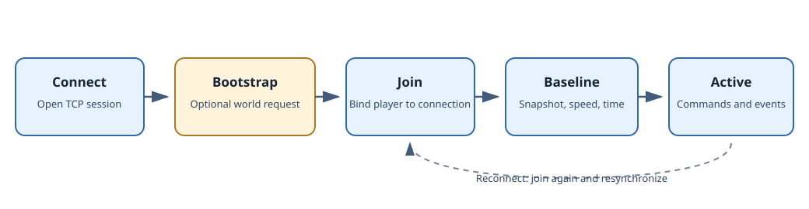

# Network protocol

This page describes the JSON client protocol used by the established .NET
`DedicatedServer.Network.ClientListenerServer` and
`SimsOnline.Protocol.PublicProtocolCodec`. It is separate from the local controller/game bridge
described in [bridge and formats](bridge-and-formats.md).

The repository also contains an experimental Rust front door,
`rust/simlink_headless_server`, with a separately versioned pipe-delimited line-v1 protocol.
That transport is not JSON-compatible and is not the standard .NET server path. See
[wire formats](protocol-reference/wire-formats.md) and
[handshake and resume](protocol-reference/handshake-and-resume.md) before choosing a client
transport. Both public listener paths lack remote authentication and encryption.

## Framing and serialization

- Transport: TCP.
- Message boundary: one UTF-8 JSON object per newline-terminated line.
- Discriminator: `$type`, with stable lowercase snake-case names.
- Property names: camel case.
- Enum values: camel-case strings.
- Null-valued optional properties: omitted by the current serializer.
- `byte[]` values: Base64-encoded JSON strings.

The serializer is implemented by
[`PublicProtocolCodec`](https://github.com/ObsidianNetwork/Sims3Online/blob/main/SimsOnline.Protocol/PublicProtocolCodec.cs).
The command and event records are the source of truth for message fields:
[ClientCommand.cs](https://github.com/ObsidianNetwork/Sims3Online/blob/main/SimsOnline.Protocol/ClientCommand.cs)
and [ServerEvent.cs](https://github.com/ObsidianNetwork/Sims3Online/blob/main/SimsOnline.Protocol/ServerEvent.cs).

Example request (synthetic identifiers):

```json
{"$type":"join_session","commandId":"00000000-0000-0000-0000-000000000001","playerId":7,"displayName":"Example"}
```

The server first reports the result for a command using `command_accepted` or
`command_rejected`. It may also send the corresponding session or state events:

```json
{"$type":"command_accepted","commandId":"00000000-0000-0000-0000-000000000001"}
{"$type":"session_joined","playerId":7,"displayName":"Example"}
```

## Client commands

The current command discriminators are:

| Discriminator | Purpose |
|---|---|
| `join_session`, `leave_session` | Join or leave the session |
| `claim_sim`, `release_sim`, `set_active_sim` | Manage a player's Sim claim or active Sim |
| `queue_interaction`, `cancel_interaction`, `leave_conversation` | Request or cancel interaction work |
| `answer_dialog` | Return an answer to a dialog for a claimed Sim |
| `request_sim_description` | Fetch a Sim description needed by a client |
| `request_world` | Request the host's world bootstrap |
| `set_game_speed`, `set_world_time` | Request game speed or authoritative world time changes |
| `request_snapshot`, `ack_snapshot` | Request a snapshot or acknowledge an applied tick |
| `set_client_role` | Declare the player's server/client role |
| `save_game` | Request a host-game checkpoint |
| `submit_lot_export` | Submit a validated client-native lot export when that mode is active |

Commands carry a `commandId` and `playerId`. The request-specific fields are documented by the
record type in `ClientCommand.cs`. Do not infer field optionality or validation rules from this
summary.

## Server events

Server events fall into these groups:

| Group | Representative event types |
|---|---|
| Session and command result | `session_joined`, `command_accepted`, `command_rejected`, `server_error` |
| Sim ownership and activity | `sim_claimed`, `sim_released`, `interaction_queued`, `interaction_started`, `interaction_completed`, `interaction_failed` |
| State synchronization | `snapshot_delta`, `full_snapshot`, `sim_spawned`, `sim_despawned`, `sim_state_changed` |
| Shared controls and persistence | `game_speed_changed`, `world_time_changed`, `save_checkpointed`, `world_file_chunk` |
| Presentation and player intent | `sim_animation`, `intent_captured`, `user_intent_captured`, `dialog_requested` |
| Lot ownership and details | `lot_export_requested`, `lot_reconcile_acked`, `sim_details_changed`, `sim_motive_changed`, `household_funds_changed`, `sim_skill_changed` |

Additional registered event names and their exact fields are listed in `ServerEvent.cs`.
`snapshot_delta` has an optional `forceFull` field; when true the client replaces its mirror
from the included snapshot rather than applying it as a small incremental update.

## Connection and session lifecycle



Before entering the live session, a remote connection may send `join_session` and the
read/bootstrap requests `request_world`, `request_snapshot`, and `request_sim_description`.
`request_world` is used on its own connection before the local game loads. A successful
`join_session` associates the connection with one player and returns a starting snapshot plus
the current speed and world time when available.

When a joined connection disconnects or is superseded, it must reconnect and join again. The
client then receives a new baseline; callers should not assume that an old socket or local
snapshot remains a valid session.

## Authority checks

The listener associates a successful join with the connection. A joined connection may send
commands only for its associated `playerId`; the server then applies the command-specific
ownership checks. An unjoined remote peer is restricted to joining and read-only bootstrap
requests. The loopback administrative path has separate local-development behavior.

These are authorization checks within the application, not remote authentication. The protocol
does not currently provide login credentials, authenticated encryption, or a negotiated
protocol-version handshake. The default listener endpoint is `127.0.0.1:34019`; changing it
does not make remote access safe.

## Compatibility

`$type` names and record fields form a changing wire contract. There is no general compatibility
promise between arbitrary client and server revisions. Keep both consumers updated, preserve
existing discriminator names when possible, and add tests for any changed wire shape. Capability
names in `session_joined` are optional; unknown names should not be treated as proof that a
feature works locally.
