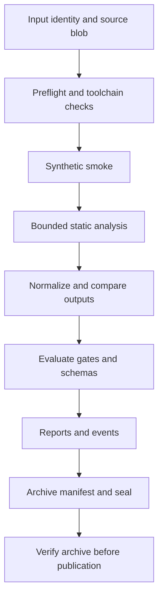

# Native observatory reference

The Python package in `tools/native_observatory/` produces bounded, identity-bound analysis evidence and validates it before comparison or publication. Its core design is a contract chain: output is tied to repository state, toolchain and input identities, then checked alongside companion evidence rather than accepted as an unstructured export. Most operations need separately installed tools and authorized local inputs; the package does not ship game binaries.

## Identity and evidence event model

The analysis-identity schema binds a run to `analysisRunId`, `binarySetId`, executable hash, `toolchainId`, Ghidra version/distribution hash, Java and Python identity, requirements-lock hash, analysis-profile hash, analysis-script hashes and `repositoryCommit`. Synthetic-smoke identity has a separate synthetic-input hash, distinct from real analysis identity. `campaign_identity.py`, `campaign_controller.py` and `campaign_reports.py` carry these identity values into reports.

Evidence events include `schema`, `correlationId`, `source`, `stream`, `eventType`, `sequence`, `observedAtUtc`, `clockDomain` and `payload`. Optional process/thread and clock fields (`processId`, `threadId`, `monotonicNs`, `simTick`, offset and uncertainty) make ordering limitations explicit. `evidence_event_validation.py` validates event structure/references. Sequence and correlation identifiers connect event streams to artifacts; an event is an observation, not by itself a verified behavioral claim.

Common artifacts include binary inventory, bounded static export, signature scan, anchor validation, event stream, gate report, campaign execution report, test report, safety report, schema-validation report, reproducibility comparison, archive manifest and archive seal. Each schema is in `schemas/evidence/`; see [schema catalog](schemas-catalog.md) for all field inventories and producer/validator paths.

## Static campaign flow

`run_static_campaign.py` provides fresh/resume modes. Its parser requires a game root, Ghidra install/archive, Java home/archive and source blob; campaign and archive roots have repository-local defaults. `campaign_controller.py` coordinates toolchain checks, synthetic smoke, preflight, static runs and report generation. `compare_runs.py` performs identity/schema and normalized-output comparisons. `campaign_events.py` and `campaign_reports.py` record and validate campaign evidence.



The safe usage check, verified with package imports, is:

```sh
python -m tools.native_observatory.run_static_campaign --help
```

Exactly one of `--fresh` or `--resume CAMPAIGN_WORK_DIR` is required. Required inputs include `--ts3-root`, `--ghidra-install`, `--ghidra-archive`, `--java-home`, `--java-archive` and `--source-blob`; `--campaign-root` and `--archive-root` choose local output locations. Do not select `--fresh` or resume a real campaign merely to view usage: those operations create/continue work directories and invoke toolchains.

## Anchors and mapping

The anchor pipeline ties a candidate to a source-lock entry and evidence references. `signature_scanner.py` validates source-lock structure and verifies the locked source blob. `validate_anchors.py` consumes a static export, binary inventory, signature scan, comparison and source blob, then produces anchor-validation and symbol-catalog outputs. `anchor_mapping.py`, `anchor_mapping_index.py`, `anchor_mapping_query.py`, `anchor_mapping_queue.py`, `anchor_mapping_reproducibility.py` and `anchor_mapping_summary.py` implement normalized mapping, lookup, review queues, reproducibility and summaries.

The managed-boundary catalog writes `artifacts/managed-boundaries.jsonl` inside the campaign archive. Each line has the `simsonline-managed-boundary-v1` schema. Use the [schema catalog](schemas-catalog.md) for the record fields.

Fail-closed behavior matters: a mismatched source lock or identity cannot be upgraded into a corroborated anchor by assigning a plausible name. Mapping artifacts preserve relationship type, verification state, confidence/provenance and evidence references. Unresolved candidates remain unresolved instead of being presented as proven managed/native links.

Safe usage inspection:

```sh
python -m tools.native_observatory.validate_anchors --help
```

This lists required input/output flags without validating or writing evidence. A real call writes both anchor validation and symbol-catalog output and can append event evidence under `--event-root`.

## Archive evidence and publication

Archive responsibilities are split into modules:

| Module | Responsibility |
|---|---|
| `evidence_archive_contract.py` | Shared paths, identity/hash helpers, typed requests/results and required gates. |
| `evidence_archive_transaction.py` | Event/report assembly, source copies, fsync and finalization helpers. |
| `evidence_archive_validation.py` | Exact-path checks, schema validation, identity-binding closure, report/source verification and seal checks. |
| `evidence_archive_publication.py` | Publishes a prepared archive through a verified publication plan. |
| `evidence_publication_io.py` | Atomic file creation and directory durability primitives. |
| `evidence_publication_fd.py` | Descriptor-relative and no-follow operations for safe publication. |
| `evidence_publication_quarantine.py` | Quarantines conflicting publication destinations rather than silently overwriting. |
| `build_evidence_archive.py` | `build`/`verify` CLI orchestration over the contract, transaction, validation and publication modules. |

The manifest inventories archive paths and hashes; the seal binds manifest/root hashes and analysis identity. The builder checks required reports and schemas. The verifier checks identity, exact paths, source linkage and hashes. Publication uses atomic/no-replace and identity-aware file operations to avoid following symlinks, clobbering unrelated content, or exposing a partial copy. Unexpected destination state is rejected or quarantined rather than silently replaced.

```sh
python -m tools.native_observatory.build_evidence_archive --help
```

Help shows `build` and `verify`. These subcommands operate on evidence; use only with authorized inputs and isolated destinations after reviewing subcommand-specific arguments.

## Platform limits

The archive publisher relies on POSIX/Linux facilities including descriptor-relative `dir_fd` operations, `O_NOFOLLOW` and `renameat2`-style no-replace semantics. Publication tests are Linux-only because weaker emulation on other platforms would undermine file-identity guarantees. Shared modules can import on Windows, but unsupported publication must fail explicitly instead of falling back to unsafe path-based behavior. A Windows import or unit test is not evidence that publication is supported there.

Ghidra/Java setup and native binary analysis are separate from archive publication. Toolchain verification does not prove target behavior; static signatures/disassembly do not replace authorized dynamic evidence. Identity schemas and source guards make the input boundary and provenance inspectable.

## Tests

Focused tests in `scripts/` include:

- `native_observatory_schema_test.py`, `native_observatory_identity_test.py`, `native_observatory_normalization_test.py`: schemas, identity binding and normalized exports.
- `native_observatory_preflight_test.py`, `native_observatory_toolchain_test.py`, `native_observatory_ghidra_smoke_test.py`: preflight/toolchain/synthetic-smoke boundaries.
- `native_observatory_anchor_test.py`, `native_observatory_anchor_admission_test.py`: source locks, validation/admission and catalog behavior.
- `native_observatory_campaign_test.py`, `native_observatory_command_recorder_test.py`, `native_observatory_compare_test.py`: orchestration, command recording and comparisons.
- `native_observatory_archive_test.py`: archive verification/publication; POSIX-specific cases skip outside Linux.

Use the repository's selected suite or a focused unittest:

```sh
python scripts/dev.py test
python -m unittest scripts.native_observatory_schema_test
```

Use module-style help invocations so package imports resolve; directly running a package file may fail because imports start at the repository package root. No campaign, archive build/publication or anchor write was run while preparing this reference.

## Related

- [Schema catalog](schemas-catalog.md)
- [Repository hygiene](repo-hygiene.md)
- [Testing](../testing.md)
- [Protocol reference](../protocol-reference/index.md)
