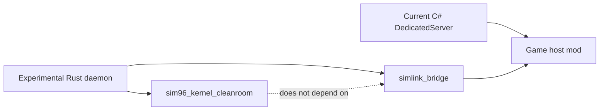

# Rust workspace reference

Three Cargo packages are tracked under `rust/`. Each declares its own `[workspace]`, so build and test each package by manifest rather than assuming a root workspace. The checked-in C# `DedicatedServer` remains the current server path. Both Rust server-facing crate READMEs call their code experimental and not a supported player release.

## Crates and server relationship

| Crate | Manifest and root | Purpose | Status |
|---|---|---|---|
| `sim96_kernel_cleanroom` | `rust/sim96_kernel_cleanroom/Cargo.toml`, `src/lib.rs` | Safe domain kernel: handles, authority, interactions, social state, persistence, services, routing, economy, vehicles, environment, presentation and runtime abstractions. It is the Rust daemon's policy dependency, not a bridge dependency. | Prototype in the experimental Rust path; no crate README is checked in. The manifest does not declare `publish = false`. Fresh builds use default clean-room implementations; optional private-oracle modules/probes are gated. |
| `simlink_bridge` | `rust/simlink_bridge/Cargo.toml`, `src/lib.rs` | Windows process-memory bridge library and `simlinkctl`; discovers a running server process/shared region and exchanges bridge verbs. | `publish = false`; experimental. OS FFI is isolated in `ffi`; unsafe is denied elsewhere. |
| `simlink_headless_server` | `rust/simlink_headless_server/Cargo.toml`, `src/lib.rs`, `src/main.rs` | Rust daemon, session/listener code and public line-protocol codec; depends on kernel and bridge. | `publish = false`; experimental, not current production path; unsafe forbidden. |

Dependency direction is deliberate: `simlink_headless_server` depends on both other crates; `sim96_kernel_cleanroom` does not depend on `simlink_bridge`. In the existing runtime, `DedicatedServer` and its host bridge remain active.



## Public root API

These are the `lib.rs` module/re-export surfaces, not a stability promise.

### `sim96_kernel_cleanroom`

Public modules: `guest_mem`, `kernel_iface`, `kernel_default`, `routing_astar`, `live_navigation`, `road_placement`, `jazz_sacs`, `handles`, `task_arena`, `clock`, `authority`, `interactions`, `social_state`, `wire`, `persistence`, `services`, `vehicles`, `environment`, `dialogs`, `integration`, `aspirations`, `household_drivers`, `careers`, `npc_social_services`, `route_presentation`, `socials`, `economy`, `icall_catalog`, `wan_transport`, `p7_benchmark`, `world_integration`, `continuity`, `soak_chaos`, `go_nogo`, and `runtime_bridge`. `routing`, `sacs_rng` and `native_diff` are conditionally compiled for the private-oracle configuration.

The root re-exports `GenHandle`, `HandleArena` and `KernelError`, and declares typed IDs including `ObjectGuid`, `SimId`, `LotId` and `ObjectId`. Its generic arena encodes a 16-bit slot plus a 16-bit generation; removal increments generation so a stale ID cannot alias a newly reused slot. `KernelRng` and `KernelSlots` select default safe implementations unless oracle modules are enabled.

### `simlink_bridge`

Modules: `corpus`, `crc32`, `discovery`, `driver`, `error`, `ffi`, `layout`, `live`, `memory`, `record`, `reply`, `scorecard`, `text`, and `verbs`. Re-exports: `discover`, `BridgeDriver`, `BulkPayload`, `HelloReply`, `Pacer`, `SleepPacer`, `BridgeError`, `ProcessAttach`, `GuestMemory`, `RegionInfo`, `SimMemory`, `encode`, `BridgeCommand`, and `VERB_TABLE`. `ffi` is the narrow operating-system boundary; process attachment is local integration, not an ordinary offline test.

### `simlink_headless_server`

Modules: `bind`, `checkpoint`, `world_save`, `join_reuse`, `last_good`, `rejoin`, `admin`, `cadence`, `presentation`, `routing`, `world_time`, `snapshot`, `stream`, `events`, `trace`, `bridge_driver`, `error`, `guest_mem32`, `idmap`, `messages`, `session`, `serve`, `scorecard`, `transport`, and `wire_v1`, alongside dedicated scorecard modules.

Root exports include endpoint parsing/listener types; `WireError`; `GuestProcess` and `ProcessGuest32`; `IdMap`; session types `CachedReply`, `CommandOutcome`, `ConnId`, `Connection`, `Refusal`, `Server`; `BridgeGameDriver`; `DriverError`, `FakeDriver`, `GameDriver`; and line-v1 encode/decode helpers plus `BulkReceiver`. For exact serialized messages, use the [protocol reference](../protocol-reference/index.md).

## Build and test

```sh
cargo test --manifest-path rust/sim96_kernel_cleanroom/Cargo.toml
cargo test --manifest-path rust/simlink_bridge/Cargo.toml
cargo test --manifest-path rust/simlink_headless_server/Cargo.toml
cargo build --manifest-path rust/sim96_kernel_cleanroom/Cargo.toml
cargo build --manifest-path rust/simlink_bridge/Cargo.toml
cargo build --manifest-path rust/simlink_headless_server/Cargo.toml
```

The kernel manifest defines `simnav_compile`, `simroad_compile`, `simlink_authority_daemon` and readiness/campaign probes; oracle-only probes require `private-oracles`. The bridge manifest provides `simlinkctl`; the daemon manifest provides `simlink_headless_server`. Some probes execute work rather than offering a benign help screen, so inspect their source before running.

The bridge's `windows-sys` dependency is Windows-targeted. Linux can exercise pure codec/layout logic but cannot prove Windows process discovery or attachment. A passing Rust test does not show that the experimental daemon has replaced the C# path.

## Constraints and failure modes

- `publish = false` is set in the two server-facing crate manifests; the kernel manifest does not make that declaration. All three are currently experimental/repository-side components, not documented stable libraries.
- The kernel forbids unsafe code. The bridge denies unsafe except in its FFI module. The headless server forbids unsafe.
- Optional oracle files/configuration are not required for a fresh default build; don't assume unavailable local inputs.
- Process-memory attachment requires a compatible Windows process and expected shared-memory layout; a successful compile is not runtime compatibility evidence.
- The C# server remains the current running implementation.

## Related

- [Protocol reference](../protocol-reference/index.md)
- [Development setup](../development.md)
- [Testing](../testing.md)
