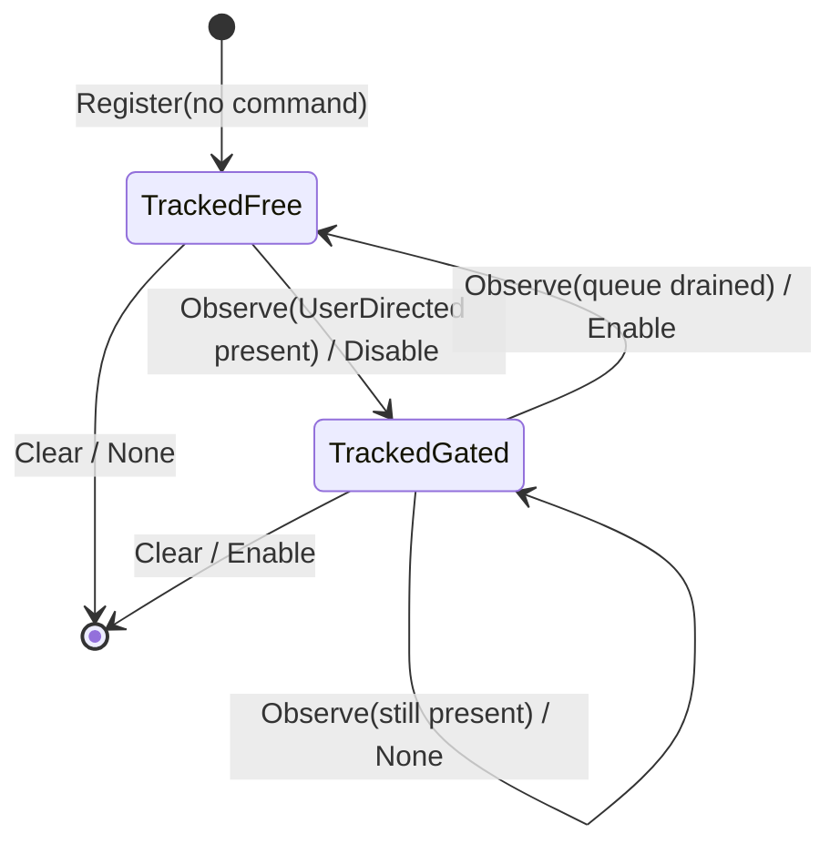

# Autonomy, command gating, and target resolution

The project does not replace the game’s action scorer. The authoritative game decides what autonomous action to offer and when; the server host mod controls when that behavior is suppressed for a claimed actor, while client mirrors are prevented from inventing actions that conflict with server state. Player decisions enter through the existing interaction queue at a user-directed priority. When a replay needs to identify a target on another process, the mod combines object lookup with narrowly scoped semantic hints such as `bookId` or seat metadata.

## Authority boundaries

| Concern | Owner | Current code boundary |
|---|---|---|
| Choose an autonomous candidate and run its game-defined test | Authoritative game | The project samples and mirrors results; it does not implement a replacement scorer. |
| Suppress a claimed Sim's autonomy during a player order | Server host mod | `SimsOnlineServerHostMod/AutonomyCommandGate.cs` plus the queue poll in `ServerHostMain.cs`. |
| Suppress local decisions for a Sim represented by a remote snapshot | Client mirror controller | `DedicatedServer/Mirroring/MirrorAutonomyController.cs`. |
| Send an explicit player pick | Client and authoritative session | `ClientCommand.QueueInteraction`, `UserPick`, and `AuthoritativeSession`. |
| Resolve replay target across different local game instances | Host mod replay handlers | `TryResolveTerminalReplayTarget` and seat-resolution helpers in `ServerHostMain.cs`. |

This split prevents two different problems: a mirrored Sim must not autonomously move away from streamed host positions, and a claimed Sim should retain ordinary free will outside the brief period when a player-directed order is queued.

## Two autonomy suppression lifetimes

### Server command-lifecycle gate

A claim registers a Sim with `AutonomyCommandGate`; it does not disable autonomy by itself. The mod polls whether any `UserDirected` interaction is present and changes a per-Sim engaged bit only on transitions:

The `GateAction` values in `SimsOnlineServerHostMod/AutonomyCommandGate.cs` are `None`, `Disable`, and `Enable`. The pure state machine owns the transition decision; `ServerHostMain.PollCommandLifecycleGates` owns engine side effects. `Disable` calls `sim.Autonomy.IncrementAutonomyDisabled()`. `Enable` decrements only while `AutonomyRestrictions.IsAnyAutonomyEnabled(sim)` says suppression remains. `Clear` unwinds the gate's outstanding contribution if the Sim is released, the player leaves, or the connection closes.

The observation is deliberately boolean: “is a user-directed interaction present?” The mod reads `InteractionList` and does not count the running interaction separately, avoiding a false non-empty result if the running item is also the queue head. If a read is indeterminate because the queue changes during iteration, the pump skips the observation rather than treating it as absent. A transient Sim lookup miss also does not clear an engaged gate; the authoritative release path does that.

| Transition | Gate action | Why it is idempotent |
|---|---|---|
| Claim, queue empty | `Register(id, false)` → `None` | Claiming does not turn off idle autonomy. |
| Claim while an order already exists | `Register(id, true)` → `Disable` | Covers a claim that arrives mid-command. |
| First observed user-directed item | `Observe(id, true)` → `Disable` | One increment for the entire command window. |
| More user-directed work remains | `Observe(id, true)` → `None` | No double increment for chained orders. |
| Queue becomes empty | `Observe(id, false)` → `Enable` | Balance the gate contribution once. |
| Release while gated | `Clear(id)` → `Enable` | Avoid leaving a claim-scoped suppression behind. |

The mod never cancels a currently running interaction to engage this gate. The game’s queue/priority behavior handles competition; avoiding a blanket cancel prevents leaving posture or continuation state without its normal unwind.

### Client mirror suppression

`MirrorAutonomyController` disables autonomy for mirrored Sims when they first appear in a snapshot. `_suppressed` remembers which increments this controller owns, so repeated deltas do not send repeated toggles. A Sim that becomes self-owned is removed from the mirrored set and receives one balancing `ApplyAutonomy(disabled: false)`; it can be suppressed again if it returns to the mirrored set. Self-owned Sims are filtered before the controller sees them.

A client-side `ApplyAutonomy` is an absolute desired-state operation in `SimsOnlineServerHostMod/Handlers/HandlerSet.cs`: it queries `AutonomyRestrictions.IsAnyAutonomyEnabled`, increments only when the requested disabled state is not already in effect, and decrements only when enabling is needed. This makes duplicate calls harmless. It does not expose a general counter-reset API to ordinary mirror events. The mirror controller also records actors for which the local Sim is unavailable; it avoids retrying each snapshot until that actor leaves and re-enters the mirrored set.

| Mechanism | Side and scope | Start | End | Key invariant |
|---|---|---|---|---|
| `AutonomyCommandGate` | Authoritative server, claimed actor | First queued `UserDirected` item | Queue drains or claim teardown | One gate-owned increment at most. |
| `MirrorAutonomyController` | Client, remotely mirrored actor | First snapshot sight | Actor leaves mirrored set | One outstanding suppression per mirrored actor. |
| `APPLY_AUTONOMY` handler | Client-role bridge command | Absolute desired state differs from current state | A later opposite desired state | Duplicate desired-state calls do not stack. |

The gate and mirror controller have different owners and lifetimes. Do not treat either as the global source of truth for the engine’s aggregate suppression depth; each tracks only the contribution it is responsible for balancing.

## How autonomous decisions are surfaced

The project observes interactions produced by the engine rather than synthesizing an action score. `ServerHostMain` has distinct emit paths for claimed Sims and eligible unclaimed Sims on player-interest lots. For unclaimed Sims, `UnclaimedRoutingEmitFilter.ShouldEmit` requires an interest-lot actor that is not claimed or already covered by another watcher and has either a routing action or a target-bearing action. The pump deduplicates by interaction ID and refuses to forward a `UserDirected` head as if it were autonomous.

For mirroring, `DedicatedServer/Mirroring/EventToBridgeCommandTranslator.cs` turns only eligible target-bearing public events into `ApplyInteractionQueue` requests. The route destination must be supplied, or a target object ID must be available to resolve locally; `TerminalInteractionFilter.IsNeverReplay` excludes keys that should never be replayed. A snapshot’s `CurrentInteractionKey` is not replayed as a new decision because a position snapshot does not contain the route’s original endpoint.

The current checked-in tooling can inspect or mirror motive values (`HandlerSet.ApplyMotive`, `ProbeSimMotive`) and the mirror protocol includes `SimMotiveChanged`. Those are state-synchronization tools, not evidence that the controller owns the game’s autonomy scoring algorithm. The source does not publish a stable score decomposition or a universal deterministic tie-breaker, so clients must not infer the server’s next action from a motive value alone.

## Player decision injection

A menu choice is forwarded as a user pick, not as arbitrary executable state. `ClientCommand.UserPick` defines `ui.name`, `ui.path`, `ui.hit`, and `ui.picked`; `AuthoritativeSession` validates that the sender is joined and that the actor is not claimed by another player. `ServerHostMain.HandleQueueUserInteraction` then resolves the offered definition again on the authoritative game, reconstructs the pick details, creates the instance with `InteractionPriorityLevel.UserDirected`, and calls the game queue.

The server gate is the right place for user choices: it preserves game-owned validation and allows the authoritative game to perform its ordinary transitions. A `CommandAccepted` or successful bridge reply means the command got through its current gate; later `InteractionStarted`, `InteractionCompleted`, or `InteractionFailed` events tell what happened to the actual instance.

### Explicit read-intent replay

The mirror has a narrowly scoped alternative for book chains. When a batch includes a ReadBook terminal, `BookChainReadIntentResolver` extracts its actor and book information and `MirrorEngine` calls `INJECT_READ_INTENT` rather than blindly replaying a terminal interaction. The bridge handler accepts the `chooser` or `getbook` mode, resolves a local book instance, builds the game’s own interaction, and queues it at `UserDirected` priority. This uses the local game’s existing chain and test behavior rather than trying to transplant an opaque object instance ID from the server.

`DedicatedServer/HostBridge/BridgeCommand.cs` defines the bridge request and `DedicatedServer/HostBridge/BridgeLineCodec.cs` encodes it. `INJECT_READ_INTENT` is client-role-only; the current wire mode names are `chooser` and `getbook`. The handler rejects an unknown mode, missing actor/book, unavailable book target, failed interaction creation, and queue refusal. If the book cannot be resolved on a mirror, `MirrorEngine` deliberately degrades that book action instead of treating its target ID as a portable identity.

## Semantic target resolution

A game object ID is useful when it resolves in the receiving process, but it is not a universal semantic identity across independent game instances. `TryResolveTerminalReplayTarget` follows a small policy:

1. Try `FindTargetObject(targetObjectId)` first.
2. If the interaction family supports an inventory-book fallback and the actor has an inventory, check the `bookId` parameter against an inventory book.
3. If the named book is not already present, look up its `BookGeneralData`, create a local instance, and add it to the actor's inventory; clean up an instance that cannot be added.
4. As a compatibility fallback, use an inventory `BookGeneral` when no semantic ID selected a specific item.
5. Otherwise return no target and let the caller report or degrade the replay.

The captured `bookId` is the game data ID string, not an object ID. `AppendBookIdParameter` emits it from the target book; `AppendReadBookProgressParameter` emits `progressNormalized` only for a valid finite value, clamped to `[0, 1]`. It is contextual presentation/replay data and does not replace target validation.

Seat selection is another scoped resolver for `ForceAlign`. `ResolveSeatFromForceAlignParameters` tries, in order, the supplied `seatContainmentSlot`, `seatArea`, a seat closest to the recorded hit point, and the actor’s current seat data for the target. When writing a capture, `AppendSeatHintParameters` may emit `seatArea`, `seatContainmentSlot`, `seatRoutingSlot`, and `seatIkSuffix`. These hints let a mirror find an appropriate local seat on the resolved target; they are not globally unique object IDs.

| Hint | Purpose | Current use |
|---|---|---|
| `bookId` | Select the intended book by its game data identity | ReadBook target fallback / explicit read intent. |
| `progressNormalized` | Preserve a bounded reading progress sample | ReadBook state handoff. |
| `seatContainmentSlot` | Prefer the corresponding seat slot on the local object | ForceAlign target seat. |
| `seatArea` | Alternative seat family/area discriminator | Seat fallback when slot hint does not resolve. |
| `seatRoutingSlot`, `seatIkSuffix` | Additional seat-routing/animation hints | Carried in parameter maps for seat alignment. |

Do not extend this into a generic “nearest object of same class” remapper without a family-specific identity contract. Current checked-in code implements book and seat paths; it does not implement the historical proposed toilet or food-object fallback. An absent/ambiguous target should stay a visible failure or a deliberate degrade, not silently choose another object.

## Failure modes and diagnostics

| Symptom | Likely boundary | Check |
|---|---|---|
| Claimed Sim autonomously acts during a player order | Gate did not engage or queue observation was indeterminate | Inspect `AutonomyCommandGate.IsGated`, `TrackedCount`, and the UserDirected queue scan. |
| Autonomy stays disabled after release | Gate/controller contribution did not unwind | Verify `Clear` path and one matching disable/enable transition. |
| Mirrored Sim walks away from streamed positions | Client mirror suppression did not apply or actor is not in mirrored set | Check first-sight suppression and `ApplyAutonomy` response; missing local actors are marked unavailable. |
| Local simulation takes an unmirrored autonomous action | Interaction key/target is outside the replayable event allowlist | Inspect the event’s key, target ID/position, and translator eligibility. |
| Book replay chooses wrong or no book | Object ID did not resolve and semantic `bookId` was absent or unresolved | Verify `bookId`, local inventory, and `BookGeneralData` lookup. |
| Seat differs on the mirror | Seat metadata was absent or no fallback found a compatible local seat | Compare seat slot/area/hit hints and resulting `ForceAlign`. |
| A move appears accepted but never animates | A request result was mistaken for a lifecycle event, or snapshot path lacked the true endpoint | Correlate queue, start, terminal event and target data. |

## Verification

Focused state-machine coverage lives in `DedicatedServer.Tests/Program.cs`:

- `AutonomyCommandGate.IncrementsOnFirstUserDirected`
- `AutonomyCommandGate.DecrementsOnQueueDrain`
- `AutonomyCommandGate.IsIdempotentAcrossSustainedCommands`
- `AutonomyCommandGate.ReleaseClearsOutstandingGate`
- `MirrorAutonomyController.SuppressesMirroredSimOnFirstSight`
- `MirrorAutonomyController.DoesNotResuppressOnSubsequentSnapshots`
- `MirrorAutonomyController.OwnedSimNeverReachesSuppression`
- `MirrorAutonomyController.UnsuppressesAndClearsFlagOnLeavingMirroredSet`
- `MirrorEngine.EventPathStillReplaysGoHereWithRealTarget`
- `MirrorEngine.SnapshotPathDoesNotReplayGoHereInteraction`

The book-chain and parameter transport cases also live in that test harness; `WireJsonPinningTests` pins the public `InteractionQueued.parameters` JSON shape. Useful implementation references are `SimsOnlineServerHostMod/AutonomyCommandGate.cs`, `SimsOnlineServerHostMod/UnclaimedRoutingEmitFilter.cs`, `SimsOnlineServerHostMod/ServerHostMain.cs`, `SimsOnlineServerHostMod/Handlers/HandlerSet.cs`, `DedicatedServer/Mirroring/MirrorAutonomyController.cs`, `DedicatedServer/Mirroring/BookChainReadIntentResolver.cs`, and `DedicatedServer/Mirroring/MirrorEngine.cs`.

## Related pages

[Interactions and lifecycle](interactions-and-lifecycle.md), [refusal reasons](refusal-reasons.md), [routing contract](routing.md), [simulation overview](../simulation.md), and [testing](../testing.md).
