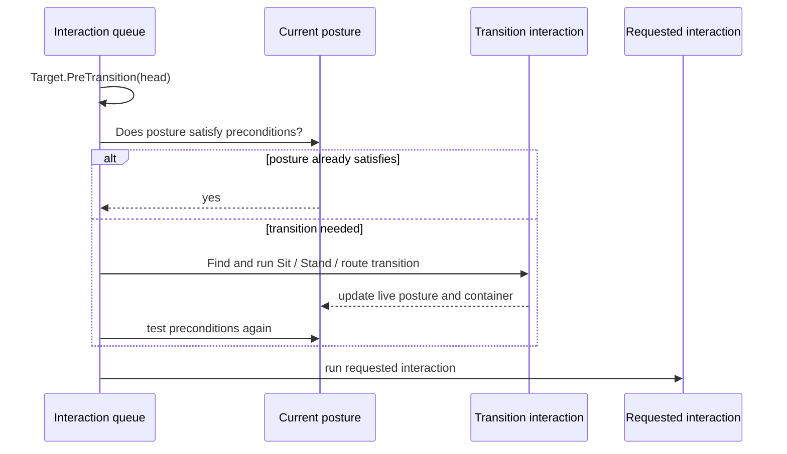

# Postures and transitions

A posture is the live, engine-owned way a Sim occupies a state such as standing, sitting, relaxing in bed, sleeping, or participating in a conversation. It is not a pose label that a mirror can safely assign by changing a field. In the Sims 3 runtime, posture is coupled to a state-machine client, an interaction queue, and often a container object or a specific slot on that object. The online mirror therefore reproduces selected transitions through the local game engine and uses position and animation presentation for the rest.

This page covers the posture model, how transitions are selected, the current replay path for seat alignment, and the limits around beds, sleep, and social posture. The protocol-visible posture fields are in `SimsOnline.Protocol\SimulationSnapshot.cs` and `SimsOnline.Protocol\InteractionReplayBundle.cs`; the host-side handling is in `SimsOnlineServerHostMod\ServerHostMain.cs` and `DedicatedServer\Mirroring\MirrorEngine.cs`.

## Model: posture is behavior plus occupancy

A posture participates in the Sim's live state. Postures can be stacked through a previous-posture relationship, answer whether they satisfy a required commodity, and own entry/exit behavior. Compatible postures may sit on top of a prior posture; incompatible transitions unwind the previous chain. Returning to standing is consequently an engine transition, not just changing a string.

| Posture family | What it represents | Typical container | Current mirror implication |
|---|---|---|---|
| `StandingPosture` | Default mobile state; standing is the posture from which many routes begin. | The Sim itself. | A snapshot can identify it, but a position correction does not create other postures. |
| `SittingPosture` / `ISeatPosture` | A seat-bound posture, including the selected seat part and its animation state. | Chair, sofa, stool, or other seat object. | The supported `ForceAlign` path recreates seat binding with the local `Seat` API. |
| `RelaxingPosture` | Awake occupancy of a bed; commonly the entry state for reading, relaxing, or sleep. | A bed and one of its bed parts. | Not equivalent to sitting; current force-align handling does not generically construct it. |
| `SleepingPosture` | Sleeping occupancy with a long-running sleep lifecycle. | A bed part. | Position and presentation can be mirrored; sleep stage, energy change, and wake logic are not a posture assignment. |
| `SocializingPosture` | Conversation-oriented posture and idle/stance behavior. | No single shared seat container is implied. | Social interactions are intentionally reduced to approach/route behavior instead of reproducing the social state machine. |

A seated posture carries more information than `PostureType`: the container object identifies the chair or bed, while the seat/bed part and state machine determine which part is occupied and how the Sim enters it. `PostureContainerObjectId` is useful for alignment checks, but does not encode every part-level ownership or occupancy decision.

`SimSnapshot` exposes optional `PostureContainerObjectId` and `PostureType` values. They are observations of the server copy, not commands. `InteractionReplayBundle` additionally carries `IsTransitionInteraction`, `QueueRole`, `PostureContainerObjectId`, parameters, and an optional `PolicyHint` so the mirror can decide whether a transition is safe to reproduce.

## How the game reaches a required posture

Before a queued interaction runs, the engine checks the target's `PreTransition` hook and evaluates the head interaction's posture requirements. If the current posture does not satisfy those requirements, it can find and run a transition interaction—often a route followed by Sit—then re-check. A terminal interaction can therefore be rejected at insertion time, fail later during its transition, or run only after the posture transition succeeds.



This ordering explains why forwarding only a terminal key is insufficient. A chair interaction may need the host's chosen seat and the client may need to reach it before the terminal is queued. A paused or blocked simulator can also prevent a queued route/Sit transition from progressing even if a controller has waited in wall-clock time.

### Sit and Stand are real interactions

The engine's queued `Sit` path routes to a seat and then enters its seat state machine. A direct `Seat.SitDown` call is a different path: it is appropriate only when the Sim is already at the seat and the exact seat/routing slot is known. In both paths the result is a real seat posture, not a local imitation of one.

`Stand` similarly unwinds the seat posture through the interaction system. Tests and mirrors should not assume that `SetPosition` or a snapshot posture string has made the Sim stand or sit.

Seat selection is sensitive to the host's point and slot. If a click/transition lacks a meaningful hit point, the game may choose an available seat relative to the actor's current position. Since two Sims need not start at identical positions, they can choose different seats even when both route to the same table. Where available, the mirror transports `seatArea` and `seatContainmentSlot` in the bundle parameter map so it can resolve the host's seat more precisely.

### How the host captures a Sit transition

`ReadBook` can stay at the head of the queue while the engine runs Sit in a separate `TransitionInteraction` slot. The host watches that slot as well as the queue head. `ServerHostMain` captures an autonomous Sit with a target for a claimed Sim as an `interaction_replay_queued` event. The legacy autonomy watcher reports the same transition as `interaction_queued`.

The watcher remembers the current Sit instance when it starts tracking the Sim. After that baseline, `SitTransitionEmitFilter` accepts a new nonzero instance ID and suppresses repeats of the last ID for that actor. When the client reaches the table and picks another chair, check for the Sit event as well as the seat parameters. A queue-head trace can show `ReadBook` throughout the transition.

## Online mirror policy

Replay policy is an enum in `InteractionReplayBundle`:

| Value | Meaning in the mirror |
|---|---|
| `NeverReplay` | Do not reproduce an engine-generated interaction. |
| `ReplayExact` | Attempt to create the recognized interaction against its target. |
| `ReplayAsRoute` | Reduce the interaction to a GoHere toward the supplied target/position. |
| `ForceAlign` | Reproduce an observed posture transition, currently focused on Sit/Stand. |
| `SlideOnly` | Do not queue an interaction; let the position/presentation stream show movement. |

`InteractionReplayPolicyResolver.Resolve` applies these rules in order:

1. `TerminalInteractionFilter.IsNeverReplay` wins first.
2. A non-null host `PolicyHint` is authoritative.
3. A posture container plus transition metadata or a Sit/Stand key selects `ForceAlign`.
4. Recognized routing interactions with a target select `ReplayAsRoute`.
5. Recognized terminal interactions with a target select `ReplayExact`.
6. An otherwise unknown interaction with a target degrades to `ReplayAsRoute`; without one it becomes `SlideOnly`.

The target check is significant: `ReplayExact` without a target object is not actionable. `TargetPosition` may be enough for a route; exact interaction replay usually needs the object id to resolve locally. The controller does not treat an unknown interaction name as permission to queue that interaction on the client.

### Seat `ForceAlign` sequence

For an emitted Sit transition, the host mod captures the actor, interaction definition, queue role, transition bit, posture container, and seat parameters. The resolver can then choose `ForceAlign`. `MirrorEngine` sends `APPLY_FORCE_ALIGN` before terminal work and verifies the resulting posture through `DIAG_INTERACTION_STATE`.

The local mod first resolves the target seat and its routing slot. If the actor is already within reach, it calls the engine's `Seat.SitDown` and verifies `ISeatPosture.Seat` matches that seat. If the direct operation is not viable because the Sim is far away, it queues a GoHere to the seat and a Sit continuation. The interaction queue is thus allowed to perform its ordinary route/transition work instead of making a far-away Sim jump into a chair.

The settle check is state-based: `MirroredInteractionState.IsSeatedInContainer` requires a posture type containing `SittingPosture` and an exact `postureContainerObjectId` match. `MirrorEngine` polls every 250 ms, up to the player-command timeout (10 seconds by default), before dispatching following terminal requests. `APPLY_FORCE_ALIGN` itself has a 30-second default command timeout to allow a route-to-seat fallback. A `null` diagnostic result stops the poll; a poll timeout is logged and terminal dispatch proceeds, so the poll is a guard rather than a guarantee of success.

A captured Sit while standing can report the actor itself as the posture container. Dispatch normalizes that bundle to the intended seat before it applies ForceAlign and before the settle poll. Without a real seat container or resolvable seat data, the posture cannot be proven from the bundle alone.

Example of the relevant portion of an interaction replay event (the enclosing event discriminator is `interaction_replay_queued`):

```json
{
  "bundle": {
    "version": 1,
    "actorObjectId": 1001,
    "interactionId": 482,
    "interactionKey": "Sims3.Gameplay.InteractionsShared.Sit+Definition",
    "interactionDefinitionType": "Sims3.Gameplay.InteractionsShared.Sit+Definition",
    "targetObjectId": 901,
    "priorityLevel": "High",
    "isUserDirected": false,
    "isAutonomous": true,
    "isTransitionInteraction": true,
    "queueRole": "transition",
    "postureType": "Sims3.Gameplay.ActorSystems.SittingPosture",
    "postureContainerObjectId": 901,
    "hostTick": 12345,
    "parameters": {
      "seatArea": "a",
      "seatContainmentSlot": "1"
    },
    "policyHint": "forceAlign"
  }
}
```

The example follows the camel-case JSON, null-omission, and string-enum settings in `SimsOnline.Protocol\PublicProtocolCodec.cs`. Its identifiers and tick are illustrative; captures may omit optional values or seat parameters. The C# enum members are defined in `InteractionReplayBundle.cs`.

## Beds, sleep, and part occupancy

Bed posture transitions use a bed part, not just an object-wide pose. A double bed can have multiple `BedData` parts, and the chosen part can have its own occupant and ownership/preference state. Share eligibility is evaluated across the current occupants and the interaction's purpose. A mirror that knows only the bed object's id may still choose a different side or accept a second Sim when the host would not.

The bed entry path is conceptually:

```text
route to an available bed part
    -> EnterRelaxing / EnterSleeping transition
    -> RelaxingPosture or SleepingPosture bound to that part
    -> bed activity / sleep loop
    -> GetOutOfBed or another exit transition
```

`RelaxingPosture` and `SleepingPosture` are related but not interchangeable. Sleep is long-running and changes motive/energy state over simulated time; wake conditions and sleep-stage progress are tied to the live game clock and the bed's occupancy. Replaying a short interaction request cannot keep those facts synchronized by itself.

Current implementation boundaries:

- `SimSnapshot.PostureType` and `PostureContainerObjectId` can report a bed posture, but are observational fields.
- The current `APPLY_FORCE_ALIGN` handler has dedicated Sit and Stand cases. It does not generally reconstruct a `BedData` part or force `RelaxingPosture`/`SleepingPosture` from a type string.
- `EnterRelaxing` and `BedSleep` are not in the current terminal prefix list. They must not be described as fully replayed merely because the server reports a bed posture.
- Multi-Sim bed sharing, side ownership, sleep-stage parity, energy progression, and wake behavior are not represented by the seat-alignment parameters.

## Social posture and orphan recovery

Social interactions use engine-created, parameterized definitions and local social selection. A client-side selection can choose a different social from the host, and forcing the host's `SocializingPosture` without matching conversation and animation state can leave a Sim unable to accept ordinary interactions.

The current `TerminalInteractionFilter` recognizes social approach families, while the client apply path treats `SocializeWith` as a route-to-target case rather than queueing an arbitrary social definition. `SocialInteractionA` and `SocialInteractionB` are routing classes for the same approach-only intent. The acceptance boundary is reaching the other Sim; it is not posture, conversation, or animation parity.

The mod also calls `RepairOrphanedSocializingPosture` before applying interaction replay. That protects against a stale social posture with no viable running conversation leaving the Sim's queue blocked. It is recovery logic, not a mechanism for recreating a conversation.

## Failure modes and diagnostics

| Symptom | Likely explanation | Useful observation |
|---|---|---|
| Book or other terminal is rejected immediately | Insert-time `Test()` sees a posture precondition that is not satisfied. | Compare `postureType`, `postureContainerObjectId`, and queue role before replay. |
| Client reaches the table but sits in a different chair | Seat/slot information is absent or local occupancy differs. | Inspect `seatArea`, `seatContainmentSlot`, and the local container id. |
| A far-away Sim does not sit after ForceAlign | Direct `Seat.SitDown` is inappropriate away from the seat; GoHere/Sit fallback may not finish. | Check route progress and `DIAG_INTERACTION_STATE`; do not infer completion from an `OK` queue response. |
| Posture poll times out | The transition did not settle, diagnostics were unavailable, or the simulation did not advance. | Search logs for `posture poll timed out`; compare actual type/container. |
| Bed interaction looks like a teleport or wrong bed side | Bed part / occupancy is not part of the generic seat alignment contract. | Compare the local bed and occupied parts on both hosts. |
| Social Sim stands or accepts another activity instead of matching the host | Social approach is intentionally route-only; conversation and social posture are not replayed. | Confirm target position and ensure the bundle was not misclassified as ForceAlign. |

## Verification

The current managed tests that exercise these boundaries include:

- `DedicatedServer.Tests\Program.cs`: `InteractionReplayPolicyResolver.SitTransitionWithContainerUsesForceAlign`, `EventToBridgeCommandTranslator.InteractionReplayQueuedForceAlignEmitsApplyForceAlign`, and `MirrorEngine.DispatchReplayBundleBatchReplaysNonBookTerminalAfterForceAlign`.
- `DedicatedServer.Tests\Program.cs`: `SitTransitionEmitFilter.DetectsSitTransitionKey` covers recognizing the Sit definition and suppressing a repeated instance ID.
- `DedicatedServer.Tests\Program.cs`: `InteractionReplayPolicyResolver.UnknownWithTargetUsesReplayAsRoute` and `InteractionReplayPolicyResolver.UnknownWithoutTargetUsesSlideOnly`.
- `DedicatedServer.Tests\RepairEntryGateTests.cs`: tests the presentation entry gate around posture repair and replay ordering.

These are policy and bridge tests; they do not prove every game's live bed, seat, or social state will converge across separate Sims instances.

## Related pages

- [Simulation model](../simulation.md)
- [Protocol](../protocol.md)
- [Terminals](terminals.md)
- [Routing](routing.md)
