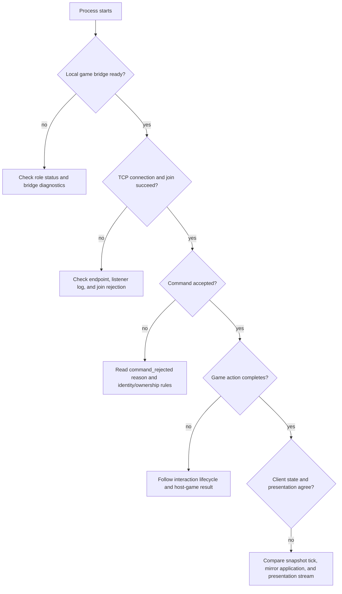

# Troubleshooting

Diagnose the earliest boundary that fails. A running process is not proof that its bridge is
ready; a connected socket is not proof that a session join succeeded; and an accepted command
is not proof that the game completed it.

## Establish a bounded baseline

From the repository root, collect local readiness and role-specific logs:

```powershell
python scripts/stackctl.py status --strict --json
python scripts/stackctl.py logs --server --lines 120
python scripts/stackctl.py logs --client --lines 120
```

For a server-only reproduction, omit the client log. If the stack was not started with
`stackctl`, inspect the controller's own output and `--state-file` instead. A `stackctl`
launch timeout does not guarantee that processes it started have stopped; check `status`
before retrying. See the [stackctl reference](guides/stackctl-reference.md) and
[logging guide](guides/logging-diagnostics.md) for role names, readiness details, and safe
capture options.

## Find the failing boundary



Use the first failed transition to choose the next guide. Do not start by changing ports,
timeouts, saves, or game profiles: those changes can hide the original failure or introduce a
second one.

## Symptoms and next checks

| Symptom | How to distinguish it | Next check |
|---|---|---|
| Server controller starts but the game is unavailable | The controller process exists, but local bridge readiness has not been established. | Run `stackctl status --strict`; inspect server logs and the bridge health procedure in [bridge tools](guides/bridge-tools.md). |
| Client cannot connect | No successful TCP connection or join event appears in the server log. | Confirm the client endpoint matches the server's configured listener. The default is loopback, `127.0.0.1:34019`; it is not a safe internet-facing endpoint. |
| Join or command is rejected | The server sends `command_rejected` with a reason, rather than `command_accepted`. | Check that the connection joined, uses the same `playerId` it joined as, and owns the Sim required by the command. See [authority checks](protocol.md#authority-checks). |
| A command is accepted but an interaction fails | The command result is accepted, followed later by an interaction failure or refusal event. | Follow the interaction ID through the [interaction lifecycle](simulation-reference/interactions-and-lifecycle.md); acceptance is not game completion. |
| World is empty or stale after joining | The connection joined, but the client has not applied an expected baseline or later snapshot. | Check world bootstrap ordering, snapshot tick and acknowledgement, and resync state in [handshake and resume](protocol-reference/handshake-and-resume.md) and [snapshots and resync](protocol-reference/snapshots-and-resync.md). |
| Client visuals disagree with host state | Compare simulation fields separately from animation or route presentation. | Check the applied snapshot and then the presentation stream; a visual mismatch does not by itself show that the authoritative simulation diverged. |
| Connection closes after a large or malformed message | The listener may report `server_error` and close on an over-limit line or decode failure. | Check the framing and size limits in [wire formats](protocol-reference/wire-formats.md). Do not publish the message body or a capture containing world data. |
| Updates stop while one client is slow | The outbound connection queue can reject work when full rather than waiting behind a blocked send. | Check connection-close and delivery diagnostics; compare the affected client with another recipient. See the [server listener reference](code-reference/dedicated-server.md#tcp-listener-and-outbound-pressure). |
| Save checkpoint is refused | The server may be waiting for client-native lot exports or a current reconciliation acknowledgement. | Check the active authority mode and export version in [world transfer and reconciliation](protocol-reference/world-transfer-and-reconcile.md). Do not retry by deleting or replacing saves. |
| Build or test differs from CI | The local SDK, optional tooling, or game-specific inputs may differ from the documented tier. | Run `dotnet --info`, then the focused command from [build from source](guides/build-source.md) or [test strategy](guides/test-strategy.md). A skipped live-game check is not a pass. |
| Strict docs build fails | A local link, anchor, dependency, or warning differs from the checked-in site. | Install `requirements-docs.txt`, run `python scripts/check_docs.py --anchors --strict`, then `mkdocs build --strict`. |

### Interpret protocol outcomes correctly

On the established .NET JSON path, `command_rejected` is a decoded command refused by
connection, role, ownership, or session policy. `server_error` reports a protocol/handler
error, such as an undecodable line or an exception. On the experimental Rust line-v1 path,
refusals use the documented `ERR` frame and closed refusal codes; do not parse JSON free-text
reasons as line-v1 codes. See [errors and refusals](protocol-reference/errors-and-refusals.md).

For interaction work, trace each stage rather than treating a single acknowledgement as the
whole result:

| Stage | What it establishes | What it does not establish |
|---|---|---|
| `command_accepted` | The session handler accepted the request. | That the game started or completed the interaction. |
| `interaction_started` | The host reported that the interaction began. | That it completed successfully. |
| `interaction_completed` | The host reported completion. | That every client rendered the expected presentation. |
| `interaction_failed` or refusal event | The action did not complete as requested. | That the transport itself failed. |

The public listener checks the joined connection's player identity before session policy is
applied. `AuthoritativeSession` then enforces game-domain role and ownership rules. The
listener and policy boundaries are implemented in
[`ClientListenerServer.cs`](https://github.com/ObsidianNetwork/Sims3Online/blob/main/DedicatedServer/Network/ClientListenerServer.cs)
and
[`AuthoritativeSession.cs`](https://github.com/ObsidianNetwork/Sims3Online/blob/main/DedicatedServer/Authority/AuthoritativeSession.cs).
The server's resync decisions are centralized in
[`ResyncPolicy.cs`](https://github.com/ObsidianNetwork/Sims3Online/blob/main/DedicatedServer/Authority/ResyncPolicy.cs);
the local bridge health checks are described in [bridge tools](guides/bridge-tools.md).

## Report a reproducible issue safely

Include the exact command or action, operating system and relevant SDK/runtime versions, the
game version when live behavior is involved, the failing boundary, and a short sanitized log
excerpt. Preserve timestamps and event ordering. Redact local paths, endpoints that identify a
private network, player/world identifiers, and personal data.

Do not attach saves, game binaries, reference assemblies, credentials, full snapshots, bridge
recordings, telemetry DSNs, or screenshots containing identifying content. Report security
issues through the private channel in the [security policy](security.md), not a public issue.
